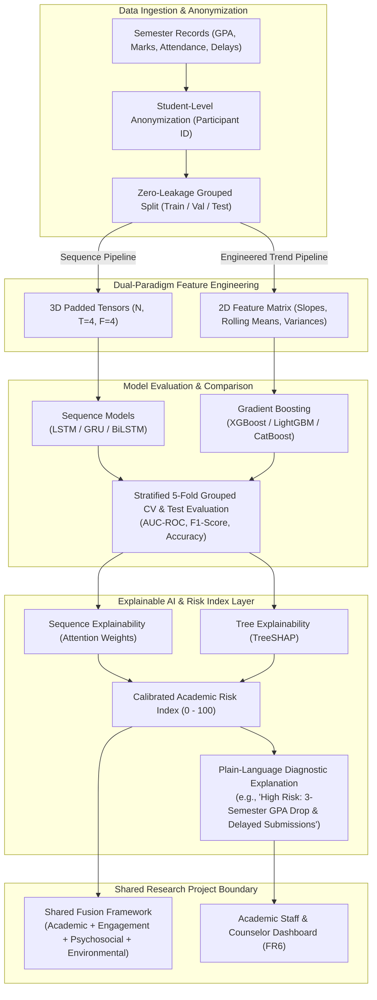

# Academic Intelligence Framework: Project Overview

**Component**: Academic Intelligence Framework  
**Project**: Multi-Factor Student Attrition Risk Prediction Using Academic, Engagement, Psychosocial, Environmental Factors  
**Project ID**: `KND_CDAP_IT_05`  
**Author**: V. S. H. Gunasekara (`IT23164680`)  
**Supervisors**: Ms. Chathurika Koswatte, Ms. Anuththara Ekanayake  
**Cluster**: Centre of Excellence for AI (CoEAI), Sri Lanka Institute of Information Technology (SLIIT)  

---

## 1. Executive Summary & Plain Language Overview
Student attrition (dropout and academic termination) is an acute challenge in higher education, with published Sri Lankan institutional attrition rates reaching 48% and exceeding 65% in high-risk regional centers (SLIATE benchmark). Conventional early-warning mechanisms flag students reactively—often only after cumulative GPA falls below an arbitrary threshold (e.g., GPA < 2.0). By that time, cumulative academic damage has already occurred, severely limiting the window for corrective counseling and remedial intervention.

The **Academic Intelligence Framework** redefines academic attrition modeling by shifting from **static, single-point snapshots** to **longitudinal academic trajectories**. By monitoring ordered semester-wise sequences of Grade Point Average (GPA), examination marks, lecture/tutorial attendance, and assignment submission delays, the system captures subtle, progressive academic decline before an acute failure threshold is crossed.

The model outputs a calibrated **Academic Risk Index (0–100)** paired with local feature-attribution explanations (SHAP / sequence attention). This score is subsequently consumed by the project group's shared **Fusion Framework**, where it combines with Engagement, Psychosocial, and Environmental risk dimensions.

---

## 2. Core Research Question
> **"Does sequence-aware longitudinal modelling (LSTM/GRU) beat hand-engineered temporal trend features combined with Gradient Tree Boosting (XGBoost/LightGBM) in predicting student academic attrition risk?"**

### The Methodological Tension:
1. **The Feature Engineering Paradigm**: Domain experts hypothesize that summary statistics—such as GPA slope (linear velocity), rolling GPA averages, attendance variance (erratic behavior), and submission delay spikes—contain sufficient signal when supplied to non-linear tree ensembles.
2. **The Sequence Representation Paradigm**: Recurrent neural networks (LSTM / GRU) hypothesize that explicit multi-step hidden state transitions preserve temporal ordering, inter-variable momentum, and non-linear decay that summary statistics compress away.

Our empirical mission is to execute a **leakage-free, statistically rigorous horse-race** between these two paradigms on identical student cohorts.

---

## 3. High-Level System Architecture



---

## 4. Component Responsibility Boundaries

As established in the Project Proposal Report (Table 2, Section 4):

| Research Deliverable | Responsible Party | Boundary Details |
| :--- | :--- | :--- |
| **Academic Data & Preprocessing** | **V.S.H. Gunasekara (IT23164680)** | Semester sequences: GPA, exam marks, attendance, delays. |
| **Engineered Trend Feature Pipeline** | **V.S.H. Gunasekara (IT23164680)** | First derivatives, rolling aggregations, delta shifts. |
| **Gradient Boosting Baseline** | **V.S.H. Gunasekara (IT23164680)** | XGBoost, LightGBM, CatBoost baseline suite. |
| **Sequence-Aware Models** | **V.S.H. Gunasekara (IT23164680)** | PyTorch LSTM, GRU, BiLSTM with masked sequence padding. |
| **Comparative Benchmarking** | **V.S.H. Gunasekara (IT23164680)** | Zero-leakage GroupKFold CV, Paired t-tests / Wilcoxon tests. |
| **Academic Risk Index (0–100)** | **V.S.H. Gunasekara (IT23164680)** | Probability calibration (Platt/Isotonic) scaled to [0, 100]. |
| **Multimodal Engagement Index** | Vimukthi H.A.V.C. (IT23191242) | Moodle LMS clickstreams, HMM engagement states. |
| **Psychosocial Risk Index** | Samarakoon S.M.S.R.K. (IT23279148) | PSS-10, AMS, GSE, PSSM psychometric survey scales. |
| **Environmental & Causal Risk Index** | Bombugala B.A.C.D. (IT23445154) | Socio-economic factors, EconML Causal Forest, PSM/IPW. |
| **Fusion Framework & Shared UI** | Shared Team Collaboration | Aggregates 4 component indices into final attrition alert. |

---

## 5. Monorepo Folder Map

```
/
├── Makefile                    # Unified entry point for POSIX/CI environments
├── make.bat                    # Native Windows wrapper invoking run.py
├── run.py                      # Cross-platform CLI driver for all lifecycle stages
├── requirements.txt            # Pinned Python package dependencies
├── .gitignore                  # Git tracking exclusions (ignoring large data & checkpoints)
│
├── configs/
│   └── config.yaml             # Single source of truth: seeds, paths, ratios, hyperparameters
│
├── backend/
│   ├── src/
│   │   ├── __init__.py
│   │   ├── config.py           # Configuration loader, compute device auto-detect, seed locker
│   │   ├── data/               # Data ingestion, schema validation, synthetic cohort generator
│   │   ├── features/           # Temporal feature engineering (slopes, rolling metrics)
│   │   ├── models/             # PyTorch LSTM/GRU and Scikit-Learn/XGBoost model wrappers
│   │   ├── training/           # Grouped cross-validation and Optuna hyperparameter tuning
│   │   ├── evaluation/         # Threshold metrics (AUC, F1, Accuracy, calibration curves)
│   │   ├── explain/            # SHAP and sequence attention explanation generators
│   │   └── api/                # FastAPI application exposing health, prediction, and explanations
│   └── tests/                  # Pytest test suite for zero-leakage, unit checks, and API contracts
│
├── frontend/                   # Modern React + Vite + TypeScript + Tailwind UI
│   ├── src/
│   │   ├── components/         # Reusable UI widgets, student risk cards, metric badges
│   │   ├── charts/             # Trajectory plots and feature importance charts
│   │   └── views/              # Longitudinal Student Inspector & Model Leaderboard
│   ├── package.json
│   └── vite.config.ts
│
├── data/                       # Controlled data storage
│   ├── raw/                    # Institutional student records (if granted IRB access)
│   ├── synthetic/              # Calibrated autoregressive synthetic student cohorts (labeled SYNTHETIC)
│   ├── processed/              # Normalized sequence tensors and engineered tabular matrices
│   ├── splits/                 # Frozen student-grouped train, validation, and test indices
│   ├── uploads/                # Dynamic CSV uploads from dashboard users
│   └── academic_schema.json    # JSONSchema enforcing academic record contracts
│
├── artifacts/                  # Generated experimental artifacts (read by UI & docs)
│   ├── models/                 # Serialized weights (.pt, .joblib)
│   ├── metrics/                # Standardized evaluation JSON records
│   ├── leaderboard/            # Comparative benchmark tables
│   ├── plots/                  # ROC curves, PR curves, trajectory charts
│   └── explanations/           # SHAP summary plots and attention heatmaps
│
└── docs/                       # Research documentation and viva preparation
    ├── source/                 # Official source PDFs (TAF.pdf, Proposal Report)
    ├── DECISION_LOG.md         # Persistent log of all technical and architectural decisions
    ├── DATA_DICTIONARY.md      # Detailed definition of all features and variables
    └── 00_PROJECT_OVERVIEW.md  # This document
```

---

## 6. How to Run Everything

### Prerequisites
- Python 3.11+ (Python 3.12 verified)
- Node.js 18+ and npm (v20+ verified)

### One-Command Lifecycle Operations
Run using `make <target>` (or `python run.py <target>` on any OS):

```bash
# 1. Environment & Scaffold Setup
python run.py setup        # or: make setup / .\make.bat setup

# 2. Run Comprehensive Test Suite
python run.py test         # or: make test / .\make.bat test

# 3. Generate Synthetic Academic Cohort (Phase 2)
python run.py data         # or: make data

# 4. Run Preprocessing & Trend Extraction (Phase 3)
python run.py preprocess   # or: make preprocess

# 5. Train Baseline & Sequence Models (Phase 4 & 5)
python run.py train        # or: make train

# 6. Evaluate & Benchmark on Frozen Test Set (Phase 6)
python run.py evaluate     # or: make evaluate

# 7. Generate SHAP & Attention Attributions (Phase 7)
python run.py explain      # or: make explain

# 8. Start FastAPI Backend Server
python run.py serve        # or: make serve (http://127.0.0.1:8000/docs)

# 9. Start React Development Dashboard
python run.py frontend     # or: make frontend (http://localhost:5173)

# 10. Run End-to-End Pipeline
python run.py all          # or: make all
```

---

## 7. Viva Defense Readiness: Foundational Questions & Answers

### Q1: Why focus on longitudinal sequence modeling rather than just the latest semester GPA?
> **Answer**: Relying solely on the latest semester GPA produces a reactive, lagging indicator. A student who declines steadily from 3.8 to 2.8 over three consecutive semesters is in severe distress, yet their cumulative GPA may remain comfortably above the standard 2.0 academic probation threshold. Longitudinal modeling detects negative velocity, erratic attendance fluctuations, and cumulative assignment delays before an irreversible failure occurs.

### Q2: Why compare LSTM/GRU against Gradient Boosting with hand-engineered trend features instead of a simple static baseline?
> **Answer**: Comparing deep learning against a naive static baseline (e.g., Logistic Regression on single-point GPA) creates an unfair straw-man comparison. The real research question is whether an unconstrained recurrent neural network can automatically discover complex temporal dynamics that are superior to the temporal features an experienced data scientist can hand-engineer (e.g., slopes, rolling means, volatility). By benchmarking against a tuned Gradient Boosting model equipped with explicit longitudinal trend features, the comparison is scientifically defensible.

### Q3: How do you mathematically guarantee zero data leakage across semesters?
> **Answer**: In academic panel datasets, each student has multiple semester observations. If data is partitioned using random row-level splitting, different semesters belonging to the same student will leak across training, validation, and test sets. To guarantee zero leakage, we enforce **Student-Level Grouped Splitting** (`StratifiedGroupKFold` on `participant_id`). All preprocessing transformations (imputation statistics, min-max scaling bounds) are strictly fit on the training student partition only and applied out-of-sample to validation and test partitions.
