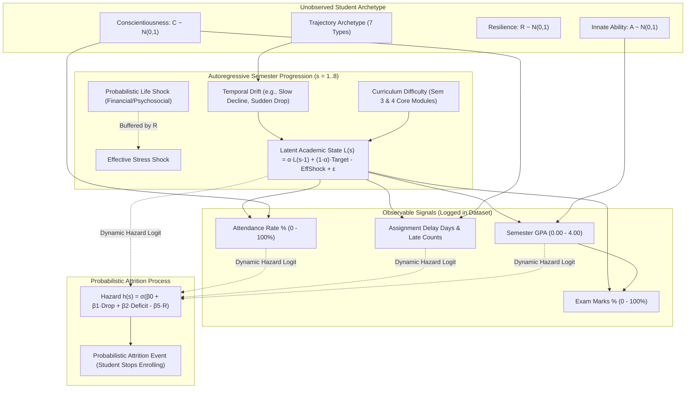

# Academic Intelligence Framework: Data & Prediction Task

**Component**: Academic Intelligence Framework  
**Project**: Multi-Factor Student Attrition Risk Prediction (Project ID: `KND_CDAP_IT_05`)  
**Student**: V. S. H. Gunasekara (`IT23164680`)  
**Supervisors**: Ms. Chathurika Koswatte, Ms. Anuththara Ekanayake  
**Cluster**: Centre of Excellence for AI (CoEAI), SLIIT  

---

## 1. Why Synthetic Data?

### The Context and Ethical Reality
In higher education institutions (such as SLIIT and state universities), academic records constitute protected personally identifiable information (PII). Under university research ethics protocols (Section 3.2 and Section 4 of the Project Proposal), institutional records office access requires formal Institutional Review Board (IRB) clearance and participant consent.

To ensure research velocity without waiting for prolonged administrative clearance, the approved project proposal explicitly specifies a contingency:
> *"If institutional academic records cannot be obtained within the available project timeline, a realistic synthetic dataset will be prepared based on information reported in published Sri Lankan higher-education studies. This will allow the proposed framework and modelling process to be tested while following the wider project's data-availability plan."* (Proposal Section 3.2, p. 15; TAF Section 9, p. 4)

### Honesty About Synthetic Data (Non-Negotiable Rule 3)
Synthetic data is utilized strictly as an **engineering testbed and methodological proving ground**. Every synthetic dataset, plot, metric file, and UI view is watermarked `SYNTHETIC`. All performance metrics reflect the models' ability to discover patterns under known parametric assumptions; they are **never** presented as real-world clinical or institutional evidence.

---

## 2. Latent-Process Data Generator Design

Rather than sticking labels onto arbitrary random distributions, the generator models students as **evolving longitudinal human journeys** governed by latent cognitive and behavioral traits, life events, and academic constraints.



### 2.1 The Seven Latent Trajectory Archetypes

| Archetype | Cohort % | Latent Behavior & Trajectory Description | Target Attrition Propensity |
| :--- | :---: | :--- | :--- |
| **`stable-high`** | 24% | High ability and diligence; consistent GPA $\ge 3.4$; strong attendance; negligible submission delays. | Extremely low ($< 2\%$) |
| **`stable-average`** | 28% | Moderate ability and steady work ethic; maintains GPA around $2.7 - 3.2$; steady attendance ($75-85\%$). | Very low ($< 5\%$) |
| **`slow-decline`** | 14% | Starts well (GPA $\sim 3.1$), but accumulates burnout or motivation decay; steady downward drift of $-0.15$ to $-0.25$ GPA per semester. | High ($35 - 50\%$) |
| **`sudden-drop`** | 9% | Healthy performance in Year 1; suffers acute mid-degree shock (Sem 2–4); GPA plummets $> 1.0$ point; attendance collapses. | Very high ($55 - 75\%$) |
| **`recovering`** | 8% | Stumbles during initial transition (Sem 1–2); buffers with resilience and academic advising; recovers in Sem 3–4. | Moderate-low ($10 - 15\%$) |
| **`volatile`** | 8% | Oscillatory performance across semesters; high sensitivity to specific modules; fluctuating attendance. | Moderate ($20 - 30\%$) |
| **`struggling-from-start`**| 9% | Enters with weak academic foundations; GPA consistently near $1.6 - 2.2$; frequent late submissions. | High ($45 - 65\%$) |

### 2.2 Mathematical State Dynamics
For each student $i$ at semester $s \in \{1, \dots, 8\}$:
1. **Autoregressive State**:
   $$L_{i,s} = \alpha L_{i, s-1} + (1 - \alpha) \left( \mu_{i} + \delta_{\text{traj}}(s) + \text{load}(s) + 0.25 C_i \right) - S_{i,s}^{\text{eff}} + \epsilon_{\text{state}}$$
   where $\alpha = 0.65$ reflects strong semester-to-semester momentum.
2. **Effective Stress Shock**:
   $$S_{i,s}^{\text{eff}} = S_{i,s} \cdot \left(1.0 - 0.45 \cdot \sigma(R_i)\right), \quad S_{i,s} \sim \text{Exp}(0.7) \text{ with } P=0.08$$
3. **Observable Signals**:
   - **GPA**: $\text{GPA}_{i,s} = \text{clip}\left(2.80 + 0.55 L_{i,s} + \epsilon_{\text{gpa}}, 0.00, 4.00\right)$
   - **Exam Marks**: $\text{Exam}_{i,s} = \text{clip}\left(22.0 + 19.5 \cdot \text{GPA}_{i,s} + 3.0 A_i + \epsilon_{\text{exam}}, 0.0, 100.0\right)$
   - **Attendance Rate**: $\text{Att}_{i,s} = \text{clip}\left(62.0 + 14.0 C_i + 7.5 L_{i,s} + \epsilon_{\text{att}}, 0.0, 100.0\right)$
   - **Assignment Delay**: $\text{Delay}_{i,s} = \max\left(0.0, \exp(1.1 - 0.45 C_i - 0.40 L_{i,s} + \epsilon_{\text{delay}}) - 0.7\right)$
   - **Late Count**: $\text{LateCount}_{i,s} \sim \text{Poisson}\left(\text{clip}(0.25 + 0.45 \cdot \text{Delay}_{i,s}, 0, 8)\right)$

### 2.3 Dynamic Attrition Hazard & Variable-Length Sequences
Attrition is modeled as a discrete-time hazard:
$$h_{i,s} = \sigma\left(\beta_0 + 1.35(2.40 - \text{GPA}_{i,s}) + 2.10 \max(0, \text{GPA}_{i,s-1} - \text{GPA}_{i,s}) + 0.045(65 - \text{Att}_{i,s}) + 0.18(\text{Delay}_{i,s} - 2.5) - 0.65 R_i\right)$$

- At each semester $s$, if a random uniform draw $U < h_{i,s}$, the student **attrites immediately**.
- Once attrited, the student **ceases enrolling** and produces no subsequent semester records.
- This creates realistic **variable-length sequences** across the cohort.

---

## 3. The Motivating Baseline Finding: Why GPA < 2.0 Fails

Standard university early-warning systems apply a static rule: flag a student for academic intervention only when cumulative or semester GPA falls below $2.0$.

We evaluated this rule across the synthetic student cohort ($n=5,000$ students, evaluated across 19,921 sliding prefix observation windows):

### Naive Cutoff Performance Table (`GPA < 2.0`)

| Metric | Empirical Score | Interpretation |
| :--- | :---: | :--- |
| **Accuracy** | **88.8%** | Artificially inflated by the majority class of non-attriting students (class imbalance). |
| **Precision** | **24.7%** | Almost 3 out of 4 flagged students are false alarms (e.g., struggling students who persist). |
| **Recall** | **3.4%** | **Catastrophic Failure**: Misses 2,019 out of 2,091 approaching dropouts! |
| **F1-Score** | **0.0604** | Demonstrates complete inadequacy for operational early warning. |

### Why Does the Static Threshold Fail?
1. **Negative Velocity Precedes the Threshold**: A student declining from $3.8 \to 3.1 \to 2.4$ is experiencing acute crisis, yet their GPA remains above $2.0$. By the time they drop below $2.0$, they have already dropped out or reached irreversible termination.
2. **Multi-Signal Degradation**: Students often show warning signs in **attendance drop** and **chronic assignment submission delays** two semesters before exams collapse.
3. **Resilient Strugglers**: Some students maintain a flat $1.8 - 1.9$ GPA but utilize institutional retake policies and successfully complete their degree. A single threshold flags them incorrectly while missing declining students.

This empirical finding directly justifies the central research question of this project: **we must capture longitudinal trajectory dynamics across multiple academic signals.**

---

## 4. Formal Prediction Task Formulation

```
Student History Observed: [Sem 1, Sem 2, ..., Sem t]  (where t in {2, 3, 4, 5, 6})
                          --------------------------
                                      │
                                      ▼
             [ Academic Intelligence Framework ]
                                      │
                                      ▼
Predicted Target: Attrition Event in Window [t+1, t+2] ? (Binary: 0 or 1)
```

### Task Parameters
- **Observation Horizons ($t$)**: Semesters $t \in \{2, 3, 4, 5, 6\}$.
- **Prediction Target**: Binary indicator $y \in \{0, 1\}$:
  $$y = 1 \iff \text{Student attrites at semester } t+1 \text{ or } t+2$$
  $$y = 0 \iff \text{Student persists past semester } t+2 \text{ or graduates}$$
- **Prefix Sampling**: For each enrolled student at horizon $t$, a sample $(\mathbf{X}_{1:t}, y)$ is generated with key `sample_id = {student_id}_t{t}`.
- **Grouped Integrity**: All prefix samples for student $i$ share `student_id = STU_i`. Grouped cross-validation guarantees that all horizons of a student reside strictly within either the training set or test set—**never split across both**.
- **Academic Risk Index**: The continuous model probability is calibrated via isotonic regression and mapped to $[0, 100]$:
  $$\text{Academic Risk Index} = \text{Calibrate}\left(\hat{P}(y=1 \mid \mathbf{X}_{1:t})\right) \times 100$$

---

## 5. Difficulty Presets & Configurable Attrition Variants

The generator supports three preset configurations and a dedicated regional high-attrition variant:

| Preset | Noise Std ($\sigma$) | Overlap | Default Attrition | Use Case |
| :--- | :---: | :---: | :---: | :--- |
| **`easy`** | 0.10 | Low (0.5) | $\sim 18\%$ | Pipeline sanity checking and test suite verification. |
| **`realistic`** (DEFAULT) | 0.18 | Medium (1.0) | **$18 - 22\%$** | Headline benchmark experiments and thesis defense results. |
| **`hard`** | 0.28 | High (1.4) | $\sim 24\%$ | Stress-testing sequence models under extreme measurement noise. |
| **`high-attrition`** | 0.20 | Medium (1.0) | **$\sim 40\%$** | Calibrated to high-risk Sri Lankan regional centers (SLIATE [17]). |

---

## 6. Viva Defense Readiness: Questions & Defensible Answers

### Q1: Why did you build a synthetic dataset instead of using real university records?
> **Answer**: Real university academic records contain protected student data requiring institutional IRB clearance and anonymization agreements (Proposal Section 3.2). While clearance was pending, proceeding without data would have halted model engineering. Building a mathematically grounded latent-process generator allowed us to develop, debug, and benchmark the entire end-to-end pipeline under verified statistical properties. As specified in proposal Section 3.2, synthetic cohorts serve as the approved developmental benchmark.

### Q2: What prevents your synthetic data from just being random noise that flatters your models?
> **Answer**: The generator is designed as a structural latent-variable process based on established psychometric and learning analytics literature. Academic signals are not independent random variables; they are generated with cross-signal correlations (GPA and exam marks correlation $> 0.85$, conscientiousness driving attendance and submission punctuality), AR(1) semester-to-semester momentum ($\alpha = 0.65$), curriculum difficulty adjustments (Sem 3–4 core module load), and non-linear noise. Crucially, the generator intentionally includes non-separable cases (resilient low-GPA persisters and sudden-drop high-GPA attriters), ensuring that trivial linear boundaries cannot achieve high performance.

### Q3: How do you guarantee there is no target leakage in the synthetic features?
> **Answer**: Three strict architectural barriers prevent leakage:
> 1. The feature dataset (`academic_long.csv`) contains strictly observable semester records; all outcome labels and hidden traits are saved in a completely separate file (`outcomes.csv`).
> 2. The task builder operates strictly on backward-looking prefix windows $[1 \dots t]$; future observations $[t+1 \dots]$ are physically masked out during prediction.
> 3. All train/test partitions are strictly grouped by student ID, ensuring no student's sequence overlaps between training and evaluation splits.

### Q4: Why predict attrition over a 2-semester forward window rather than just the next semester?
> **Answer**: Predicting only the immediate next semester ($t+1$) offers insufficient lead time for university counseling and academic support interventions, especially when end-of-semester exam results are released just weeks before the next term. A 2-semester forward window ($t+1$ and $t+2$) provides academic advisors with an actionable 6-to-12-month horizon to design meaningful academic recovery plans.
