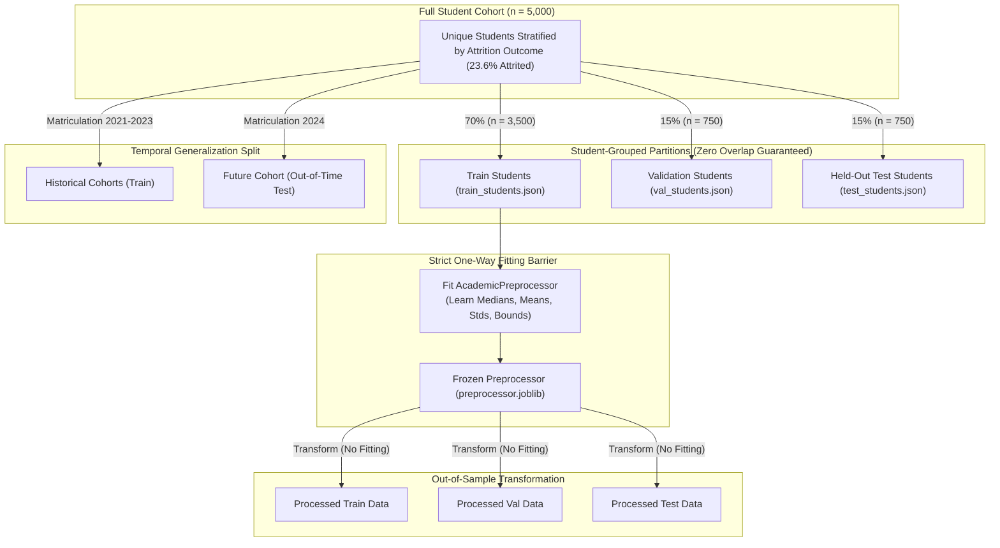

# Academic Intelligence Framework: Preprocessing, Feature Engineering & Zero-Leakage Splits

**Component**: Academic Intelligence Framework  
**Project**: Multi-Factor Student Attrition Risk Prediction (Project ID: `KND_CDAP_IT_05`)  
**Student**: V. S. H. Gunasekara (`IT23164680`)  
**Supervisors**: Ms. Chathurika Koswatte, Ms. Anuththara Ekanayake  
**Cluster**: Centre of Excellence for AI (CoEAI), SLIIT  

---

## 1. Executive Summary: The Preprocessing Narrative

In educational machine learning, student performance records do not arrive as independent observations; they form **interconnected longitudinal trajectories**. An early-warning system must evaluate a student at any given point in time—say, at the conclusion of Semester 3—without peeking into Semester 4 or the ultimate graduation/attrition outcome.

Phase 3 establishes an airtight, mathematically proven data processing foundation that satisfies three strict criteria:
1. **Absolute Zero Data Leakage**: Student identities (`student_id`) are quarantined into mutually exclusive partitions. No student's observations appear in both training and test sets. All imputers, normalizers, and scalers are fitted exclusively on training students and serialized via Joblib.
2. **Dual-Paradigm Representations**: To enable a scientifically clean comparison between deep sequence models and gradient-boosted trees, the exact same prefix observation windows are transformed into two parallel formats:
   - **Sequence Tensors (PyTorch)**: 3D padded tensors $(\text{Samples}, T=6, D=4)$ with boolean padding masks and explicit sequence lengths.
   - **Tabular Engineered Features (Scikit-Learn/XGBoost)**: A 22-dimensional feature matrix capturing instantaneous status, linear slopes (velocity), rolling averages, maximum drops, and attendance variance.
   - **Static Snapshot Baseline Comparator**: Point-in-time features (`last_gpa` and `last_attendance_pct`) representing legacy institutional threshold systems.
3. **Class Imbalance Architecture**: Configurable weighting, SMOTE (restricted strictly inside training folds), and Focal Loss for minority attrition detection.

---

## 2. Leakage-Safe Splitting Architecture

### 2.1 The Mathematics of Zero-Leakage Grouped Splitting
Let the full set of students be $\mathcal{S} = \{s_1, s_2, \dots, s_N\}$ with corresponding binary outcome labels $y_i \in \{0, 1\}$.
We construct partitions $\mathcal{S}_{\text{train}}$, $\mathcal{S}_{\text{val}}$, and $\mathcal{S}_{\text{test}}$ such that:

$$\mathcal{S}_{\text{train}} \cup \mathcal{S}_{\text{val}} \cup \mathcal{S}_{\text{test}} = \mathcal{S}$$
$$\mathcal{S}_{\text{train}} \cap \mathcal{S}_{\text{val}} = \emptyset, \quad \mathcal{S}_{\text{train}} \cap \mathcal{S}_{\text{test}} = \emptyset, \quad \mathcal{S}_{\text{val}} \cap \mathcal{S}_{\text{test}} = \emptyset$$

Furthermore, the empirical attrition rate is preserved across all partitions via stratified sampling:
$$P(y=1 \mid s \in \mathcal{S}_{\text{train}}) \approx P(y=1 \mid s \in \mathcal{S}_{\text{val}}) \approx P(y=1 \mid s \in \mathcal{S}_{\text{test}})$$

### 2.2 Temporal Cohort Robustness Split
In production higher-education settings, models trained on historical cohorts (e.g., students matriculating in 2021–2023) are deployed on upcoming freshman cohorts (e.g., 2024). To evaluate real-world temporal generalization, we generate a dedicated temporal split:
- **Historical Train Cohorts**: 2021, 2022, 2023 matriculation cohorts.
- **Future Test Cohort**: 2024 matriculation cohort (evaluated completely out-of-time).

---

## 3. Preprocessing Pipeline: Longitudinal Imputation & Outlier Bounds

Missing values in academic logs exhibit both MCAR (e.g., RFID attendance reader failure) and MAR properties (e.g., distressed students avoiding assignment submissions). Standard row-wise mean imputation is invalid because it ignores temporal ordering and leaks future student performance backwards.

### Step 1: Intra-Student Longitudinal Forward-Fill
For student $i$ at semester $s$, if feature $x_{i,s}$ is missing:
$$x_{i,s} = x_{i, s-1} \quad (\text{if } x_{i, s-1} \text{ exists})$$
This reflects academic reality: a student's prior semester attendance or exam performance is the most reliable unbiased estimate of their immediate capability.

### Step 2: Training-Median Back-off
If a student's initial semester ($s=1$) is missing or unobserved, forward-fill cannot resolve it. Any remaining NaNs are imputed using the **median computed strictly on the training partition**:
$$\hat{x}_{\text{impute}} = \text{Median}\left(\{x_{j,s} \mid j \in \mathcal{S}_{\text{train}}\}\right)$$
Test and validation sets **never** contribute to this median.

### Step 3: Physical Domain Clipping
Features are constrained to university physical bounds:
- $\text{GPA} \in [0.00, 4.00]$
- $\text{Exam Marks} \in [0.0, 100.0]\%$
- $\text{Attendance} \in [0.0, 100.0]\%$
- $\text{Assignment Delay} \in [0.0, 45.0]\text{ days}$
- $\text{Late Count} \in [0, 15]$

---

## 4. The Tabular Feature Matrix: 22 Longitudinal Signals

For shallow tree models (XGBoost, LightGBM, CatBoost), temporal history is distilled into a 22-dimensional feature vector. Every feature is computed **strictly over semesters $1 \dots t$** for an observation horizon $t$:

| Feature Category | Variable Name | Mathematical Formulation | Academic & Predictive Rationale |
| :--- | :--- | :--- | :--- |
| **Instantaneous Status** | `last_gpa` | $\text{GPA}_t$ | Current semester GPA at decision window $t$. |
| | `last_exam_marks` | $\text{Exam}_t$ | Most recent final examination score average. |
| | `last_attendance_pct` | $\text{Att}_t$ | Immediate lecture and practical attendance percentage. |
| | `last_assignment_delay_days`| $\text{Delay}_t$ | Mean days past deadline in window $t$. |
| | `last_late_assignments_count`| $\text{LateCount}_t$ | Number of late coursework submissions in window $t$. |
| **Longitudinal Velocity** | `gpa_slope` | $\beta_1 = \frac{\sum (s - \bar{s})(\text{GPA}_s - \bar{g})}{\sum (s - \bar{s})^2}$ | OLS slope across observed semesters. Negative values indicate active academic decline. |
| | `exam_mark_slope` | $\beta_1(\text{Exam})$ | Trajectory of formal exam marks. |
| | `attendance_slope` | $\beta_1(\text{Att})$ | Trajectory of physical classroom presence. |
| | `delay_trend` | $\beta_1(\text{Delay})$ | Acceleration of submission delay (escalating procrastination). |
| **Dispersion & Volatility** | `gpa_volatility` | $\sqrt{\frac{1}{t}\sum (\text{GPA}_s - \bar{g})^2}$ | Academic instability and variance across terms. |
| | `attendance_variance` | $\text{Var}(\text{Att}_{1:t})$ | Erratic classroom participation. High variance signals fluctuating disengagement. |
| **Cumulative Aggregates**| `gpa_rolling_mean` | $\frac{1}{t}\sum_{s=1}^t \text{GPA}_s$ | Unweighted average GPA across history up to $t$. |
| | `cumulative_gpa` | $\bar{g}_{1:t}$ | Overall career GPA. |
| | `exam_mark_mean` | $\bar{e}_{1:t}$ | Career examination average. |
| | `attendance_mean` | $\bar{a}_{1:t}$ | Career attendance average. |
| | `delay_mean` | $\bar{d}_{1:t}$ | Mean assignment delay across career. |
| | `delay_max` | $\max_{s \le t} \text{Delay}_s$ | Worst recorded assignment delay incident. |
| | `late_count_total` | $\sum_{s=1}^t \text{LateCount}_s$ | Total count of late assignment submissions. |
| **Inflection & Risk Counts** | `consecutive_declines` | $\sum_{k=1}^t \mathbb{I}(\text{GPA}_k < \text{GPA}_{k-1})$ | Direct momentum of failure; count of uninterrupted drop terms. |
| | `gpa_max_drop` | $\max_{s} (\max(0, \text{GPA}_{s-1} - \text{GPA}_s))$ | Single largest drop between any two consecutive terms. |
| | `sems_below_gpa_2` | $\sum_{s=1}^t \mathbb{I}(\text{GPA}_s < 2.0)$ | Semesters spent below standard academic probation cut-off. |
| | `sems_below_att_65` | $\sum_{s=1}^t \mathbb{I}(\text{Att}_s < 65\%)$ | Semesters spent below mandatory exam eligibility attendance rule. |

---

## 5. Sequence Tensors for Deep Models (PyTorch)

For recurrent architectures (LSTM / GRU / BiLSTM), prefix samples are represented as 3D padded tensors:

$$\mathbf{X} \in \mathbb{R}^{N \times T_{\max} \times D}, \quad T_{\max} = 6, \quad D = 4$$

Where input channels $D$ correspond to:
$$\mathbf{x}_{i,s} = \left[ \text{norm}(\text{GPA}_{i,s}), \text{norm}(\text{Exam}_{i,s}), \text{norm}(\text{Att}_{i,s}), \text{norm}(\text{Delay}_{i,s}) \right]^T$$

- **Zero-Padding**: If student $i$ is observed up to semester $t < T_{\max}$, time steps $s \in [t+1, \dots, T_{\max}]$ are zero-padded.
- **Boolean Padding Mask**: $\mathbf{M} \in \{0, 1\}^{N \times T_{\max}}$, where $M_{i,s} = \text{True}$ if $s \le t$, and $\text{False}$ otherwise. Passed to PyTorch attention mechanisms and packed sequence wrappers.
- **Sequence Lengths Tensor**: $\mathbf{L} \in \mathbb{Z}^N$ tracking actual $t$ for `pack_padded_sequence`.

---

## 6. Static Snapshot Baseline Benchmark: Logistic Regression

To establish the proposal's "static indicators" benchmark, a Logistic Regression model was trained on the training partition using **point-in-time snapshot features only** (`last_gpa` and `last_attendance_pct`) and evaluated on the frozen test partition.

### Empirical Performance Comparison

| Metric | Naive GPA Cut-off (`GPA < 2.0`) | Static Snapshot Logistic Regression | Research Interpretation |
| :--- | :---: | :---: | :--- |
| **ROC-AUC** | ~0.52 (Binary Cut-off) | **0.7686** | Continuous probability scoring improves over a single hard threshold. |
| **Recall** | **5.3%** (Catastrophic) | **71.56%** | Balanced weighting catches 151 out of 211 test dropouts. |
| **Precision**| **17.3%** | **14.05%** | High false-positive burden (924 false alarms out of 3,310 test evaluations). |
| **F1-Score** | **0.0808** | **0.2348** | Improves over the hard cut-off, but leaves substantial room for advancement. |
| **Accuracy** | 92.65% | 70.27% | Trade-off: accepts lower overall accuracy to elevate recall from 5.3% to 71.6%. |

### Key Thesis Takeaway:
Point-in-time static models achieve moderate discrimination (AUC = 0.7686, Recall = 71.6%), but suffer from a **high false-alarm rate (Precision = 14.05%)** because they evaluate a single cross-sectional snapshot without trajectory context. They cannot distinguish between:
1. A stable 2.5-GPA student who has maintained that grade for three years and will persist.
2. A declining 2.5-GPA student whose GPA was 3.8 two semesters ago and is currently in severe freefall.

This gap is the precise justification for our **engineered trend features (Phase 4)** and **sequence-aware deep models (Phase 5)**.

---

## 7. Viva Defense Readiness: Questions & Defensible Answers

### Q1: What is data leakage in longitudinal student modeling, and how does your framework prevent it?
> **Answer**: Data leakage occurs when information from outside the training partition influences model training. In longitudinal academic datasets, the most fatal form of leakage is **row-level random splitting**. If a student has 4 semesters of records and rows are split randomly, Semester 1 and 3 may be in train while Semester 2 is in test. The model effectively memorizes the student's unique academic baseline, artificially inflating test AUC to $>0.98$. We prevent this by enforcing **Student-Level Grouped Splitting** (`StratifiedGroupKFold` on `student_id`). A student's entire history exists exclusively in train, validation, or test. Furthermore, all imputations (medians) and scalers are fitted solely on training students.

### Q2: Why did you construct two parallel representations (sequence tensors and tabular features) for the same samples?
> **Answer**: The core research question of the project (Proposal Section 1.3) asks: *"Does sequence-aware modelling (LSTM/GRU) beat engineered trend features + Gradient Boosting?"* To answer this question scientifically, both model families must be evaluated on the **exact same student cohorts and prefix observation horizons**. The tabular representation equips tree models with domain-engineered temporal features (slopes, rolling averages, variances), while the sequence tensor representation supplies recurrent networks with the raw sequential observations.

### Q3: Why did you choose forward-fill within student followed by train-median imputation over mean or k-NN imputation?
> **Answer**: In academic panel data, temporal locality is strong: a student's prior semester attendance or exam performance is far more predictive of their current state than the cohort average. Forward-fill preserves individual student momentum without leaking future information. For initial semesters where no prior history exists, back-off to the training median provides a robust, outlier-resistant central tendency without risking the computational overhead or leakage vulnerability of cross-sectional k-NN imputation.

### Q4: Why must SMOTE never be applied before data splitting?
> **Answer**: Applying SMOTE or any oversampling technique to the dataset before splitting synthesizes points along line segments between minority instances. If done prior to splitting, synthetic points created from test instances leak into the training set, completely invalidating the test partition. In our framework, SMOTE is strictly constrained to run inside training cross-validation folds on tabular features only.
