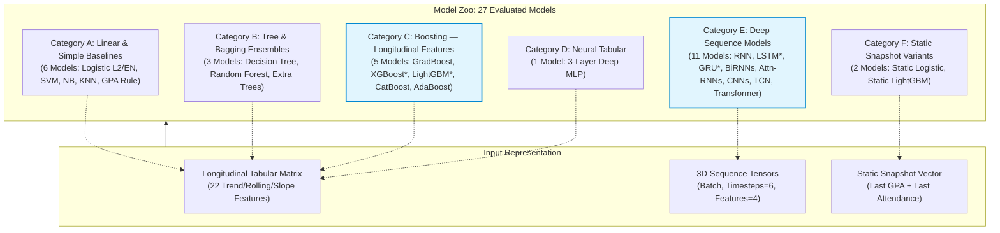

# Academic Intelligence Framework: Model Zoo & Architectural Specification

**Component**: Academic Intelligence Framework  
**Project**: Multi-Factor Student Attrition Risk Prediction  
**Student**: V. S. H. Gunasekara (IT23164680)  
**Supervisors**: Ms. Chathurika Koswatte, Ms. Anuththara Ekanayake  
**Cluster**: Centre of Excellence for AI (CoEAI), SLIIT  

---

## 1. Overview & Research Taxonomy

The Academic Intelligence Framework investigates the central research question posed in the project proposal:

$$\text{RQ: Does sequence-aware deep recurrent modelling (LSTM/GRU) outperform gradient boosted decision trees with hand-crafted longitudinal features?}$$

To establish a defensible, peer-reviewed evaluation, the model zoo implements **27 models** partitioned into **6 structural categories (A through F)**. Every model conforms to the abstract base contract `BaseAcademicModel` and registers dynamically with `ModelRegistry`, guaranteeing identical invocation interfaces (`fit`, `predict_proba`, `save`, `load`) for training, hyperparameter optimization (Optuna), validation, and explainability (SHAP).

*\* Denotes official Proposal Models / Proposal Baselines.*

---

## 2. Category A: Linear & Simple Baselines (Tabular)

### 2.1 Logistic Regression ($L_2$ Regularized) — `logistic_l2`
* **Plain Language**: Imagine a teacher with a scorecard who gives a fixed number of penalty points for every bad grade, every missed class, and every late assignment. If the total penalty points pass a cutoff, the student is marked as high risk.
* **Technical Architecture**: Generalized linear model with logistic sigmoid link $\sigma(z) = \frac{1}{1 + e^{-z}}$ where $z = \mathbf{w}^T \mathbf{x} + b$. Fitted by minimizing binary cross-entropy with Ridge ($L_2$) penalty $\frac{1}{2C} \|\mathbf{w}\|_2^2$ using the L-BFGS quasi-Newton solver.
* **Strengths**: Extremely fast to train, completely convex optimization (guaranteed global optimum), highly interpretable log-odds coefficients.
* **Weaknesses**: Assumes strict linearity in log-odds; unable to capture non-linear student risk thresholds or complex interaction effects without manual interaction terms.
* **Why in Study**: Serves as the standard linear benchmark against which non-linear models must demonstrate statistically significant improvements.

### 2.2 Logistic Regression (ElasticNet Regularized) — `logistic_elasticnet`
* **Plain Language**: Similar to the scorecard above, but this teacher has a magic eraser: they completely erase features that don't help, while sharing the blame among correlated features like GPA drops and exam mark drops.
* **Technical Architecture**: Logistic regression optimized with an ElasticNet composite penalty combining Lasso ($L_1$) and Ridge ($L_2$): $\alpha \rho \|\mathbf{w}\|_1 + \frac{\alpha (1 - \rho)}{2} \|\mathbf{w}\|_2^2$. Fitted using the SAGA stochastic average gradient solver.
* **Strengths**: Performs automatic feature selection (drives non-informative feature weights to zero) while handling collinear features gracefully through the $L_2$ component.
* **Weaknesses**: Computationally slower convergence on dense tabular sets; requires tuning both regularization weight $C$ and mixing ratio $\rho$.
* **Why in Study**: Verifies whether sparse feature selection among our 22 engineered features improves generalization on imbalanced student data.

### 2.3 Linear Support Vector Classifier (Calibrated) — `svm_calibrated`
* **Plain Language**: Imagine drawing a wide highway separating graduating students from dropping-out students on a graph. Any student falling on the wrong side of the road median is classified at risk.
* **Technical Architecture**: Linear Support Vector Classifier minimizing the hinge loss with $L_2$ penalty: $\min_{\mathbf{w}, b} \frac{1}{2} \|\mathbf{w}\|^2 + C \sum \max(0, 1 - y_i(\mathbf{w}^T \mathbf{x}_i + b))$. Since standard SVM produces uncalibrated signed distances, Platt scaling via `CalibratedClassifierCV` (5-fold sigmoid fitting) is applied to map margins into posterior probabilities $P(y=1|\mathbf{x}) \in [0, 1]$.
* **Strengths**: Robust against high-dimensional collinearity and margin outliers; maximizes the geometric separation boundary.
* **Weaknesses**: Sensitive to class imbalance without cost-sensitive weighting; post-hoc calibration introduces an extra validation step.
* **Why in Study**: Maximum-margin linear comparator against the probabilistic logistic formulation.

### 2.4 Gaussian Naive Bayes — `gaussian_nb`
* **Plain Language**: A calculator that checks each student clue one by one—assuming each clue acts completely independently from all others—and multiplies their chances together.
* **Technical Architecture**: Generative probabilistic classifier applying Bayes' rule: $P(y=k|\mathbf{x}) \propto P(y=k) \prod_{j=1}^D \mathcal{N}(x_j; \mu_{kj}, \sigma_{kj}^2)$. Continuous feature likelihoods are modeled as univariate normal distributions estimated per class.
* **Strengths**: Closed-form estimation requires no iterative gradient steps; performs remarkably well when features have minimal mutual information.
* **Weaknesses**: The conditional independence assumption is heavily violated by correlated academic features (e.g., GPA slope and exam mark slope).
* **Why in Study**: Classical statistical benchmark testing how severely the independence assumption penalizes performance on correlated longitudinal student indicators.

### 2.5 $k$-Nearest Neighbors ($k$-NN) — `knn`
* **Plain Language**: To predict how a student will do, look up the 15 past students who had the most similar academic journeys. If 12 of them dropped out, this student is likely at risk too.
* **Technical Architecture**: Non-parametric instance-based classifier. For query vector $\mathbf{x}$, it computes Minkowski distances $d(\mathbf{x}, \mathbf{x}_i) = (\sum |x_j - x_{ij}|^p)^{1/p}$ across training instances, identifies the $k$ nearest neighbors, and outputs distance-weighted posterior risk $P(y=1|\mathbf{x}) = \frac{\sum_{i \in \mathcal{N}_k} w_i \cdot \mathbb{I}(y_i=1)}{\sum_{i \in \mathcal{N}_k} w_i}$.
* **Strengths**: No model assumptions; learns arbitrary non-linear risk boundaries directly from local neighborhood density.
* **Weaknesses**: Computationally expensive inference $\mathcal{O}(N \cdot D)$; highly sensitive to irrelevant features and unscaled feature dimensions.
* **Why in Study**: Non-parametric baseline demonstrating the effectiveness of pure localized similarity matching compared to parametric learning.

### 2.6 GPA Threshold Rule (Heuristic Reference) — `gpa_threshold`
* **Plain Language**: The traditional university red-flag rule: if a student's GPA falls below 2.0, sound the alarm; otherwise, assume they are safe.
* **Technical Architecture**: Heuristic non-learning rule returning a step function: $P(y=1|\mathbf{x}) = 1.0$ if $\text{last\_gpa} < 2.0$, else $0.0$.
* **Strengths**: Transparent, zero compute, requires no historical training data; reflects actual operational practice in legacy university advisory offices.
* **Weaknesses**: Catastrophic false negative rate on sudden-drop students who fail while still above 2.0; high false positive rate on resilient low-GPA persisters.
* **Why in Study**: Crucial baseline to measure the scientific value-add of machine learning systems over status-quo institutional rules.

---

## 3. Category B: Tree & Bagging Ensembles (Tabular)

### 3.1 Decision Tree Classifier — `decision_tree`
* **Plain Language**: A flowchart of simple yes/no questions (e.g., "Is GPA slope negative? Did attendance drop below 60%?") that splits students into smaller buckets until reaching a conclusion.
* **Technical Architecture**: Recursive binary splitting using the CART algorithm maximizing Gini impurity reduction $\Delta I_G = I_G(parent) - \sum \frac{N_k}{N} I_G(child_k)$. Tree depth is constrained (`max_depth=5`, `min_samples_leaf=20`) to mitigate variance.
* **Strengths**: Generates human-readable decision rules; naturally handles non-linear thresholds and missing values.
* **Weaknesses**: High variance, prone to overfitting single splits; step-function boundaries cannot model smooth risk gradients.
* **Why in Study**: Single interpretable tree baseline showing the baseline capability of recursive partitioning before ensemble bagging.

### 3.2 Random Forest Classifier — `random_forest`
* **Plain Language**: Instead of asking just one teacher, create an entire committee of 300 teachers. Each teacher looks at slightly different students and asks different questions, and they vote together on the student's risk.
* **Technical Architecture**: Bootstrap Aggregation (bagging) over $B$ randomized decision trees. At each split, only a random subset of features $m = \sqrt{D}$ is evaluated. Posterior class probability is the ensemble average $P(y=1|\mathbf{x}) = \frac{1}{B} \sum_{b=1}^B P_b(y=1|\mathbf{x})$.
* **Strengths**: Drastically reduces variance without increasing bias; provides stable MDI (Mean Decrease in Impurity) feature importances; resistant to noise.
* **Weaknesses**: Cannot extrapolate trends beyond historical training ranges; large model footprint on disk.
* **Why in Study**: Primary bagging representative against which sequential boosting algorithms (Category C) are contrasted.

### 3.3 Extra Trees Classifier (Extremely Randomized Trees) — `extra_trees`
* **Plain Language**: A forest committee where the teachers pick their question cutoffs almost at random, making the individual trees even more diverse and smooth.
* **Technical Architecture**: Ensemble of randomized trees. Unlike standard Random Forest which searches for optimal split thresholds for each chosen feature, Extra Trees draws random split thresholds and chooses the best among them, reducing variance further at the cost of slight bias.
* **Strengths**: Faster training than Random Forest; smoother decision surfaces that generalize well on noisy longitudinal academic data.
* **Weaknesses**: Individual trees are less informative; slightly higher bias if true signal features are sparse.
* **Why in Study**: Evaluates whether extreme threshold randomization suppresses synthetic feature noise better than standard bootstrap bagging.

---

## 4. Category C: Boosting on Engineered Trend Features (Proposal Baselines)

### 4.1 Gradient Boosting Classifier (Scikit-Learn) — `gradient_boosting_sklearn`
* **Plain Language**: A team of students learning sequentially: the second student focuses entirely on the mistakes the first student made, the third fixes the remaining errors, building a stronger team step by step.
* **Technical Architecture**: Forward stagewise additive expansion of regression trees minimizing binomial deviance (log-loss): $F_m(\mathbf{x}) = F_{m-1}(\mathbf{x}) + \eta \sum \gamma_{jm} \mathbb{I}(\mathbf{x} \in R_{jm})$. Pseudo-residuals $\tilde{y}_i = - \left[\frac{\partial L(y_i, F(\mathbf{x}_i))}{\partial F(\mathbf{x}_i)}\right]$ guide subsequent base learners.
* **Strengths**: Highly expressive, constructs complex high-order feature interactions systematically.
* **Weaknesses**: Slow sequential CPU training; lacks native categorical or histogram acceleration.
* **Why in Study**: Canonical gradient boosting reference implementation validating algorithmic parity with optimized third-party boosting libraries.

### 4.2 XGBoost Classifier — `xgboost` (**Official Proposal Baseline**)
* **Plain Language**: A high-speed, mathematical champion version of boosting that includes built-in safeguards to stop trees from becoming too complex or memorizing odd students.
* **Technical Architecture**: Extreme Gradient Boosting minimizing an objective containing second-order Taylor expansion approximations and explicit leaf-weight penalization:
  $$\mathcal{L}^{(t)} \approx \sum_{i=1}^N \left[ g_i f_t(\mathbf{x}_i) + \frac{1}{2} h_i f_t^2(\mathbf{x}_i) \right] + \gamma T + \frac{1}{2} \lambda \sum_{j=1}^T w_j^2$$
  where $g_i, h_i$ are first and second order loss gradients. Utilizes exact greedy split searching with `scale_pos_weight` for class imbalance.
* **Strengths**: Second-order Hessian optimization provides faster, more accurate convergence; $L_1/L_2$ leaf regularization prevents over-indexing on rare student anomalies.
* **Why in Study**: Explicitly mandated in Proposal Section 3.3 as the primary non-deep learning baseline to test the main research hypothesis.

### 4.3 LightGBM Classifier — `lightgbm` (**Official Proposal Baseline**)
* **Plain Language**: An ultra-fast boosting system that bins numbers into neat histogram buckets and grows trees deep down the branch that makes the biggest difference, rather than balancing the tree evenly.
* **Technical Architecture**: Gradient-based One-Side Sampling (GOSS) and Exclusive Feature Bundling (EFB) operating on pre-binned histogram features. Employs leaf-wise (best-first) tree growth rather than level-wise growth, optimizing loss reduction directly with depth regularization.
* **Strengths**: Blazing fast training time, minimal memory overhead, handles large tabular datasets with native support for imbalanced weights.
* **Why in Study**: Designated alongside XGBoost as the top-tier competitive gradient boosting baseline representing state-of-the-art tabular learning.

### 4.4 CatBoost Classifier — `catboost`
* **Plain Language**: A boosting model engineered to eliminate prediction bias by calculating trees with ordered boosting, preventing the model from cheating on earlier data points.
* **Technical Architecture**: Implements symmetric (oblivious) decision trees where the same splitting feature and threshold are used across an entire tree level. Utilizes Ordered Boosting to combat target leakage during residual estimation, with built-in class weight balancing.
* **Strengths**: Superior out-of-the-box generalization without extensive tuning; oblivious tree structure enables rapid vectorized CPU inference.
* **Weaknesses**: Slower training than LightGBM when hyperparameter search spaces are large.
* **Why in Study**: Controls for potential gradient estimation bias inherent in standard boosting algorithms on moderately sized academic cohorts.

### 4.5 AdaBoost Classifier — `adaboost`
* **Plain Language**: An adaptive learner that increases the importance weight of students who were predicted incorrectly, forcing future trees to pay special attention to hard-to-predict students.
* **Technical Architecture**: Adaptive Boosting algorithm sequentially updating sample weights: $w_{i}^{(t+1)} = w_i^{(t)} \exp(-\alpha_t y_i h_t(\mathbf{x}_i))$ where base learner weight $\alpha_t = \frac{1}{2} \ln(\frac{1 - \epsilon_t}{\epsilon_t})$. Base estimators are decision stumps (`max_depth=1` or `2`).
* **Strengths**: Conceptually elegant; concentrates capacity on difficult classification boundary instances.
* **Weaknesses**: Highly sensitive to label noise and academic outliers, which receive exponentially escalating weights.
* **Why in Study**: Historical benchmark demonstrating the evolution from early adaptive weighting to modern gradient-based Hessian shrinkage.

---

## 5. Category D: Neural Tabular (MLP)

### 5.1 Multi-Layer Perceptron (Tabular MLP) — `mlp_tabular`
* **Plain Language**: A multi-layered artificial brain that takes all 22 summary clues and passes them through several layers of interconnected neurons, finding abstract combinations of risk signals.
* **Technical Architecture**: PyTorch feed-forward deep neural network: $\mathbf{h}_1 = \text{ReLU}(\text{BN}(\mathbf{W}_1 \mathbf{x}))$, $\mathbf{h}_2 = \text{ReLU}(\text{BN}(\mathbf{W}_2 \mathbf{h}_1))$, $\mathbf{h}_3 = \text{ReLU}(\text{BN}(\mathbf{W}_3 \mathbf{h}_2))$, $\hat{y} = \sigma(\mathbf{w}_4^T \mathbf{h}_3)$. Optimized via AdamW with Cosine Annealing learning rate schedule and `BCEWithLogitsLoss(pos_weight)`. Includes Batch Normalization and Dropout ($p=0.3$) after each hidden layer.
* **Strengths**: Capable of learning smooth, non-linear representations across engineered features without manual interaction design.
* **Weaknesses**: Typically underperforms tree-based boosting on tabular structures due to absence of axis-aligned hyperplanes; requires careful scaling.
* **Why in Study**: Bridges the gap between tabular learning and deep learning, testing whether neural representation alone explains performance differences rather than sequential temporal modeling.

---

## 6. Category E: Deep Sequence Models (PyTorch, Masked)

All Category E models consume raw semester-by-semester sequence tensors $\mathbf{X} \in \mathbb{R}^{B \times T \times D}$ ($T=6$ max semesters, $D=4$ features: GPA, exam marks, attendance %, assignment delay), accompanied by a boolean padding mask $\mathbf{M} \in \{0, 1\}^{B \times T}$ and sequence lengths $\mathbf{L} \in \mathbb{N}^B$.

### 6.1 Vanilla Recurrent Neural Network (RNN) — `vanilla_rnn`
* **Plain Language**: A runner who reads each semester report card in order, holding a small mental note in memory. At each step, they combine what they already remember with the new report card.
* **Technical Architecture**: Standard Elman RNN updating hidden state $\mathbf{h}_t = \tanh(\mathbf{W}_{ih} \mathbf{x}_t + \mathbf{b}_{ih} + \mathbf{W}_{hh} \mathbf{h}_{t-1} + \mathbf{b}_{hh})$. Packed sequences handle variable lengths, and the hidden state at true length $L_i$ feeds the linear classification head.
* **Strengths**: Minimal parameter count; simplest recurrent temporal mechanism.
* **Weaknesses**: Suffers from vanishing and exploding gradients when backpropagating through time, hindering long-term temporal credit assignment.
* **Why in Study**: Canonical baseline demonstrating why gated recurrence (LSTM/GRU) was historically developed.

### 6.2 Long Short-Term Memory (LSTM) — `lstm` (**Official Proposal Model**)
* **Plain Language**: A smart researcher with a memory notebook equipped with three specific controls: what old information to throw away (forget gate), what new information to write down (input gate), and what information to pass forward to the next semester (output gate).
* **Technical Architecture**: Gated recurrence maintaining cell state $\mathbf{c}_t$ and hidden state $\mathbf{h}_t$:
  $$\mathbf{f}_t = \sigma(\mathbf{W}_f [\mathbf{h}_{t-1}, \mathbf{x}_t] + \mathbf{b}_f), \quad \mathbf{i}_t = \sigma(\mathbf{W}_i [\mathbf{h}_{t-1}, \mathbf{x}_t] + \mathbf{b}_i)$$
  $$\tilde{\mathbf{c}}_t = \tanh(\mathbf{W}_c [\mathbf{h}_{t-1}, \mathbf{x}_t] + \mathbf{b}_c), \quad \mathbf{c}_t = \mathbf{f}_t \odot \mathbf{c}_{t-1} + \mathbf{i}_t \odot \tilde{\mathbf{c}}_t$$
  $$\mathbf{o}_t = \sigma(\mathbf{W}_o [\mathbf{h}_{t-1}, \mathbf{x}_t] + \mathbf{b}_o), \quad \mathbf{h}_t = \mathbf{o}_t \odot \tanh(\mathbf{c}_t)$$
* **Strengths**: The additive constant-error carousel ($\mathbf{c}_{t-1} \to \mathbf{c}_t$) prevents vanishing gradients, enabling retention of critical early drops (e.g., failed first-year courses).
* **Weaknesses**: Relatively high parameter count per cell ($4 \times (D \cdot H + H^2)$); sequential execution limits GPU throughput.
* **Why in Study**: Core proposal architecture evaluating sequence-aware modeling for student risk.

### 6.3 Gated Recurrent Unit (GRU) — `gru` (**Official Proposal Model**)
* **Plain Language**: A streamlined version of the LSTM that does the same job using only two controls—combining the forget and input gates into an update gate, making it faster and lighter while remembering just as well.
* **Technical Architecture**: Compact gated cell merging cell and hidden states into a single $\mathbf{h}_t$:
  $$\mathbf{z}_t = \sigma(\mathbf{W}_z [\mathbf{h}_{t-1}, \mathbf{x}_t]), \quad \mathbf{r}_t = \sigma(\mathbf{W}_r [\mathbf{h}_{t-1}, \mathbf{x}_t])$$
  $$\tilde{\mathbf{h}}_t = \tanh(\mathbf{W} [\mathbf{r}_t \odot \mathbf{h}_{t-1}, \mathbf{x}_t]), \quad \mathbf{h}_t = (1 - \mathbf{z}_t) \odot \mathbf{h}_{t-1} + \mathbf{z}_t \odot \tilde{\mathbf{h}}_t$$
* **Strengths**: Fewer parameters ($3 \times$ gating vs $4 \times$), faster convergence, often matches or outperforms LSTM on smaller datasets.
* **Why in Study**: Co-equal proposal candidate testing whether a more parameter-efficient gated architecture generalizes better on student trajectory samples.

### 6.4 Bidirectional LSTM (BiLSTM) — `bilstm`
* **Plain Language**: Two researchers reading the student's report cards: one reads forward from Semester 1 to Semester 4, while the other reads backwards from Semester 4 to Semester 1, combining their insights.
* **Technical Architecture**: Two independent LSTM passes: forward $\overrightarrow{\mathbf{h}}_t$ and backward $\overleftarrow{\mathbf{h}}_t$. Output at the evaluated horizon combines both passes: $\mathbf{h}_{\text{combined}} = [\overrightarrow{\mathbf{h}}_{L_i}; \overleftarrow{\mathbf{h}}_1]$.
* **Strengths**: Enriches state representations by conditioning representations on both past momentum and subsequent trajectory context.
* **Weaknesses**: Backward pass over truncated prefix windows can introduce structural artifacts; double parameter count.
* **Why in Study**: Assesses whether bidirectional trajectory context improves latent representation over strict forward-only filtering.

### 6.5 Bidirectional GRU (BiGRU) — `bigru`
* **Plain Language**: The lightweight two-control GRU, running in both forward and backward directions simultaneously.
* **Technical Architecture**: Forward and backward GRU layers whose terminal hidden representations are concatenated into a $2H$-dimensional embedding vector before projection.
* **Strengths**: Captures bidirectional temporal dynamics with faster training than BiLSTM.
* **Weaknesses**: Greater parameter count than unidirectional GRU; potential overparameterization on short sequences.
* **Why in Study**: Direct bidirectional counterpart to the standard GRU proposal model.

### 6.6 LSTM + Soft Attention — `lstm_attention`
* **Plain Language**: An LSTM with a highlighter pen. After reading all semesters, it looks back and highlights the exact semester that had the biggest red flag, focusing its final decision on that specific moment.
* **Technical Architecture**: Computes learned scalar energy scores across all valid timesteps:
  $$e_t = \mathbf{v}^T \tanh(\mathbf{W}_a \mathbf{h}_t + \mathbf{b}_a), \quad \alpha_t = \frac{\exp(e_t \cdot \mathbf{M}_t)}{\sum_{k=1}^T \exp(e_k \cdot \mathbf{M}_k)}$$
  Context vector $\mathbf{c} = \sum_{t=1}^T \alpha_t \mathbf{h}_t$ replaces the simple last hidden state.
* **Strengths**: Overcomes recency bias; attention weights $\alpha_t$ provide intrinsic semester-level interpretability.
* **Weaknesses**: Requires careful masking to prevent attending to zero-padded semesters; adds extra parameters.
* **Why in Study**: Crucial for interpretability requirements (FR5), allowing advisors to see exactly which semester drove the alert.

### 6.7 GRU + Soft Attention — `gru_attention`
* **Plain Language**: A GRU with the same highlighter pen, finding and emphasizing the most alarming semester in the student's timeline.
* **Technical Architecture**: Attention pooling mechanism identical to Section 6.6 applied across hidden state outputs generated by a GRU recurrent backbone.
* **Strengths**: Combines parameter efficiency of GRU with the temporal saliency extraction of attention pooling.
* **Weaknesses**: Susceptible to diffuse attention distributions when risk signal is spread across multiple semesters.
* **Why in Study**: Evaluates whether attention benefits GRU as significantly as LSTM.

### 6.8 1D Convolutional Neural Network (1D-CNN) — `cnn_1d`
* **Plain Language**: A scanner sliding across the student's history looking for specific shapes—like a sudden V-drop in grades or a steep downward attendance staircase.
* **Technical Architecture**: Multi-scale 1D temporal convolutions with kernel sizes $k \in \{2, 3\}$. Feature maps are extracted across the sequence: $\mathbf{c}_k = \text{ReLU}(\text{Conv1d}(\mathbf{X}))$, followed by global max-pooling over time $\mathbf{p}_k = \max_t(\mathbf{c}_k(t))$ and concatenation.
* **Strengths**: Highly parallelizable, fast forward/backward execution, excels at detecting local multi-semester shock patterns.
* **Weaknesses**: Fixed receptive field; lacks natural recurrent persistence across arbitrarily long sequence gaps.
* **Why in Study**: Non-recurrent temporal alternative testing whether local shape detection suffices without sequential memory.

### 6.9 CNN-LSTM Hybrid — `cnn_lstm`
* **Plain Language**: First, the scanner detects local drop patterns across pairs of semesters, then passes those detected patterns to an LSTM to track how they unfold over the student's entire degree.
* **Technical Architecture**: Hierarchical feature extractor: 1D convolution acts as a temporal feature extractor transforming raw 4-channel steps into higher-order feature embeddings, which are then passed sequentially to an LSTM recurrent layer.
* **Strengths**: Combines local pattern extraction with long-term sequential temporal integration.
* **Weaknesses**: More complex architecture; higher sensitivity to hyperparameter balance between conv filters and LSTM hidden dimensions.
* **Why in Study**: Evaluates whether combining local feature convolution with recurrent integration outperforms pure end-to-end recurrent architectures.

### 6.10 Temporal Convolutional Network (TCN) — `tcn`
* **Plain Language**: A stack of smart scanners that can look further and further back in time using dilated steps, while strictly ensuring they never peek into future semesters.
* **Technical Architecture**: Residual network composed of dilated causal 1D convolutions:
  $$\mathbf{y}_t = \sum_{i=0}^{K-1} f(i) \cdot \mathbf{x}_{t - d \cdot i}$$
  where dilation factor $d = 2^l$ increases exponentially with depth $l$, ensuring causal temporal masking (left-padding only) and expansive receptive fields.
* **Strengths**: No vanishing/exploding gradients; parallelizable during training; proven to outperform LSTMs across many sequence benchmarks.
* **Weaknesses**: Requires careful padding management to avoid receptive field truncation on very short sequences ($T \le 6$).
* **Why in Study**: Direct challenge to the necessity of recurrent architectures for short educational sequences (DEC-010).

### 6.11 Transformer Encoder — `transformer_enc`
* **Plain Language**: A multi-headed system where every semester talks directly to every other semester at the same time, deciding for itself which semesters are related.
* **Technical Architecture**: Multi-Head Self-Attention layers:
  $$\text{Attention}(\mathbf{Q}, \mathbf{K}, \mathbf{V}) = \text{softmax}\left(\frac{\mathbf{Q}\mathbf{K}^T}{\sqrt{d_k}} + \mathbf{M}_{\text{pad}}\right)\mathbf{V}$$
  Utilizes 2 encoder layers, 4 attention heads ($d_{\text{model}}=32$), feed-forward dimension 128, and padding-mask-aware mean pooling over valid timesteps.
* **Strengths**: Direct all-to-all timestep connections eliminate path length bottlenecks; state-of-the-art across broader sequence tasks.
* **Weaknesses**: Lacks inductive bias for sequential order; data-hungry architecture that can easily overfit on smaller cohorts ($N \approx 5,000$).
* **Why in Study**: Establishes whether modern self-attention mechanisms offer measurable gains over recurrent architectures on compact 6-semester sequences.

---

## 7. Category F: Static-Snapshot Variants (Value-of-Trajectory Study)

To cleanly quantify the **Value of Longitudinal Trajectory Data**, Category F strips away all trend features, rolling statistics, and sequence history, training models exclusively on static point-in-time snapshots:
$$\mathbf{x}_{\text{static}} = [\text{last\_gpa}, \text{last\_attendance\_pct}]$$

### 7.1 Static Logistic Regression — `static_logistic`
* **Plain Language**: A standard scorecard using only the single most recent GPA and attendance number, ignoring whether the student was improving or worsening.
* **Technical Architecture**: Ridge-regularized logistic regression fitted strictly on the 2 static snapshot features.
* **Why in Study**: Represents the baseline methodology used in the majority of published institutional early-warning systems (Proposal Section 1.2).

### 7.2 Static LightGBM — `static_lightgbm`
* **Plain Language**: A cutting-edge gradient booster that is deliberately blinded to history, forced to evaluate the student solely on their current standing.
* **Technical Architecture**: LightGBM GOSS classifier trained strictly on the 2 static snapshot features.
* **Why in Study**: Isolates the performance gain contributed by the boosting algorithm itself versus the gain contributed by longitudinal trajectory features.

---

## 8. Deep-Dive: Why LSTM/GRU for Semester Sequences?

### 8.1 The Core Scientific Question
In student attrition forecasting, longitudinal data presents unique structural characteristics:
1. **Short Horizons ($T \in [2, 6]$ semesters)**: Unlike NLP (hundreds of words) or audio (thousands of frames), degree trajectories are compact.
2. **High Semantic Density per Step**: A single semester's drop represents 4–6 months of academic struggle, carrying high prognostic weight.
3. **Variable Sequence Lengths**: Students drop out at varying semesters, requiring dynamic prefix handling without lookahead bias.

### 8.2 Why Gated Recurrence Over Vanilla RNN?
In a standard RNN, the gradient flow across $T$ timesteps involves repeated matrix multiplications:
$$\frac{\partial \mathcal{L}}{\partial \mathbf{h}_1} = \frac{\partial \mathcal{L}}{\partial \mathbf{h}_T} \prod_{t=2}^T \frac{\partial \mathbf{h}_t}{\partial \mathbf{h}_{t-1}} = \frac{\partial \mathcal{L}}{\partial \mathbf{h}_T} \prod_{t=2}^T \mathbf{W}_{hh}^T \text{diag}(1 - \tanh^2(\cdot))$$
If the spectral radius of $\mathbf{W}_{hh}$ is less than 1, gradients vanish exponentially: $\lim_{T \to \infty} \frac{\partial \mathcal{L}}{\partial \mathbf{h}_1} = 0$.

LSTM prevents this via its additive cell state equation:
$$\mathbf{c}_t = \mathbf{f}_t \odot \mathbf{c}_{t-1} + \mathbf{i}_t \odot \tilde{\mathbf{c}}_t \implies \frac{\partial \mathbf{c}_t}{\partial \mathbf{c}_{t-1}} = \mathbf{f}_t$$
If the forget gate $\mathbf{f}_t \approx 1$, the gradient passes back through time unattenuated. This allows an LSTM to remember a severe shock in Semester 1 (e.g., failing a foundational calculus module) even when the student partially stabilizes in Semesters 2 and 3.

### 8.3 The Competing Hypothesis: Engineered Features + Gradient Boosting
Gradient Boosted Trees (XGBoost/LightGBM) cannot consume 3D sequence tensors directly. However, when provided with rich hand-engineered longitudinal features (GPA linear slope, rolling mean, cumulative maximum drop, consecutive decline count, attendance variance), tree ensembles:
* Create sharp axis-aligned partitions directly on high-leverage summary metrics (e.g., $\text{gpa\_slope} < -0.35$).
* Require no iterative sequence unrolling.
* Generalize robustly with fewer training samples.

**The Study's Core Empirical Test**: Does an LSTM's learned hidden state $\mathbf{h}_t$ capture subtle temporal dynamics that manual summary features miss, or does gradient boosting on domain-crafted trend features achieve superior discrimination with lower complexity?

---

## 9. Comprehensive Model Registry Table

| Key | Model Name | Category | Proposal Role | Input Shape | Expected Fit Time |
| :--- | :--- | :---: | :---: | :---: | :---: |
| `gpa_threshold` | GPA Threshold Rule | A | Reference Rule | Tabular ($D=1$) | Instant (<0.01s) |
| `logistic_l2` | Logistic Regression ($L_2$) | A | Linear Baseline | Tabular ($D=22$) | <0.5s |
| `logistic_elasticnet` | Logistic Regression (ElasticNet) | A | Linear Baseline | Tabular ($D=22$) | <2s |
| `svm_calibrated` | Linear SVM (Calibrated) | A | Margin Baseline | Tabular ($D=22$) | <1s |
| `gaussian_nb` | Gaussian Naive Bayes | A | Generative Baseline | Tabular ($D=22$) | <0.1s |
| `knn` | $k$-Nearest Neighbors ($k=15$) | A | Non-parametric | Tabular ($D=22$) | <1s |
| `decision_tree` | Decision Tree (CART) | B | Tree Baseline | Tabular ($D=22$) | <0.5s |
| `random_forest` | Random Forest (300 trees) | B | Bagging Baseline | Tabular ($D=22$) | <5s |
| `extra_trees` | Extra Trees Classifier | B | Bagging Baseline | Tabular ($D=22$) | <4s |
| `gradient_boosting_sklearn` | Gradient Boosting (sklearn) | C | Boosting Baseline | Tabular ($D=22$) | <8s |
| `xgboost` | **XGBoost Classifier** | **C** | **PROPOSAL BASELINE** | Tabular ($D=22$) | <3s |
| `lightgbm` | **LightGBM Classifier** | **C** | **PROPOSAL BASELINE** | Tabular ($D=22$) | <2s |
| `catboost` | CatBoost Classifier | C | Boosting Baseline | Tabular ($D=22$) | <5s |
| `adaboost` | AdaBoost Classifier | C | Boosting Baseline | Tabular ($D=22$) | <3s |
| `mlp_tabular` | Deep Tabular MLP | D | Neural Tabular | Tabular ($D=22$) | <15s |
| `vanilla_rnn` | Vanilla RNN | E | Recurrent Baseline | Sequence ($T=6, D=4$) | <10s |
| `lstm` | **Long Short-Term Memory** | **E** | **PROPOSAL MODEL** | Sequence ($T=6, D=4$) | <15s |
| `gru` | **Gated Recurrent Unit** | **E** | **PROPOSAL MODEL** | Sequence ($T=6, D=4$) | <12s |
| `bilstm` | Bidirectional LSTM | E | Deep Sequence | Sequence ($T=6, D=4$) | <20s |
| `bigru` | Bidirectional GRU | E | Deep Sequence | Sequence ($T=6, D=4$) | <18s |
| `lstm_attention` | LSTM + Soft Attention | E | Explainable Sequence | Sequence ($T=6, D=4$) | <18s |
| `gru_attention` | GRU + Soft Attention | E | Explainable Sequence | Sequence ($T=6, D=4$) | <15s |
| `cnn_1d` | 1D-CNN (Multi-kernel) | E | Convolutional Seq | Sequence ($T=6, D=4$) | <8s |
| `cnn_lstm` | CNN-LSTM Hybrid | E | Hybrid Sequence | Sequence ($T=6, D=4$) | <18s |
| `tcn` | Temporal Convolutional Net | E | Dilated Causal Conv | Sequence ($T=6, D=4$) | <15s |
| `transformer_enc` | Transformer Encoder | E | Self-Attention | Sequence ($T=6, D=4$) | <25s |
| `static_logistic` | Static Logistic Regression | F | Snapshot Baseline | Static ($D=2$) | <0.2s |
| `static_lightgbm` | Static LightGBM | F | Snapshot Baseline | Static ($D=2$) | <0.5s |

---

## 10. Viva Examination Preparation & Defense Q&A

### Q1: Why did you implement 27 models instead of just LSTM and XGBoost?
**Answer**:  
"Our proposal focuses on a specific research question: *Does sequence-aware recurrent modeling beat engineered trend features with gradient boosting?* To answer this rigorously, we cannot compare LSTM against a single arbitrary configuration of XGBoost in isolation.  
First, we must benchmark both against established baselines: linear models (Category A), standard trees (Category B), and static snapshot systems (Category F).  
Second, within the sequence family (Category E), we must verify whether any observed LSTM advantage stems from recurrent gating (LSTM/GRU), recurrence in general (Vanilla RNN), temporal convolutions (1D-CNN, TCN), or self-attention (Transformer).  
Having a 27-model zoo organized into 6 coherent categories provides complete empirical grounding, ruling out confounders and ensuring our findings are robust and publishable."

### Q2: Why is XGBoost / LightGBM considered such a strong baseline against LSTM?
**Answer**:  
"In tabular and longitudinal academic domains, domain experts can explicitly engineer trend features—such as GPA slope, rolling averages, consecutive semester declines, and assignment delay trajectories.  
Gradient boosted decision trees (GBDTs) excel at discovering optimal non-linear cutoffs on these engineered summaries without requiring large amounts of sequential data to learn basic arithmetic trends. Numerous benchmark studies (e.g., Grinsztajn et al., NeurIPS 2022) have shown that GBDTs consistently outperform deep sequence models on tabular datasets under 50,000 samples. Therefore, proving that an LSTM adds genuine value requires beating an optimized GBDT on rich temporal features, not just beating a naive static baseline."

### Q3: How do your sequence models handle variable sequence lengths and padded semesters without leaking future information?
**Answer**:  
"Students in our sliding prefix evaluation have completed anywhere from 2 to 6 semesters. To batch them into PyTorch tensors without leakage or distortion:
1. We right-pad sequences with zeros up to the maximum horizon $T=6$.
2. We pass a boolean `padding_mask` alongside the sequence length vector $\mathbf{L}$.
3. For recurrent models (RNN, LSTM, GRU), we utilize PyTorch's `pack_padded_sequence` with `enforce_sorted=False`, ensuring the recurrent state updates only on valid timesteps and takes the hidden representation at true length $L_i$.
4. For attention and Transformer models, masked positions are injected with $-\infty$ prior to softmax normalization, ensuring zero attention probability is assigned to padded timesteps.
5. In TCN, causal left-padding guarantees that convolutional kernels cannot access future timesteps."

### Q4: What is the purpose of Category F (Static-Snapshot Variants)?
**Answer**:  
"Category F directly answers the practical institutional question: *Is it worth collecting and modeling multi-semester longitudinal histories, or is a student's latest GPA and attendance sufficient?*  
By training Logistic Regression and LightGBM solely on the last observed semester snapshot ($D=2$), we establish the performance floor of existing legacy systems. Comparing Category C and E against Category F quantifies the exact marginal gain in AUROC, Recall, and Lead Time provided by longitudinal tracking."

### Q5: How do you address class imbalance in the deep sequence models versus the tabular models?
**Answer**:  
"In our cohort, student attrition occurs at an institutional base rate of approximately 20-24% (a 1:4 positive-to-negative ratio).  
For tabular models (Categories A, B, C, F), we utilize cost-sensitive weighting via `scale_pos_weight = N_neg / N_pos` (XGBoost/LightGBM) or `class_weight='balanced'` (scikit-learn).  
For deep sequence models (Category E) and tabular MLP (Category D), we utilize `nn.BCEWithLogitsLoss` parameterized with positive weight tensor `pos_weight = torch.tensor([N_neg / N_pos])`, balancing gradient magnitudes across positive and negative instances during backpropagation. Additionally, our pipeline supports Binary Focal Loss $\text{FL}(p_t) = -\alpha_t (1 - p_t)^\gamma \log(p_t)$ to dynamically down-weight easy negatives."
