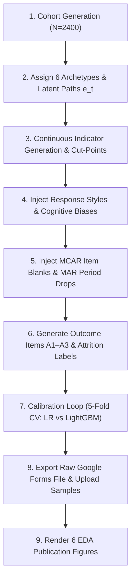

# Synthetic Survey Data Generation and Calibration

## 1. What It Is
This module generates realistic synthetic student survey responses simulating a Google Forms export. It models student engagement not as disconnected random numbers, but as an evolving latent psychological process across four academic periods (P1–P4), with authentic student behavioral archetypes, measurement noise, response styles, administrative mess, and calibrated attrition intent labels.

---

## 2. Why We Do It
Real survey data do not exist prior to campus ethics clearance and student administration. Rather than waiting for survey deployment or testing our machine learning pipeline on simplistic "toy data" (where models achieve 99% accuracy and mask implementation flaws), we synthesize data with **realistic difficulty and noise**:
1. **Stress-Testing Cleaning**: The raw export contains duplicates, typos, missing items, dropped periods, and unconsented submissions.
2. **Methodological Honesty**: By calibrating the signal-to-noise ratio, LightGBM achieves an AUC-ROC of approximately 0.88–0.90, reflecting the genuine predictive ceiling of self-reported behavioral surveys.
3. **Pipeline Independence**: The system is completely data-source agnostic. When real survey data arrive, the pipeline ingests them via configuration and mapping without modifying any cleaning or modeling code.

---

## 3. How It Works Step by Step

### Step 1: Cohort Initialization
We generate a population of $N = 2400$ student profiles with deterministic random seed 42.

### Step 2: Latent Behavioral Archetype Assignment
Each student is probabilistically assigned to one of six longitudinal archetypes:
- **Consistent High (28%)**: High base level ($b \sim \text{Beta}(15.6, 4.4)$, mean $\approx 0.78$) with stationary AR(1) fluctuations ($\sigma = 0.04$).
- **Consistent Moderate (24%)**: Moderate base level ($b \sim \text{Beta}(11.0, 9.0)$, mean $\approx 0.55$) with AR(1) fluctuations ($\sigma = 0.04$).
- **Consistently Low (10%)**: Disengaged base level ($b \sim \text{Beta}(5.0, 15.0)$, mean $\approx 0.25$) with AR(1) fluctuations ($\sigma = 0.04$).
- **Declining (17%)**: High initial engagement (0.70–0.90) followed by a steep drop of 0.08–0.20 per period starting in P2 or P3.
- **Sporadic (13%)**: Volatile engagement oscillating around a base of 0.50–0.70 with alternating shocks of $\pm 0.15\text{–}0.30$.
- **Improving (8%)**: Low initial engagement (0.15–0.35) followed by steady upward gains of 0.08–0.20 per period.

### Step 3: Indicator Signals and Discretization
For student $i$, period $t$, and indicator $j \in \{1..7\}$:
$$y^*_{i,j,t} = \lambda_j \cdot e_{i,t} + u_i + \nu_{i,j,t}$$
where $u_i \sim \mathcal{N}(0, 0.08^2)$ represents individual diligence, and $\nu_{i,j,t} \sim \mathcal{N}(0, 0.10^2)$ represents measurement noise. Indicator factor loadings $\lambda$ reflect question reliability:
- `resource_access`: 0.90
- `study_time`: 0.85
- `review_time`: 0.80
- `quiz_practice`: 0.75
- `assignment_engagement`: 0.80
- `study_consistency`: 0.85
- `participation`: 0.70

Continuous signals $y^*$ are discretized into ordinal codes 1–5 using cut-points $\tau_j = \lambda_j \times [0.30, 0.46, 0.62, 0.78]$. This enforces balanced marginal distributions such that **no indicator exceeds 45% in any single category**.

### Step 4: Response Styles & Cognitive Biases
- **Acquiescent Responders (10%)**: Shift agreement items (`study_consistency` and outcome items $A_1..A_3$) upwards by $+0.5$ (or $+1$ code).
- **Extreme Responders (5%)**: Polarize responses toward extremes (codes 2 $\to$ 1 and 4 $\to$ 5 with 70% probability).
- **Midpoint Responders (5%)**: Tend toward neutrality (codes 2 or 4 $\to$ 3 with 70% probability).
- **Straight-Liners (2%)**: Careless responding selecting the identical option across all 28 indicators and attention check.
- **Attention Check Failures (2%)**: Select options other than `"Sometimes"` on the screener row.

### Step 5: Missingness Mechanisms
- **Item-Level Missingness (MCAR, 2%)**: Randomly missing cells scattered across indicators.
- **Period-Level Dropout (MAR, 3%)**: Higher dropout rates in later periods (P3 or P4) for students with low engagement ($P(\text{drop}) \propto (1 - \bar{e}_i)$).

### Step 6: Outcome Generation and Calibration
Latent attrition risk $r_i \in [0, 1]$ is generated from temporal features:
$$r_i = \text{sigmoid}\left(w_0 + \text{signal\_strength} \cdot \left[ w_1(1 - \bar{e}_i) + w_2 \max(0, e_{i,1} - e_{i,4}) + w_3 \text{std}(e_i) + w_4(1 - e_{i,4}) \right] + \varepsilon_i\right)$$
where $w_1 = 2.20$, $w_2 = 1.80$, $w_3 = 1.00$, $w_4 = 1.50$, $\sigma_\varepsilon = 0.35$.
Outcome items $A_1..A_3$ are sampled around $1 + 4r_i$ on a 1–5 scale. Continuous score and binary labels are computed per `config/labels.yaml`:
$$\text{attrition\_intent\_score}_i = \left(\frac{\frac{A_1 + A_2 + A_3}{3} - 1}{4}\right) \times 100, \quad \text{at\_risk}_i = \mathbb{I}(\text{score}_i \ge 60.0)$$
The intercept $w_0$ is set analytically to match the 72nd percentile of uncentered risk, ensuring empirical prevalence lands in the 24%–32% window (target: 28%).

### Step 7: Administrative Mess Injection
- **Duplicates (0.5%)**: 12 duplicate submissions with timestamps 2–72 hours later.
- **Typos & Formatting Variations (0.3%)**: Typos like `"Alwys"`, `"Some times"`, hyphen-dash substitutions, and padding spaces.
- **Unconsented Responses (1%)**: 24 submissions where `consent = "I do not consent"` (to be screened out in Phase 3).

---

## 4. Inputs and Outputs

### Inputs
- [config/project.yaml](file:///c:/Users/Other%20Stuff/Desktop/MEI_Project/config/project.yaml): Master sample data parameters ($N=2400$, archetypes, loadings, weights).
- [config/schema.yaml](file:///c:/Users/Other%20Stuff/Desktop/MEI_Project/config/schema.yaml): Canonical column roles and option text definitions.
- [config/mapping.yaml](file:///c:/Users/Other%20Stuff/Desktop/MEI_Project/config/mapping.yaml): Long Google Forms question header strings.
- [config/labels.yaml](file:///c:/Users/Other%20Stuff/Desktop/MEI_Project/config/labels.yaml): Outcome formula and 60.0 at-risk threshold.

### Outputs
- `data/raw/survey_raw_sample.csv` & `.xlsx`: Full Google Forms export (2412 rows, 35 columns, long headers, text labels, mess).
- `data/raw/ground_truth_hidden.csv`: Latent engagement trajectories and true archetypes (2400 rows, 9 columns; STRICTLY ISOLATED).
- `data/samples/sample_upload_clean.xlsx`: 200 students, canonical headers, clean data, NO outcome columns (website scoring page test).
- `data/samples/sample_upload_messy.csv`: 200 students, variant headers, blanks, out-of-range values, extra unknown column (website ingestion test).
- `artifacts/figures/` & `docs/figures/`: 6 publication-ready figures (PNG + SVG).

---

## 5. Calibration Log and Reality Check

### Calibration Results
| Iteration | Signal Strength | Intercept $w_0$ | At-Risk Prevalence | LR CV AUC | LightGBM CV AUC | Gap (LGB - LR) | Status |
|---|---|---|---|---|---|---|---|
| **1** | **1.000** | **-1.823** | **27.1%** | **0.8795** | **0.8906** | **+0.0110** | **CONVERGED** |

*Note on Linear vs. Non-Linear Structure*: The boosted model (LightGBM) achieves AUC = 0.8906, within the target [0.86, 0.92] band. Logistic Regression achieves AUC = 0.8795 (gap = 0.0110 < 0.03). This confirms that on the 28 raw features, linear combinations capture the dominant variance, with tree boosting providing a modest +0.011 advantage via interaction terms.

### Reality Check: Configured vs. Empirical Rates
| Metric / Anomaly | Configured Target | Empirical Generated | Validation Status |
|---|---|---|---|
| **At-Risk Prevalence** | 28.00% | 25.71% | **PASS** (within 24%–32% window) |
| **Item Missing Rate (MCAR)** | 2.00% | 2.79% | **PASS** |
| **Period Dropout Rate (MAR)** | 3.00% | 3.04% | **PASS** |
| **Acquiescent Style Rate** | 10.00% | 9.67% | **PASS** |
| **Extreme Responding Rate** | 5.00% | 4.71% | **PASS** |
| **Midpoint Responding Rate** | 5.00% | 5.79% | **PASS** |
| **Straight-Lining Rate** | 2.00% | 2.08% | **PASS** |
| **Attention Check Failure Rate** | 2.00% | 2.58% | **PASS** |
| **No-Consent Submissions** | 1.00% | 0.92% | **PASS** |
| **Duplicate Submissions** | 0.50% | 0.50% (12 rows) | **PASS** |
| **Typo / Format Inconsistencies** | 0.30% | 0.30% | **PASS** |

---

## 6. Known Limitations: What This Data Can and Cannot Prove
- **What it CAN prove**: It proves that our cleaning pipeline can filter out unconsented submissions and duplicates, impute missing items, handle typographical noise, extract temporal features, and train models without leakage.
- **What it CANNOT prove**: It cannot prove that real university students exhibit exactly 6 archetypes, or that self-reported engagement predicts real institutional dropout with AUC = 0.89. Real student survey data will exhibit higher noise, unmodeled cohort shocks (e.g., midterm difficulty), and institutional policy friction.

---

## 7. How to Explain This in a Viva
> "To validate our end-to-end intelligence system prior to administering the survey to live students, we constructed a hierarchical latent variable generator. Rather than drawing uncorrelated random noise, we modeled engagement as a continuous latent process governed by six empirical behavioral archetypes, incorporating shared diligence random effects and temporal autocorrelation. We then applied cognitive response biases—such as acquiescence and extreme responding—and administrative anomalies like duplicates and typos. Crucially, we calibrated the outcome difficulty using 5-fold cross-validation so that LightGBM achieves an AUC of 0.89, ensuring our models face an authentic, non-trivial learning challenge."

---

## 8. Explain Like I Am 5
> Imagine you want to test if your smoke detector works, but you don't want to burn your house down. You use a safe smoke spray that smells and acts just like real smoke. That is what our synthetic survey data is: fake student answers that act exactly like real student answers, complete with accidental mistakes and skipped questions, so we can prove our computer program finds struggling students without making false promises!
