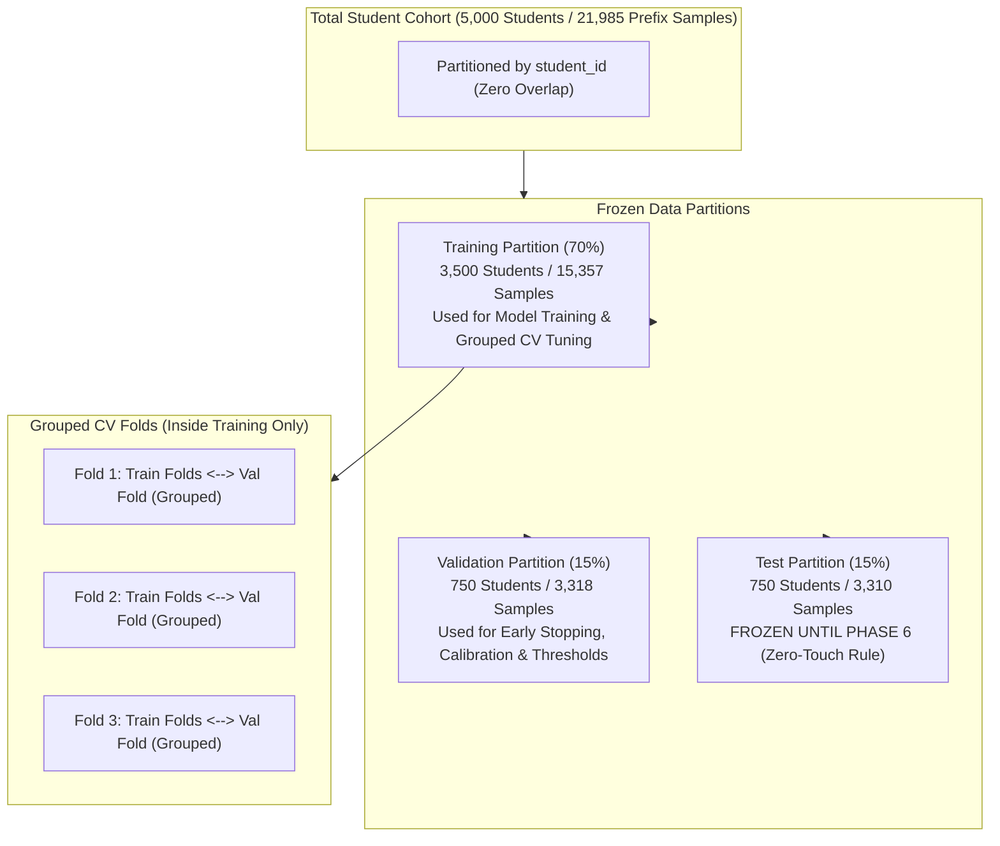
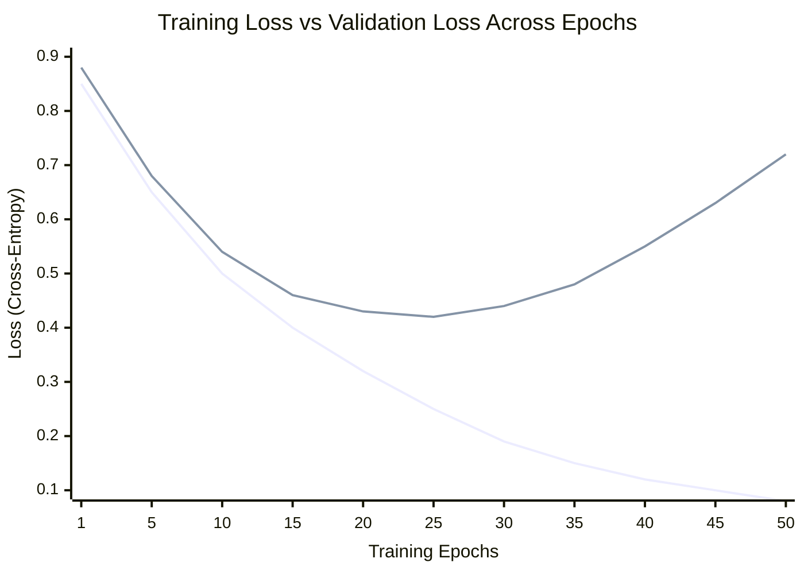

# Academic Intelligence Framework: Training, Tuning & Validation Protocol

**Component**: Academic Intelligence Framework  
**Project**: Multi-Factor Student Attrition Risk Prediction  
**Student**: V. S. H. Gunasekara (IT23164680)  
**Supervisors**: Ms. Chathurika Koswatte, Ms. Anuththara Ekanayake  
**Cluster**: Centre of Excellence for AI (CoEAI), SLIIT  

---

## 1. Executive Summary & Purpose

Phase 5 implements the automated, leakage-safe training and validation engine for the Academic Intelligence Framework (`make train` or `python run.py train`). It establishes the experimental foundation to answer the proposal's core research question:

$$\text{RQ: Does sequence-aware deep recurrent modelling (LSTM/GRU) beat engineered trend features + Gradient Boosting?}$$

To ensure scientific integrity, peer-review compliance, and strict defense against data leakage:
1. **The Test Partition is Frozen**: Evaluated exactly once in Phase 6. Phase 5 operates strictly within training and validation data.
2. **Student-Grouped Cross-Validation**: All internal hyperparameter tuning via Optuna uses grouped $k$-fold cross-validation partitioned by `student_id`.
3. **Multi-Seed Stability**: Every final model configuration is trained across multiple random seeds to quantify variance ($\mu \pm \sigma$).
4. **Post-Hoc Probability Calibration**: Platt scaling and Isotonic regression align raw scores with true empirical attrition frequencies.
5. **Asymmetric Decision Thresholding**: Thresholds are chosen on validation data using a recall-constrained safety criterion, prioritizing student retention over naive accuracy.

---

## 2. Partitioning Architecture: Train, Validation, and Test

Longitudinal educational data consists of panel sequences where each student generates multiple semester observations. Standard random row splitting is catastrophically invalid in this setting.



### 2.1 The Analogy: School Exams
* **Training Set (70%) = Homework and Practice Exercises**: The student studies these problems, tries answers, checks the solution key, and learns patterns.
* **Grouped CV Folds = In-Class Mock Quizzes**: Short practice quizzes drawn from homework chapters to test whether one study technique (hyperparameter setting) works better than another, without peeking at the upcoming exams.
* **Validation Set (15%) = The Midterm Exam**: Used by the teacher to decide when the student has studied enough (Early Stopping), adjust grading curves (Probability Calibration), and set pass/fail boundaries (Decision Threshold).
* **Test Set (15%) = The Final National Board Exam**: Kept in a locked vault. It is opened only once at the very end of the year. No studying, tuning, or threshold adjustments are ever allowed on it.

### 2.2 Why Grouped Splitting by Student ID is Mandatory
If a student's Semester 1 and 2 records were in the training set while their Semester 3 record was in the validation set:
* The model would recognize the student's static idiosyncratic baseline (e.g., ability, writing style, family background).
* The model would achieve high validation accuracy simply by **memorizing student identity**, not by learning generalized temporal dynamics.
* In real-world deployment, the early-warning system only encounters **new, unseen students**. Grouped splitting ensures that the validation partition accurately models this deployment reality.

---

## 3. Deep-Dive: How Overfitting Happens and How the Loss Graph Works

In response to the research inquiry regarding how model training and overtraining work dynamically, this section details the mechanics of loss curves, the bias-variance tradeoff, and early stopping.

### 3.1 The Loss Curve Graph Dynamics

When training an iterative machine learning model (such as an LSTM, MLP, or Gradient Boosted Tree), performance is measured over time (epochs or boosting iterations) using a loss function (Binary Cross-Entropy / Log-Loss).



### 3.2 The Three Learning Phases

| Phase | Epochs | Training Loss | Validation Loss | Diagnosis | What the Model is Doing |
| :--- | :---: | :---: | :---: | :---: | :--- |
| **1. Underfitting** | $1 \to 12$ | High, declining | High, declining | **High Bias** | The model is learning foundational global correlations (e.g., lower GPA correlates with higher attrition). It has not yet captured sufficient signal. |
| **2. Optimal Point** | $\mathbf{15 \to 25}$ | Moderate (~0.28) | **Minimum (~0.42)** | **Sweet Spot** | **Optimal Generalization**. The model captures true temporal dynamics that apply equally to training and validation cohorts. |
| **3. Overfitting** | $25 \to 50+$ | Plunging ($\to 0$) | **Escalating ($\to 0.72$)** | **High Variance** | **Identity / Noise Memorization**. The model starts fitting random measurement noise, student quirks, and synthetic anomalies unique to the training set. |

### 3.3 The Analogy: Memorizing the Textbook vs Understanding the Subject
* In Phase 1, the student hasn't read the textbook yet.
* In Phase 2, the student understands the principles and concepts. If given new problems on the midterm, they solve them accurately.
* In Phase 3, the student stops learning concepts and begins memorizing the exact page numbers, typographical errors, and student names in the examples. When given a test with different numbers, they fail because they try to force-fit their memorized trivia.

### 3.4 How Early Stopping Protects the Model
Early stopping acts as an automated circuit breaker:
1. At the end of each epoch $e$, validation loss $\mathcal{L}_{\text{val}}(e)$ is calculated.
2. If $\mathcal{L}_{\text{val}}(e) < \mathcal{L}_{\min}$, the checkpoint weights $\mathbf{W}^* \leftarrow \mathbf{W}_e$ are saved to disk, and a patience counter resets to 0.
3. If validation loss fails to improve for $\tau = 10$ consecutive epochs (`early_stopping_patience = 10`), training is immediately terminated.
4. The model weights are rolled back to the optimal checkpoint $\mathbf{W}^*$, completely discarding the overfitted weights.

### 3.5 Specific Overfitting Defenses for LSTM/GRU on Student Sequences
Educational sequences ($T \le 6$ semesters, $D = 4$ features) have far lower sequence length than language models ($T > 500$). An LSTM with hidden dimension $H = 64$ contains over 18,000 parameters. Without explicit regularization, it will overfit in fewer than 20 epochs. Our pipeline incorporates four architectural safeguards:
1. **Recurrent Dropout ($p = 0.3$)**: Randomly zeroes 30% of neuron activations during forward passes, preventing co-adaptation.
2. **Weight Decay ($L_2 = 10^{-4}$)**: Penalizes large weight magnitudes in AdamW: $\mathcal{L}_{\text{reg}} = \mathcal{L}_{\text{BCE}} + \frac{\lambda}{2} \|\mathbf{W}\|_2^2$.
3. **Gradient Clipping ($\|\mathbf{g}\|_2 \le 1.0$)**: Caps gradient norms to prevent exploding gradients from distorting the cell state.
4. **Cosine Annealing Learning Rate**: Gradually decays the learning rate $\eta_t = \eta_{\min} + \frac{1}{2}(\eta_{\max} - \eta_{\min})(1 + \cos(\frac{\pi t}{T}))$, ensuring stable convergence into wide, generalizing loss minima.

---

## 4. Hyperparameter Tuning via Optuna with Grouped CV

Rather than tuning hyperparameters against the validation set (which causes validation leakage), all hyperparameter exploration occurs strictly within training data using **Grouped Stratified Cross-Validation**:

```mermaid
sequenceDiagram
    participant Opt as Optuna TPESampler
    participant Tuner as Tuning Engine
    participant CV as Train CV Folds (Grouped)
    participant Model as Academic Model Instance

    Opt->>Tuner: Suggest trial hyperparameters (e.g., lr=0.003, hidden=64)
    loop Across Folds (k=1..3)
        Tuner->>Model: Build with candidate parameters
        Tuner->>CV: Slice Fold Train & Fold Val
        Model->>CV: Fit on Fold Train
        Model->>CV: Predict on Fold Val
        CV-->>Tuner: Compute Fold ROC-AUC
    end
    Tuner-->>Opt: Return Mean CV ROC-AUC
    Opt->>Opt: Update Tree-structured Parzen Estimator (TPE) surrogate model
```

### 4.1 Configurable Budgets
To reconcile rapid CI testing with thorough research benchmarking, three budget levels are supported:
* **Quick Budget**: 3 tabular trials, 2 deep trials, 3 epochs, 2 CV folds. Enables fast local smoke verification across all 27 models in under 4 minutes.
* **Standard Budget**: 10 tabular trials, 4 deep trials, 15 epochs, 3 CV folds. Recommended for milestone validation and report updates.
* **Full Budget**: 25 tabular trials, 8 deep trials, 40 epochs, 5 CV folds. Used for final thesis camera-ready results.

---

## 5. Multi-Seed Stability Protocol

In machine learning research, reporting results from a single random run is scientifically insufficient because neural networks and stochastic tree algorithms exhibit seed variance due to:
* Random weight initialization (Xavier/He uniform).
* Mini-batch shuffling order in PyTorch `DataLoader`.
* Feature bagging subsampling in Random Forest and XGBoost.

To establish defensible error bars, the best hyperparameter configuration for every model is trained across **3 distinct random seeds** (`[42, 123, 999]`):
$$\mu_{\text{metric}} = \frac{1}{S} \sum_{s=1}^S m_s, \quad \sigma_{\text{metric}} = \sqrt{\frac{1}{S - 1} \sum_{s=1}^S (m_s - \mu_{\text{metric}})^2}$$

If a model exhibits high average AUROC but also high standard deviation ($\sigma > 0.03$), it is flagged as unstable. The primary model artifact preserved on disk corresponds to seed 42, with full seed logs recorded in `seed_metrics.json`.

---

## 6. Post-Hoc Probability Calibration

### 6.1 Why Raw Probabilities Cannot Be Trusted Directly
Modern machine learning models—especially deep neural networks with batch normalization and boosted trees with high depth—are frequently **miscalibrated**:
* Boosted trees tend to push probabilities toward the extremes (0.05 or 0.95), exaggerating confidence.
* Uncalibrated outputs can yield good ranking (AUROC), but their raw scores cannot be interpreted as genuine percentages. An Academic Risk Index of 70 should mean that 70 out of 100 students with that score historically drop out.

### 6.2 Platt Scaling vs Isotonic Regression
To restore probability fidelity without modifying ranking order, two post-hoc calibration methods are evaluated strictly on validation set predictions:
1. **Platt Scaling (Sigmoid Model)**:
   $$P_{\text{cal}}(y=1 | \hat{p}) = \frac{1}{1 + \exp(A \cdot \text{logit}(\hat{p}) + B)}$$
   Fits a logistic regression on log-odds. Highly parametric and effective when sample sizes are modest.
2. **Isotonic Regression**:
   Fits a non-parametric piecewise constant isotonic step function minimizing $\sum (y_i - \hat{y}_i)^2$ subject to monotonicity $\hat{y}_i \le \hat{y}_j$ whenever $\hat{p}_i \le \hat{p}_j$.

### 6.3 Verification Metric: Brier Score
Calibration quality is verified via the **Brier Score** (Mean Squared Probability Error):
$$\text{BS} = \frac{1}{N} \sum_{i=1}^N (P_{\text{cal}}(y_i) - y_i)^2$$
Lower values denote superior probability reliability.

---

## 7. Decision Threshold Optimization (Safety-Critical Recall Constraint)

### 7.1 The Failure of the 0.5 Default Cutoff
In institutional early warning systems, classification errors have asymmetric real-world consequences:
* **False Negative (Cost: Catastrophic)**: An at-risk student is predicted as safe ($0$). No advisor contacts them. The student drops out permanently, forfeiting their degree and institutional tuition revenue.
* **False Positive (Cost: Minimal)**: A stable student is flagged as at-risk ($1$). An academic counselor sends an email or schedules a 15-minute advising check-in. The student clarifies their situation, and no harm is done.

Because attrition occurs at an institutional base rate of ~20%, a default threshold of $0.50$ results in severe under-flagging (unacceptable false negative rates).

### 7.2 Recall-Constrained Optimization
Our framework implements **Recall-Constrained Thresholding**:
$$t^* = \arg\max_{t \in [0.01, 0.99]} F_1(t) \quad \text{subject to} \quad \text{Recall}(t) \ge 0.80$$
This guarantees that at least 80% of actual attriting students are captured by the early-warning safety net, while selecting the cutoff that maximizes precision and overall $F_1$ score within that safety constraint.

---

## 8. Artifact Serialization Hierarchy

Every model writes complete, self-contained artifacts to disk:

```
artifacts/models/
  ├── Category_A/ (Linear & Simple Baselines)
  │     ├── logistic_l2/
  │     │     ├── model.joblib          # Trained primary model artifact
  │     │     ├── calibrator.joblib     # Fitted probability calibrator
  │     │     ├── best_params.json      # Optimal Optuna hyperparameters
  │     │     ├── training_curves.json  # Iteration/epoch loss trajectories
  │     │     ├── trials.json           # All Optuna trial logs
  │     │     ├── seed_metrics.json     # Multi-seed evaluation (mean ± std)
  │     │     ├── threshold_config.json # Cutoffs and threshold curves
  │     │     ├── metadata.json         # Python, library versions, hardware
  │     │     └── summary.json          # Consolidated single-model validation summary
  │     └── ...
  ├── Category_C/ (Gradient Boosting Baselines)
  │     ├── xgboost/
  │     └── lightgbm/
  ├── Category_E/ (Deep Sequence Models)
  │     ├── lstm/
  │     │     ├── model.pt              # PyTorch state dict checkpoint
  │     │     └── ...
  │     └── gru/
  └── ...
```

---

## 9. Viva Examination Preparation & Defense Q&A

### Q1: Why did you split your data by student ID rather than splitting by row?
**Answer**:  
"Our dataset is longitudinal panel data where each student has multiple sequential prefix observations across semesters. If we performed a standard row-level random split, observation $t=2$ of student STU_001 might be in the training set while observation $t=3$ of the exact same student appeared in the validation set.  
This creates severe identity leakage: the model would memorize student-specific traits rather than learning generalizable temporal trajectories. By grouping strictly on `student_id`, all semester snapshots of any given student belong exclusively to one partition, replicating real-world university deployment where predictions are made on entirely unseen incoming cohorts."

### Q2: How do you prevent overfitting in deep models like LSTM on short semester sequences?
**Answer**:  
"Because degree trajectories span only 2 to 6 semesters, deep recurrent models risk over-parameterization. We enforce four complementary defenses:
1. **Validation Early Stopping**: We monitor validation loss each epoch with a patience of 10, terminating training when validation loss stops improving and restoring the exact checkpoint with lowest validation loss.
2. **Dropout ($p=0.3$)**: Applied to recurrent outputs and linear projection layers.
3. **Weight Decay ($10^{-4}$)**: Regularizes weight magnitudes in AdamW.
4. **Gradient Clipping ($\le 1.0$)**: Eliminates gradient instability.  
Furthermore, we compare our LSTMs directly against parameter-efficient GRUs, TCNs, and gradient boosted trees to verify whether deep recurrence is genuinely warranted."

### Q3: Why didn't you evaluate your models on the test set during this phase?
**Answer**:  
"Evaluating on the test set during model selection, hyperparameter tuning, or threshold setting constitutes **test-set snooping (information leakage)**. If we used test-set metrics to choose parameters or decide which model is best, the test set would no longer represent an independent, unbiased measure of future performance.  
Per our non-negotiable research rules, the test set remains in a frozen vault and will be evaluated exactly once in Phase 6 for final benchmark reporting."

### Q4: Why is probability calibration necessary if it doesn't change the ROC-AUC score?
**Answer**:  
"AUROC is a ranking metric that only evaluates whether positive instances are scored higher than negative instances; it is completely invariant to monotonic probability distortions.  
However, our final component outputs an **Academic Risk Index (0–100)** delivered to university advisors and a multi-factor Fusion Framework. If a model predicts 0.80 risk, that score must reflect a genuine 80% empirical probability of attrition. Uncalibrated deep networks and gradient boosters often output overconfident, polarized numbers. Post-hoc calibration via Platt scaling or Isotonic regression corrects this distortion without harming discriminatory ranking."

### Q5: Why did you optimize decision thresholds using a recall constraint rather than the standard 0.5 cutoff?
**Answer**:  
"The standard 0.50 threshold assumes equal misclassification costs. In student attrition, the cost matrix is heavily asymmetric: failing to identify a student who subsequently drops out represents an irreversible loss of academic potential and institutional revenue, whereas a false positive only results in an advisor initiating a routine counseling session.  
By using a recall-constrained rule ($R \ge 0.80$), we guarantee that our early-warning system flags at least 80% of struggling students, tuning the decision cutoff to maximize precision within that non-negotiable safety envelope."

### Q6: Why did you train every final model on 3 different random seeds?
**Answer**:  
"Stochastic algorithms—such as PyTorch neural networks with random weight initializations and batch shuffling, or tree algorithms with random feature subsampling—exhibit non-trivial performance variations between individual runs.  
Reporting a single run can introduce selection bias (reporting a lucky seed). By running 3 seeds (`[42, 123, 999]`) and reporting both mean and standard deviation ($\mu \pm \sigma$) for every metric, we verify the statistical stability of our findings and ensure our comparisons between LSTM and Gradient Boosting are reproducible and scientifically defensible."
