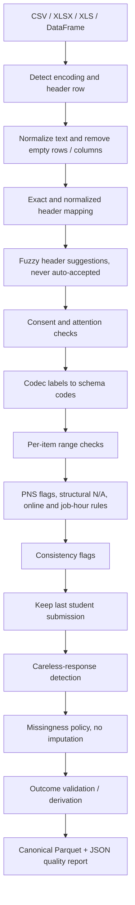

# EF-05 Data Cleaning and Quality Reporting

The reusable Environmental & Financial cleaner is implemented in
`src/cleaning/envfin.py` and exported from `src/cleaning/cleaner.py` as
`EnvironmentalFinancialCleaner`. The legacy `SurveyCleaner` remains available
for older callers. The EF implementation is shared by the CLI, retraining
validation, and website-upload quality-report path; it does not impute values.
The website's existing production inference model still expects the previous
feature schema, so its score calculation continues through the legacy schema
aligner. Likewise, confirmed model retraining is blocked until the model feature
contract is migrated to the canonical EF questionnaire; dry-run cleaning and
outcome validation still produce the EF Parquet and JSON report. This guard
prevents reporting a successful retrain while the trainer would otherwise use
stale preprocessed files.

Run the generated sample end to end:

```powershell
python -m efi.cli clean --input data/raw/survey_raw_sample.csv --mode training
```

Each run writes `data/interim/clean_<run_id>.parquet` and
`data/interim/clean_<run_id>.json`. The JSON contains a row/column/action log
for each stage, mapping suggestions, row reasons, per-rule counts, missingness,
class balance, item distributions, warnings, and traffic-light messages.
`--mode scoring` preserves rows through quality gates and writes per-row reasons
in the `row_reasons` output column; it still excludes wholly empty input rows.
`--output-root` can redirect run artifacts for isolated testing.

## Flow



## Rules and rationale

| Stage / report rule | Behavior | Reason |
|---|---|---|
| `read_normalize` | Reads CSV, XLSX, or XLS; detects text encoding and scans configured rows for a recognized header; drops all-empty rows/columns; trims values; normalizes Unicode dashes and smart quotes. | Google Forms exports can include preambles, formatting noise, or different spreadsheet formats. |
| `map_headers` | Uses `config/mapping_envfin.yaml` exact and normalized canonical/accepted variants first. Fuzzy header matches include candidate and confidence, but are never accepted automatically. Unmatched headers are retained and reported as unknown; missing questionnaire items are listed. | Prevents a plausible-but-wrong column match from silently changing the meaning of a feature. |
| `consent_filter` | In training, keeps configured affirmative consent responses; declines and unrecognized consent values are removed and logged. Scoring preserves them with a row reason. | Non-consenting submissions must not enter the training dataset. |
| `attention_filter` | In training, keeps configured pass responses; failures are removed and logged. Scoring preserves them with a row reason. | Applies the configured response-quality gate without hiding rejected scoring records. |
| `encode_values` | Uses the EF codec tables for exact label-to-code conversion. A unique fuzzy item-label match is accepted only at or above the configured 90 threshold. Other unconvertible answers become missing and receive row reasons. Numeric codes are passed through to the range stage. | Tolerates small typos while retaining an explicit, auditable threshold. |
| `item_range_checks` | Validates each item against its own schema codes, including only that item's configured special codes. Invalid codes become missing and are logged. Codes are zero-based in the schema (`0` through `n_levels - 1`); structural N/A and PNS are handled separately. | Prevents one item's valid code range from being incorrectly applied to another. |
| `special_answers` | Converts each PNS code to missing and creates `pns_<item>`. Retains structural N/A as its schema code and creates `is_online` when all commute items are structural N/A. A “No” job status sets job-hours to the “None” code; working students who left hours blank remain missing. | Preserves meaningful non-response/online semantics without treating them as ordinary ordered answers. |
| `consistency_flags` | Keeps rows and adds `flag_commute_physical_mode`, `flag_commute_partial_na`, and `flag_unemployed_with_hours`; each count appears in the report. Low income with “Never” cost difficulty is not flagged. | Flags contradictions for review instead of inventing corrected answers. |
| `deduplicate` | Training keeps the last submission per nonmissing `student_id` after consent and attention filtering. Scoring retains duplicates and marks all earlier repeated IDs with a reason. | Makes the training record policy explicit while preserving uploaded scoring records. |
| `careless_response` | Flags rows whose ordinal answers share one relative level position on at least 80% of configured ordinal items. Training drops flagged rows by default; `cleaning.drop_straight_liners` can disable dropping. Scoring retains flagged rows. | Detects response patterns without treating every repeated text answer as a straight-line. |
| `missing_data` | Reports missing count and fraction for each available feature. Training drops rows with strictly more than 25% missing feature cells. Scoring keeps them with `more_than_25_percent_features_missing`. Neither mode imputes. | Imputation must be fitted inside training folds (G3), never before splitting. |
| `outcome_handling` | When a score exists, validates 0–100 and derives `at_risk` using the schema threshold (60). A supplied binary label is used only when the score is missing. Rows without outcomes remain available in scoring mode; training requires at least one valid outcome. | Keeps outcome construction consistent and separates prediction-only rows from labeled training rows. |
| Traffic light | Green means no configured warning thresholds were crossed; yellow means reviewable warnings exist; red means required features or usable training outcomes are missing. Messages state the reason. | Makes the report interpretable without hiding the underlying counts or rules. |

### Mapping and encoding thresholds

Header variants and fuzzy suggestions are configured by
`config/mapping_envfin.yaml` (`matching_engine.threshold`, currently 88). A
fuzzy header never auto-maps, even above that threshold. Item answer typo
tolerance is configured under `cleaning.value_fuzzy_threshold` in
`config/project.yaml` (90). Matching ties across different codes are rejected
as missing rather than guessed. The loader uses `charset-normalizer`, `openpyxl`,
and `xlrd`; PyArrow is pinned to a NumPy-compatible version for Parquet output.

## Generated sample run

The recorded EF-05 acceptance run read the synthetic full export. These values
describe only the generator output, not real students:

| Measure | Observed |
|---|---:|
| Input rows | 1,206 (1,200 base records plus 6 duplicate submissions) |
| Training rows retained | 1,108 |
| Consent declines removed | 12 |
| Attention-check failures removed | 24 |
| Earlier duplicate IDs removed | 6 |
| Straight-line responses flagged and removed | 56 |
| Rows over the 25% missing-feature limit removed | 0 |
| Invalid/typo answers converted to missing | 12 |
| Partial commute N/A flags | 7 |
| N/A commute-time with physical mode flags | 3 |
| Unemployed with positive hours flags | 0 |
| Retained outcome balance | 793 low-risk (0), 315 at-risk (1) |
| Retained at-risk share | 28.43% |
| Traffic light | **Green** |

Some response-style examples also meet the straight-line definition, so the 56
flagged rows exceed the 24 rows explicitly generated by the
`straight_liner_rate` setting. The report's rule log distinguishes detected
patterns from the generator's configured injection count.

Item missingness is calculated after consent/attention filtering, duplicate
resolution, and straight-line filtering, and before row-level missingness
removal:

| Item | Missing rows | Item | Missing rows |
|---|---:|---|---:|
| `income_band` | 21 | `aid_status` | 24 |
| `family_support_duty` | 27 | `cost_difficulty` | 80 |
| `commute_time` | 24 | `commute_spend` | 21 |
| `transport_mode` | 23 | `living_situation` | 25 |
| `quiet_study_place` | 21 | `home_internet` | 20 |
| `main_device` | 24 | `mobile_data_plan` | 15 |
| `part_time_job` | 32 | `job_hours` | 36 |
| `financial_shock` | 23 | `money_worry` | 15 |
| `missed_due_to_barriers` | 21 |  |  |

The sample has no warning for fewer than 300 retained rows, at-risk prevalence
below 15%, or an item level above 60%; the full synthetic training result
therefore remains green. A 200-row messy upload in scoring mode is retained
without row drops; its unrecognized invalid answer values are available in
`row_reasons`, the unknown `legacy_extra_field` receives a fuzzy suggestion
with confidence, and the report warns that the file is under 300 rows.

## Common mistakes to avoid

- **Cleaning after splitting:** split first only after deterministic row-level
  validity rules are applied. Any learned transformation must be fitted on the
  training fold only and then applied to validation/test.
- **Imputing before splitting:** do not fill missing values in this cleaner.
  Imputation statistics belong inside the model pipeline to prevent leakage.
- **Deleting instead of flagging:** consistency contradictions and scoring
  quality concerns are retained as flags/reasons. Training filters are limited
  to the configured consent, attention, duplicate, straight-line, and missing
  data rules.
- **Accepting fuzzy mappings automatically:** inspect suggestions and confirm
  the survey wording before altering the mapping configuration.
- **Treating codes as labels:** cleaned feature columns are schema codes; use
  `config/schema_envfin.yaml` and the EF codec to interpret them.
- **Treating an online N/A as missing:** commute structural N/A remains its own
  code and is accompanied by `is_online`.
- **Treating this sample as evidence:** all rates and outcomes above are
  synthetic pipeline checks, not real population results or validated
  individual predictions.
