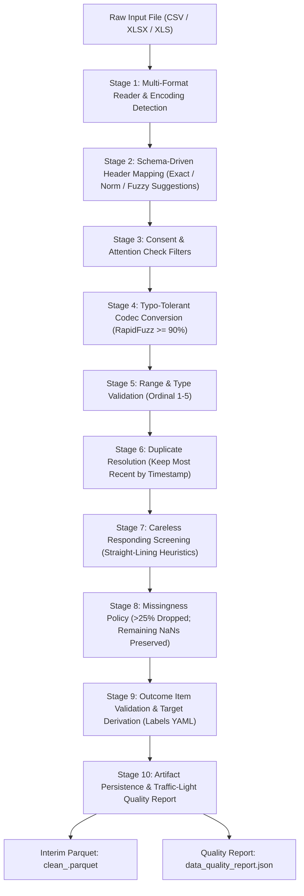
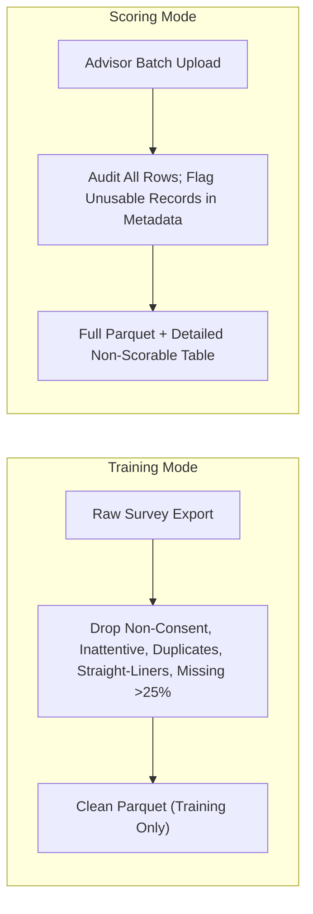

# Survey Data Cleaning and Quality Assurance

## 1. What It Is
The Survey Data Cleaning module (`src/mei/cleaning/`) is an automated, schema-governed 10-stage pipeline that ingests raw, messy survey exports (CSV, XLSX, or XLS) from Google Forms or student administrative systems and converts them into a clean, validated canonical dataset (`data/interim/clean_<run_id>.parquet`). It generates a comprehensive JSON Data Quality Report (`data_quality_report.json`) that audits data integrity, header mapping fidelity, careless responses, and class balance using an automated traffic-light status system (**GREEN**, **AMBER**, **RED**).

---

## 2. Why We Do It
Self-reported questionnaire data inherently contain noise, typos, administrative errors, and careless responding. In an educational attrition-risk system:
1. **Garbage In, Disaster Out**: If straight-liners (students who select option "3" for all 28 questions) or inattentive respondents enter the training set, machine learning models learn false associations between unengaged response patterns and attrition outcomes.
2. **Strict Leakage Prevention (Global Rule G3)**: Data cleaning must resolve typos, format issues, and invalid rows *without* imputing missing feature cells. Imputing values before train/test splitting or cross-validation folds leaks target distribution and global feature statistics, corrupting cross-validation honesty.
3. **Dual-Mode Contract**: Retraining jobs require strict row drops (training mode), whereas real-world web uploads from academic advisors must **never** silently discard student records (scoring mode). Instead, scoring mode audits each record, flagging non-scorable submissions with human-readable rejection reasons while preserving all valid data.
4. **Resilience to Header Changes**: Institutional survey exports frequently alter wording (e.g., adding bracketed period annotations or slightly rephrasing prompts). A strict, configuration-driven mapper ensures predictable column resolution without human intervention.

---

## 3. How It Works Step by Step

### Stage Details

1. **Stage 1 — Multi-Format Ingestion (`reader.py`)**:
   - Detects file encoding automatically with fallback hierarchy (`utf-8` $\to$ `utf-8-sig` $\to$ `cp1252` $\to$ `latin-1`).
   - Drops completely blank rows and columns. Strips leading/trailing whitespace and normalizes curly quotes (`"“"`, `"”"`) and en/em-dashes (`"–"`, `"—"`) to standard ASCII characters (`"-"`).
2. **Stage 2 — Header Mapping (`mapper.py`)**:
   - Compares raw column names against canonical definitions in `config/mapping.yaml`.
   - Uses exact matching, then case/punctuation-normalized matching.
   - For unknown columns, runs RapidFuzz token sort ratio against all known variants (threshold $\ge 88.0\%$). In accordance with project rules, suggestions are returned to the caller for audit or UI review, but **never silently auto-accepted**.
3. **Stage 3 — Informed Consent & Attention Check (`filters.py`)**:
   - Screen informed consent: submissions where `consent != 'Yes'` are dropped in training mode.
   - Screen attention check: respondents who fail the embedded trap item (`"Sometimes"`) are flagged as inattentive.
4. **Stage 4 — Typo-Tolerant Codec (`encoder.py`)**:
   - Converts natural language survey options (e.g. `"Every day"`, `"1-2 days"`) into canonical integer codes $1..5$.
   - Executes RapidFuzz similarity matching with a strict $\ge 90.0\%$ threshold to recover common typographical slips (e.g. `"Everyday"`, `"Alwys"`). Unrecoverable strings are converted to `NaN`.
5. **Stage 5 — Range & Type Validation (`encoder.py`)**:
   - Confirms that all 28 feature codes and 3 outcome items fall strictly within $[1, 5]$. Any out-of-range value is converted to `NaN` and logged.
6. **Stage 6 — Duplicate Resolution (`filters.py`)**:
   - If a `student_id` submits multiple surveys, rows are sorted by `timestamp` in ascending order, and only the **last valid submission** is retained.
7. **Stage 7 — Careless Responding (`filters.py`)**:
   - Identifies straight-lining through a dual heuristic across the 28 indicator answers:
     1. Overall response standard deviation equals zero ($\sigma = 0$).
     2. Zero response variance across $\ge 6$ of the 7 indicators across all 4 periods.
8. **Stage 8 — Missing Data Policy (`filters.py`)**:
   - Counts missing values across the 28 indicator items. Rows missing $> 25\%$ of cells ($> 7$ items) are dropped in training mode.
   - **Strict Rule G3 Anti-Leakage Compliance**: Rows with $\le 25\%$ missingness are retained with their `NaN` values intact. No imputation is performed in cleaning.
9. **Stage 9 — Outcome Derivation (`outcomes.py`)**:
   - For training data, validates presence of outcome items $A_1..A_3$. Computes the composite `attrition_intent_score` and binary `at_risk` indicator (threshold $\ge 60.0$) using `config/labels.yaml`. In scoring mode, target derivation is skipped if outcome columns are omitted.
10. **Stage 10 — Persistence & Quality Reporting (`pipeline.py`)**:
    - Serializes clean tabular data using `fastparquet` to `data/interim/clean_<run_id>.parquet`.
    - Computes item marginals, missingness summaries per period, class balance, and evaluates traffic-light criteria (**GREEN**, **AMBER**, **RED**).

---

## 4. Cleaning Rules Log & Sample Cohort Metrics

The table below summarizes the exact rules applied during the validation run on `data/raw/survey_raw_sample.csv` ($N = 2412$ raw submissions).

| Rule ID | Rule Name | Stage | Trigger Criteria | Action Taken | Affected on Sample Data |
| :--- | :--- | :---: | :--- | :--- | :---: |
| **R01** | Ingestion Cleanup | 1 | Empty rows/cols, non-UTF8 encoding, irregular quotes/dashes | Normalize encodings/strings, reset index | 0 empty rows dropped |
| **R02** | Header Mapping | 2 | Header variants in `mapping.yaml`; unknown headers | Rename canonical headers; suggest fuzzy matches ($\ge 88\%$) | 35/35 mapped (0 missing, 0 extra) |
| **R03A** | Consent Filter | 3 | `consent != "Yes"` | Drop row (training mode) | 22 unconsented rows dropped |
| **R03B** | Attention Check | 3 | `attention_check != "Sometimes"` | Drop row (training mode) | 61 inattentive rows dropped |
| **R04** | Codec Encoding | 4 | Text survey labels; minor typos ($\ge 90\%$ similarity) | Map to ordinal $1..5$; fix typos; unmapped $\to \text{NaN}$ | 41 typos corrected across 68,988 cells |
| **R05** | Range Check | 5 | Codes outside $[1, 5]$ | Replace with $\text{NaN}$ | 0 out-of-range cells |
| **R06** | Duplicate Resolution | 6 | Duplicate `student_id` | Keep most recent submission by timestamp | 11 prior duplicate submissions dropped |
| **R07** | Careless Responding | 7 | Straight-lining ($\sigma = 0$ or invariant across $\ge 6/7$ indicators) | Drop row (training mode) | 89 straight-liner rows dropped |
| **R08** | Missingness Policy | 8 | Feature missingness $> 25\%$ ($> 7$ items); $\le 25\%$ missingness | Drop row if $> 25\%$; preserve $\text{NaN}$ if $\le 25\%$ | 45 excessive rows dropped; 3,053 $\text{NaN}$s kept |
| **R09** | Outcome Derivation | 9 | Items $A_1..A_3$ present | Compute score ($0..100$) and `at_risk` ($\ge 60$) | 0 missing outcomes; 553 at-risk (25.32%) |

### Sample Cohort Data Retention Summary
- **Raw Rows In**: 2,412
- **Clean Rows Out**: 2,184
- **Retention Rate**: 90.55%
- **Remaining Feature Missingness**: 4.89% (3,053 cells out of 62,412 total feature cells; left unimputed)
- **At-Risk Target Prevalence**: 25.32% (553 students at-risk, 1,631 students not-at-risk)
- **Data Quality Status**: **GREEN** (Retention $> 80\%$, sample $> 300$, missingness $< 10\%$, class balance in $15\%\text{--}45\%$)

---

## 5. Dual-Mode Cleaning Contract: Training vs. Scoring

| Dimension | Training Mode (`--mode training`) | Scoring Mode (`--mode scoring`) |
| :--- | :--- | :--- |
| **Primary Goal** | Build uncompromised, leak-free training cohorts | Ingest user uploads and score students without silent drops |
| **Outcome Items ($A_1..A_3$)** | **Mandatory**; raises error if missing | **Optional**; skipped cleanly if unlabelled |
| **Invalid Rows (Consent/Trap/Missing)** | **Dropped** from output dataset | **Retained**; flagged in `rejected_rows` with reason |
| **Header Mapping Failure** | Fatal error; halts execution | Suggests mappings; produces AMBER/RED warning report |
| **Target Audience** | Automated retraining pipeline | Web UI upload / Academic advisor batch scoring |

---

## 6. Common Mistakes and Anti-Patterns

1. **Imputing Missing Values in Cleaning (The Leakage Trap)**:
   - *Wrong*: Imputing missing survey items with column medians or KNN inside the cleaning module.
   - *Right*: Leave missing values as `NaN` in `clean_<run_id>.parquet`. Imputation transformers must be fitted exclusively on training folds within cross-validation (`Pipeline([('imputer', SimpleImputer()), ('model', ...)])`).
2. **Silently Dropping Rows During Advisor Scoring**:
   - *Wrong*: Discarding a student's row because they straight-lined or missed a consent checkbox during web UI scoring.
   - *Right*: Keep the row index in the output dataframe and append a structured `RowQualityDetail` to the report with rejection reason `"straight_lining"` so advisors see exactly why that student cannot be scored.
3. **Silent Fuzzy Header Matching**:
   - *Wrong*: Automatically mapping `"campus_branch"` to `"resource_access_p1"` because a fuzzy score happened to pass a loose threshold.
   - *Right*: Require exact or normalized matches for automated renaming. Provide fuzzy suggestions only as metadata for user confirmation.
4. **Hardcoding Column Names Instead of Referencing Schemas**:
   - *Wrong*: Writing `df['resource_access_p1']` directly in cleaning routines.
   - *Right*: Query `schema.get_feature_names()` or `schema.get_outcome_names()` dynamically from `config/schema.yaml`.

---

## 7. Viva / Defense Explanation
> *"In survey-based predictive systems, data cleaning is not simply formatting text—it is an active defense against psychological measurement artifacts and validation leakage. Our cleaning pipeline implements a strict 10-stage sequence. We filter unconsented submissions, attention check failures, and straight-liners (respondents with zero variance across 28 items). To respect Global Rule G3, we intentionally do not impute missing values at this stage; imputation before splitting is a well-known source of data leakage that yields artificially inflated performance metrics. Furthermore, our pipeline distinguishes between training mode (which drops invalid records to ensure pristine modeling) and scoring mode (which audits and retains all uploaded records while flagging non-scorable entries with explicit reasons). Every execution produces an immutable JSON report with traffic-light status, guaranteeing complete reproducibility."*

---

## 8. ELI5 Explanation
> *Imagine a school asks students to fill out an online questionnaire. Some students might click "Submit" twice, some might click option "3" all the way down without reading the questions, and some might make typing mistakes like writing "Alwys" instead of "Always". Our cleaning robot looks at the survey answers one by one. It fixes obvious spelling errors, removes duplicate forms so nobody gets counted twice, and spots the kids who just rushed through clicking the exact same bubble. But it never guesses missing answers—it leaves those blank so our future math models don't cheat. Finally, it prints out a report card with a green, yellow, or red light telling the teachers whether the survey is ready to use.*
