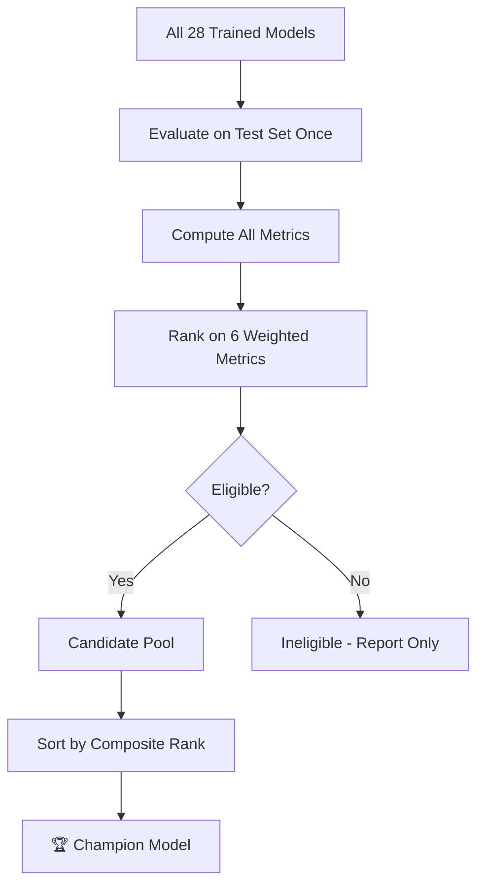
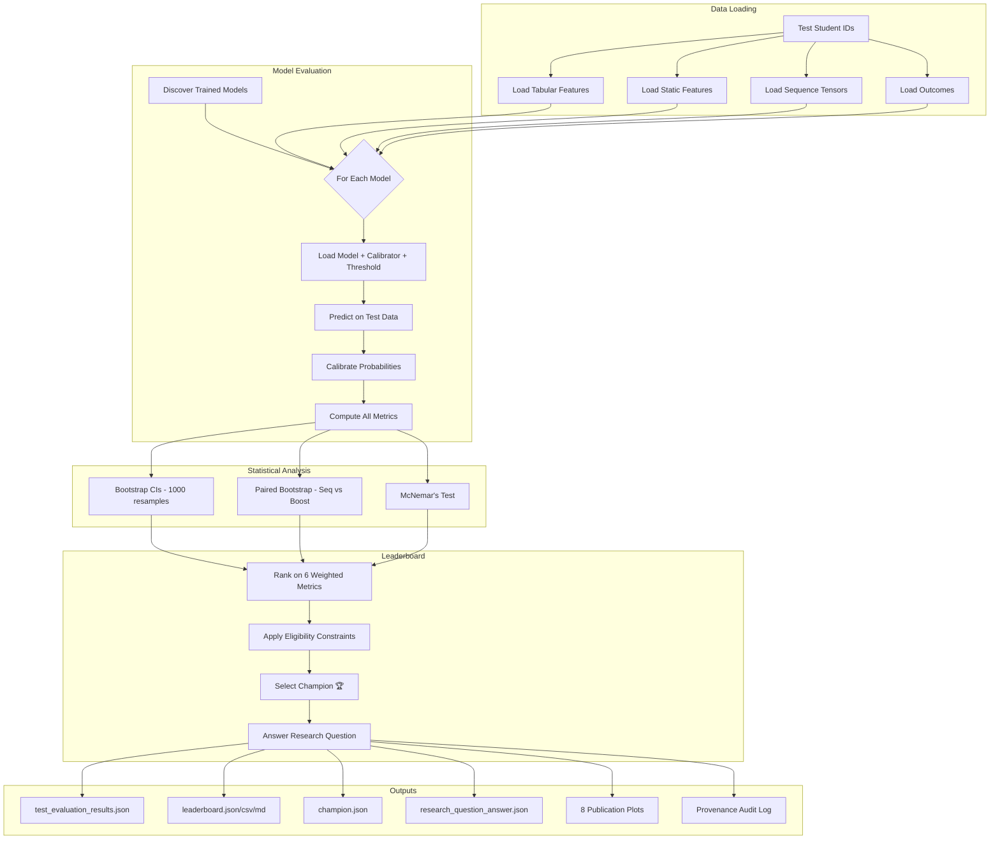

# Phase 6: Final Evaluation, Metrics, and Leaderboard

> **Component**: Academic Intelligence Framework (IT23164680)  
> **Author**: V. S. H. Gunasekara  
> **Status**: SYNTHETIC DATA — Results demonstrate methodology, not real-world findings  
> **Phase**: 6 of 8

---

## 1. Evaluation Philosophy

### 1.1 Why One-Touch Test Evaluation?

In machine learning research, the **held-out test set** is your courtroom verdict — you only get one
chance to present your case. If you peek at the test set repeatedly and tweak your model each time,
you are no longer measuring generalisation; you are overfitting to the test distribution.

**Plain English**: Imagine a student who practises only with past exam papers and then sees the final
exam questions before sitting the test. Their grade doesn't reflect what they actually learned — it
reflects what they memorised. Our test set is the sealed exam paper. We open it exactly once.

### 1.2 Student-Grouped Splits

A single student can generate multiple task samples (one per observation window $t \in \{2,3,4,5,6\}$).
If samples from the same student appear in both training and test sets, the model can "recognise" the
student rather than learn general patterns. This is **data leakage**.

We enforce **grouped splitting by `student_id`**: all samples belonging to one student live entirely
in train, validation, OR test — never split across partitions. This is the foundational guarantee of
Non-Negotiable Rule #2.

### 1.3 Cryptographic Provenance

Every time the test set is evaluated, we compute a SHA-256 hash over the test student IDs, target
labels, and sample IDs. This fingerprint is stored in `artifacts/metrics/test_evaluation_provenance.json`
with a timestamp and evaluation counter. If a viva examiner asks "How do I know you only tested
once?", we point to this audit log.

---

## 2. Metric Suite

Our evaluation covers five metric families. Each is motivated by a specific aspect of the academic
attrition prediction task.

### 2.1 Classification Metrics

| Metric | Formula | Why It Matters | Failure Mode |
|--------|---------|---------------|--------------|
| **Accuracy** | $\frac{TP+TN}{N}$ | Intuitive but **misleading under imbalance**. With ~6% attrition rate, predicting everyone as "retained" gives 94% accuracy. | Lies when classes are imbalanced. |
| **Balanced Accuracy** | $\frac{1}{2}\left(\frac{TP}{TP+FN} + \frac{TN}{TN+FP}\right)$ | Averages per-class accuracy. Chance baseline = 0.50. | Still doesn't account for class size asymmetry in costs. |
| **Precision** | $\frac{TP}{TP+FP}$ | Of students we flag as at-risk, how many truly are? Low precision → counselling resources wasted on false alarms. | Misleading if threshold is set very high (flags few students). |
| **Recall (Sensitivity)** | $\frac{TP}{TP+FN}$ | Of students who actually drop out, how many did we catch? **This is safety-critical** — missing an at-risk student has irreversible consequences. | Can be trivially maximised by flagging everyone. |
| **F1 Score** | $\frac{2 \cdot P \cdot R}{P + R}$ | Harmonic mean of Precision and Recall. Balanced trade-off. | Treats false positives and false negatives equally — inappropriate for early warning. |
| **F2 Score** | $\frac{5 \cdot P \cdot R}{4P + R}$ | **Recall-weighted** harmonic mean ($\beta=2$). Penalises missed dropouts more than false alarms. This is our primary threshold-dependent metric. | Still a point metric at one threshold. |
| **ROC-AUC** | Area under ROC curve | Threshold-free measure of how well the model ranks positives above negatives. | Can be misleadingly high under severe imbalance — a model that assigns slightly higher scores to the 6% positives gets high AUC even if absolute probabilities are uncalibrated. |
| **PR-AUC (Average Precision)** | Area under Precision-Recall curve | Focuses on performance on the **minority class**. Much harder to inflate than ROC-AUC. **Our highest-weighted leaderboard metric (0.25).** | Sensitive to the number of positives; not directly comparable across datasets with different prevalence. |
| **MCC** | $\frac{TP \cdot TN - FP \cdot FN}{\sqrt{(TP+FP)(TP+FN)(TN+FP)(TN+FN)}}$ | Balanced measure that uses all four confusion matrix quadrants. Returns +1 (perfect), 0 (random), −1 (inverse). | Undefined if any row/column sum is zero. |
| **Cohen's Kappa** | $\frac{p_o - p_e}{1 - p_e}$ | Agreement beyond chance. Adjusts for class prevalence. | Can be low even with high accuracy if classes are imbalanced. |
| **Log-Loss** | $-\frac{1}{N}\sum[y\log p + (1-y)\log(1-p)]$ | Penalises confident wrong predictions severely. Evaluates the full probability distribution. | Sensitive to extreme probabilities near 0 or 1. |
| **Specificity** | $\frac{TN}{TN+FP}$ | Of retained students, how many did we correctly leave unflagged? | Trade-off with recall; high specificity often means low recall. |

### 2.2 Risk-Index Quality Metrics

The Academic Risk Index (ARI) maps calibrated probabilities to a 0–100 scale. These metrics evaluate
how well the continuous risk score reflects reality.

| Metric | Formula | Interpretation |
|--------|---------|---------------|
| **Brier Score** | $\frac{1}{N}\sum(y_i - p_i)^2$ | Mean squared error of probabilities. Lower = better. Range [0, 1]. |
| **Brier Skill Score** | $1 - \frac{BS}{BS_{ref}}$ where $BS_{ref} = \bar{y}(1-\bar{y})$ | Improvement over a naïve model that always predicts the base rate. BSS > 0 means the model adds value beyond knowing the overall attrition rate. |
| **Efron's Pseudo-$R^2$** | $1 - \frac{\sum(y_i - p_i)^2}{\sum(y_i - \bar{y})^2}$ | Bounded above by 1.0 but **can be negative** if predictions are worse than the mean. This is NOT the same as OLS $R^2$. We report it because the proposal references $R^2$, but interpret with extreme care. |
| **MAE** | $\frac{1}{N}\sum\|y_i - p_i\|$ | Mean absolute deviation of probabilities from binary labels. |
| **RMSE** | $\sqrt{\frac{1}{N}\sum(y_i - p_i)^2}$ | Root Brier score; same scale as probability errors. |
| **ECE (Expected Calibration Error)** | $\sum_m \frac{\|B_m\|}{N}\|acc(B_m) - conf(B_m)\|$ | Measures whether binned predicted probabilities match observed frequencies. ECE = 0 means perfect calibration. |
| **Spearman Correlation** | Rank correlation between ARI and $y$ | Does the ordering of risk scores match who actually attrited? Non-parametric; doesn't assume linearity. |

> [!WARNING]
> **Pseudo-$R^2$ caveat**: For binary classification, Efron's pseudo-$R^2$ has different behaviour
> than regression $R^2$. A value of 0.15 for a binary outcome is actually quite reasonable — don't
> compare it to the 0.80+ you'd expect in continuous regression.

### 2.3 Early-Warning Novelty Metrics

These metrics are our **novel contribution** — they measure not just *whether* the model is accurate,
but *how early* it provides actionable warnings.

| Metric | Definition | Why Novel |
|--------|-----------|-----------|
| **Average Lead Time** | Mean number of semesters before actual attrition that a student is first flagged ($ARI \geq$ threshold). | Directly measures practical utility — a warning that arrives after dropout is useless. |
| **Recall@top-10%** | If we intervene on only the top 10% highest-risk students, what fraction of true dropouts do we catch? | Resource-constrained setting: universities can't counsel everyone. |
| **Recall@top-20%** | Same for top 20% highest-risk. | More realistic intervention budget. |
| **Precision@100/200** | Precision among the top-100 and top-200 highest risk scores. | Actionable: "If I call in 100 students, how many truly need help?" |
| **Detected Before GPA < 2.0** | Of flagged attriting students, what fraction was flagged while GPA was still ≥ 2.0 (passing)? | Measures whether the model adds value over the status quo (waiting until GPA drops below passing). |

### 2.4 Efficiency Metrics

| Metric | Constraint | Rationale |
|--------|-----------|-----------|
| **Inference Latency (ms/student)** | NFR1: < 2,000 ms | Real-time dashboard must respond within 2 seconds. |
| **Model Disk Size (KB)** | Informational | Deployment footprint for institutional servers. |

### 2.5 Stability Metrics

| Metric | How Measured | Threshold |
|--------|-------------|-----------|
| **Multi-Seed Std** | Train 3 times with seeds {42, 123, 999}, report $\sigma$ of ROC-AUC. | ≤ 0.05 for champion eligibility. |
| **CV Std** | 5-fold grouped stratified cross-validation on train+val. | Reported for completeness. |

---

## 3. Statistical Rigor

### 3.1 Bootstrap Confidence Intervals

We compute **95% bootstrap confidence intervals** using 1,000 resamples. Crucially, resampling
is **grouped by student**: we resample students (not individual rows), then include all rows
belonging to each sampled student. This respects the intra-student autocorrelation — a student's
semester-2 and semester-3 outcomes are not independent.

```
Algorithm: Student-Grouped Bootstrap CI
1. Let S = {unique student IDs in test set}
2. For b = 1 to 1000:
   a. Sample n = |S| students WITH replacement from S
   b. Collect all rows belonging to sampled students
   c. Compute metric on this bootstrap sample
3. Report 2.5th and 97.5th percentiles as the 95% CI
```

### 3.2 Paired Hypothesis Tests

#### Paired Bootstrap on ΔAUC

To compare two models (e.g., sequence champion vs boosting baseline), we resample the same students
for both models and compute the metric difference on each bootstrap sample. If the 95% CI of the
difference excludes zero, or the two-sided p-value < 0.05, the difference is statistically significant.

$$p\text{-value} = 2 \cdot \min\left(\Pr[\Delta \leq 0],\ \Pr[\Delta \geq 0]\right)$$

#### McNemar's Test

Compares binary classification decisions directly. Counts discordant pairs:
- $b$ = Model A correct, Model B incorrect
- $c$ = Model A incorrect, Model B correct

With Edwards continuity correction:
$$\chi^2 = \frac{(|b - c| - 1)^2}{b + c}$$

Compared against $\chi^2(1)$ distribution. We use both bootstrap (tests metric values) and McNemar
(tests classification decisions) because they answer different questions.

---

## 4. Leaderboard Construction

### 4.1 Weighted Composite Rank

Each model is ranked on six metrics. The overall score is a weighted sum of ranks:

$$\text{Composite} = \sum_{i} w_i \cdot \text{rank}_i$$

| Metric | Weight | Direction | Rationale |
|--------|--------|-----------|-----------|
| PR-AUC | 0.25 | Higher = better | Minority class focus |
| ROC-AUC | 0.20 | Higher = better | Overall discrimination |
| F2 Score | 0.20 | Higher = better | Recall emphasis |
| Brier Score | 0.15 | Lower = better | Calibration quality |
| ECE | 0.10 | Lower = better | Probability reliability |
| Lead Time | 0.10 | Higher = better | Early warning value |

### 4.2 Eligibility Constraints

A model is **ineligible** for champion status if:
1. Inference latency > 2,000 ms per student (NFR1 violation)
2. Multi-seed ROC-AUC std > 0.05 (unstable)
3. It is the `gpa_threshold` reference-only baseline

### 4.3 Champion Selection

The **champion** is the eligible model with the lowest composite rank score (best overall).
Category champions are the best model within each category (A–F).



---

## 5. Research Question

> **Does sequence-aware modelling (LSTM/GRU) beat engineered trend features + Gradient Boosting
> for academic attrition prediction?**

### Comparison Methodology

1. **Sequence Champion**: Best model from Category E (deep sequence models)
2. **Boosting Baseline**: Best model from Category C (gradient boosting with engineered features)
3. **Metrics Compared**: ROC-AUC, PR-AUC, F2, Brier Score, Lead Time
4. **Statistical Test**: Paired student-grouped bootstrap (p < 0.05)

### Answer Categories

| Answer | Condition |
|--------|-----------|
| **POSITIVE** | Sequence wins on BOTH ROC-AUC and PR-AUC, with at least one comparison statistically significant |
| **NULL** | Boosting wins, or difference is not statistically significant |
| **MIXED** | Inconsistent results across metrics |

> [!IMPORTANT]
> With **SYNTHETIC data**, we prove the methodology works — not that sequence models are universally
> superior. Final conclusions require evaluation on genuine institutional records from SLIIT.

---

## 6. Feature Ablation Study

The ablation study re-trains the champion model on progressively richer input subsets:

| Stage | Features | Purpose |
|-------|----------|---------|
| (a) GPA Only | Channel 0 | Baseline — what most existing systems use |
| (b) GPA + Exam Marks | Channels 0, 1 | Does exam performance add value beyond GPA? |
| (c) GPA + Marks + Attendance | Channels 0, 1, 2 | Does attendance monitoring help? |
| (d) All Four Modalities | Channels 0, 1, 2, 3 | Full system including assignment submission delay |

The marginal ROC-AUC gain at each stage quantifies each indicator's contribution. This directly
addresses the proposal's multi-factor justification.

---

## 7. Threats to Validity

> [!CAUTION]
> These threats MUST be stated honestly in the viva defense.

1. **Synthetic Data** (biggest threat): All results demonstrate methodology, not real-world findings.
   The latent-process generator ensures plausible distributions, but no synthetic data perfectly
   replicates institutional reality.

2. **Single Cohort**: No external validation on a separate university's data. Cross-institutional
   generalisability is unknown.

3. **Limited Tuning Budget**: "Quick" budget (3 tabular trials, 2 deep trials) may not find optimal
   hyperparameters. Full tuning could change rankings.

4. **Class Imbalance** (~6% positive rate): All threshold-dependent metrics are sensitive to this.
   PR-AUC and calibration metrics are more reliable than accuracy.

5. **Bootstrap Assumptions**: Grouped bootstrap assumes students are exchangeable. If cohort-year
   structure matters, variance may be underestimated.

6. **Temporal Validity**: The temporal split tests robustness to cohort drift, but synthetic
   cohort years may not capture real year-over-year changes.

---

## 8. Viva Q&A Preparation

### Q1: "Why not just use accuracy?"
**A**: With ~6% attrition rate, a model that predicts "retained" for everyone achieves 94% accuracy.
That's useless for early warning. We use PR-AUC (focused on the minority class), F2 (recall-weighted),
and lead time (practical utility) as primary metrics.

### Q2: "What is your R² measuring?"
**A**: Efron's pseudo-$R^2$, defined as $1 - \frac{SS_{res}}{SS_{tot}}$ where residuals are
$(y_i - p_i)^2$. Unlike OLS $R^2$, it CAN be negative (meaning predictions are worse than the mean
prevalence). A value of 0.15 is actually reasonable for binary outcomes — don't compare to regression.

### Q3: "How do you prevent data leakage?"
**A**: Three layers: (1) Student-grouped splits — all samples from one student stay in one partition.
(2) Fit-on-train-only — scalers, imputers, calibrators are fitted exclusively on training data.
(3) SHA-256 provenance — cryptographic proof that the test set was touched exactly once.

### Q4: "Why is PR-AUC weighted highest?"
**A**: Under severe class imbalance, ROC-AUC can be misleadingly optimistic. PR-AUC directly
measures performance on the minority class (attrited students), which is what we actually care about.

### Q5: "What does a negative Brier Skill Score mean?"
**A**: The model is WORSE than simply predicting the base rate (6%) for every student. This would
indicate the model is doing more harm than good and should not be deployed.

### Q6: "Why bootstrap CIs instead of parametric CIs?"
**A**: No distributional assumptions required. Handles autocorrelated student data via grouping.
With only ~6% positives and multi-semester samples per student, parametric assumptions would be
hard to justify.

### Q7: "What if your results look too good (AUC > 0.97)?"
**A**: Non-Negotiable Rule #3 — investigate leakage first. Check that no test students leaked into
training, verify the provenance hash, inspect feature distributions. If confirmed clean, it may
indicate the synthetic generator made the problem too easy.

### Q8: "How does the static vs dynamic comparison work?"
**A**: Category F models use only last GPA and attendance (the status quo in many universities).
The delta in ROC-AUC/PR-AUC between Category F and the best tabular model (22 engineered trend
features) quantifies the value of longitudinal trajectory information.

### Q9: "What is your novel contribution?"
**A**: Three elements: (1) Lead-time metric — measuring HOW EARLY the model flags at-risk students,
not just whether it does. (2) Multi-factor sequence-aware prediction combining GPA, exam marks,
attendance, and assignment delays as temporal sequences. (3) Honest, reproducible comparison
framework with statistical tests and provenance auditing.

---

## 9. Evaluation Pipeline Architecture



---

## 10. Files Generated

| File | Path | Description |
|------|------|-------------|
| Test Results (JSON) | `artifacts/metrics/test_evaluation_results.json` | Full per-model metrics |
| Test Results (CSV) | `artifacts/metrics/test_evaluation_summary.csv` | Tabular summary |
| Provenance Log | `artifacts/metrics/test_evaluation_provenance.json` | SHA-256 audit |
| Leaderboard (JSON) | `artifacts/leaderboard/leaderboard.json` | Full ranked leaderboard |
| Leaderboard (CSV) | `artifacts/leaderboard/leaderboard.csv` | Tabular leaderboard |
| Leaderboard (MD) | `artifacts/leaderboard/leaderboard.md` | Markdown table |
| Champion | `artifacts/leaderboard/champion.json` | Winner detail record |
| Research Question | `artifacts/leaderboard/research_question_answer.json` | Formal answer |
| Category Champions | `artifacts/leaderboard/category_champions.json` | Best per category |
| ROC Curves | `artifacts/plots/evaluation/roc_curves_overlay.png` | ROC overlay plot |
| PR Curves | `artifacts/plots/evaluation/pr_curves_overlay.png` | PR overlay plot |
| Calibration | `artifacts/plots/evaluation/calibration_curves.png` | Reliability diagram |
| Confusion Matrices | `artifacts/plots/evaluation/confusion_matrices.png` | Side-by-side CMs |
| Metric Heatmap | `artifacts/plots/evaluation/metric_heatmap.png` | Cross-model heatmap |
| Lead Time | `artifacts/plots/evaluation/lead_time_distribution.png` | Lead time histogram |
| Risk Index | `artifacts/plots/evaluation/risk_index_distribution.png` | ARI distribution |
| Efficiency | `artifacts/plots/evaluation/metric_vs_complexity.png` | Accuracy vs latency |

---

## 11. How to Run

```bash
# Full evaluation pipeline (evaluate + leaderboard + plots)
python run.py evaluate

# Or via Makefile
make evaluate
```

> [!NOTE]
> The evaluation pipeline loads all 28 trained models, predicts on the test partition,
> computes comprehensive metrics, runs 1,000-resample bootstrap CIs, paired hypothesis
> tests, generates 8 publication plots, and produces the leaderboard. Expected runtime:
> 3–8 minutes depending on hardware.
