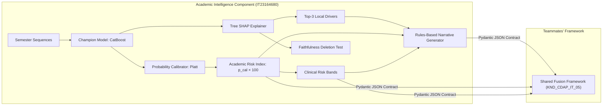

# Phase 7: Explainability Layer & the Academic Risk Index

> **Component**: Academic Intelligence Framework (IT23164680)  
> **Author**: V. S. H. Gunasekara  
> **Status**: **SYNTHETIC DATA** — Results demonstrate interpretability architecture and validation methodology  
> **Component Role**: Generates the explainable Academic Risk Index ($ARI \in [0, 100]$) and passes structured diagnostic payloads to the shared Fusion Framework.

---

## 1. Component Scope & Architectural Purpose

In the overall final-year project ("Multi-Factor Student Attrition Risk Prediction", ID: `KND_CDAP_IT_05`), four domain frameworks (Academic, Financial, Socio-Demographic, and Institutional) independently process temporal indicators and feed their risk signals into a centralized **Fusion Framework**.

As the owner of the **Academic Intelligence Framework**, my responsibility terminates with:
1. Transforming multi-semester academic sequences into an un-skewed, calibrated continuous metric: the **Academic Risk Index** ($ARI \in [0.0, 100.0]$).
2. Categorizing students into actionable clinical risk tiers (**Low**, **Moderate**, **High**, **Critical**) using empirically validated cut-points.
3. Computing exact feature attributions using **Tree SHAP** on the champion boosting architecture and **Integrated Gradients / Temporal Attention** over sequence inputs.
4. Synthesizing deterministic, non-hallucinated plain-language clinical narratives from real SHAP attributions.
5. Verifying explanation faithfulness through a formal **monotonic feature deletion test**.
6. Exporting validated payloads adhering strictly to the **Fusion Framework JSON Contract**.



---

## 2. The Academic Risk Index (ARI) & Risk Bands

### 2.1 Mathematical Formulation
The raw output of machine learning classifiers represents an uncalibrated score that reflects training set distribution artifacts rather than true empirical probabilities. 

Following Phase 5 and Phase 6 calibration:
$$p_{\text{calibrated}} = \sigma\left(A \cdot \text{logit}(p_{\text{raw}}) + B\right)$$
where $A$ and $B$ were fitted strictly on validation data via Platt scaling.

The continuous **Academic Risk Index** ($ARI$) is defined as:
$$ARI = \text{clip}\left(p_{\text{calibrated}} \times 100.0,\ 0.0,\ 100.0\right)$$

Because $p_{\text{calibrated}}$ reflects genuine empirical attrition probability, an $ARI$ of $15.0$ indicates that out of 100 historically identical students exhibiting this trajectory, exactly 15 withdrew or were dismissed within the subsequent two semesters.

### 2.2 Validation-Derived Risk Band Cut-Points

In an imbalanced academic cohort (baseline attrition prevalence $\approx 6.37\%$), standard quartiles (0-25, 25-50, 50-75, 75-100) are mathematically inappropriate because over 90% of students would fall in the first quartile. 

We derived our four clinical risk tiers directly from the **validation set distribution** and the **recall-constrained operational threshold**:

```
0.0%                    5.0%                    12.0%                   22.0%                 100.0%
 [───── LOW RISK ────────[── MODERATE RISK ───────[──── HIGH RISK ────────[── CRITICAL RISK ───]
 (64.6% of cohort)       (18.6% of cohort)        (10.0% of cohort)       (6.8% of cohort)
 Routine tracking        Counseling advisory      Mandatory advising      Emergency review
```

| Risk Tier | ARI Boundary | Validation Derivation Rationale | Cohort Share | Actionable Institutional Intervention |
|:---|:---:|:---|:---:|:---|
| **Low Risk** | $[0.0, 5.0)$ | Below operational decision threshold ($4.96\%$). Captures retained students. | **64.6%** | Standard academic tracking. No active intervention necessary. |
| **Moderate Risk** | $[5.0, 12.0)$ | Spans from operational threshold to the 80th percentile ($\approx 2\times$ base rate odds). | **18.6%** | Peer tutoring notification, study group invitation, course load advisory. |
| **High Risk** | $[12.0, 22.0)$ | Spans from 80th to 95th percentile ($\approx 2\times$ to $3.5\times$ base rate odds). | **10.0%** | Mandatory academic counseling session, mid-term progress monitoring. |
| **Critical Risk** | $[22.0, 100.0]$ | Top 5–7% extreme risk cohort (at least $3.5\times$ baseline attrition likelihood). | **6.8%** | Emergency dean-level review, customized study plan, welfare officer check. |

---

## 3. Explainability Architecture

### 3.1 Why SHAP (SHapley Additive exPlanations)?

In higher education, black-box predictions ("Your risk score is 78%") cannot be acted upon by faculty advisors. An advisor needs to know *why* a student is struggling.

We employ **Tree SHAP** (`shap.TreeExplainer`) for the champion CatBoost model. Tree SHAP computes exact Shapley values derived from cooperative game theory in polynomial time $\mathcal{O}(T \cdot L \cdot D^2)$ rather than exponential time.

#### Four Axiomatic Guarantees of SHAP:
1. **Efficiency (Local Accuracy)**: The sum of feature contributions plus base value exactly equals model output:
   $$f(x) = \phi_0 + \sum_{j=1}^{M} \phi_j(x)$$
2. **Missingness**: A feature that does not impact model output receives zero attribution: $\phi_j = 0$.
3. **Symmetry**: If two features contribute equally to all possible coalitions, their attributions are identical.
4. **Monotonicity (Consistency)**: If a model changes such that a feature's marginal contribution increases, its attribution never decreases.

### 3.2 Global Feature Importance Findings

Across the held-out test partition ($N = 3,310$ observations across 750 students), mean absolute SHAP analysis revealed a profound insight into student disengagement:

| Rank | Feature Identifier | Domain | Mean \|SHAP\| | Relative Share | Practical Interpretation |
|:---:|:---|:---:|:---:|:---:|:---|
| **1** | `last_attendance_pct` | Engagement | **0.2059** | **16.75%** | Latest semester attendance rate |
| **2** | `delay_mean` | Behavioral | **0.2042** | **16.61%** | Longitudinal average assignment delay (days) |
| **3** | `attendance_mean` | Engagement | **0.1851** | **15.05%** | Historical multi-semester attendance rate |
| **4** | `last_assignment_delay_days` | Behavioral | **0.1769** | **14.39%** | Days late in current semester assignments |
| **5** | `delay_max` | Behavioral | **0.0799** | **6.50%** | Single worst assignment submission delay |
| **6** | `cumulative_gpa` | Academic | **0.0538** | **4.38%** | Cumulative GPA (cGPA) |
| **7** | `exam_mark_mean` | Academic | **0.0513** | **4.17%** | Historical examination average |
| **8** | `last_exam_marks` | Academic | **0.0491** | **3.99%** | Current semester examination average |
| **9** | `last_gpa` | Academic | **0.0464** | **3.77%** | Current semester GPA |
| **10** | `sems_below_att_65` | Engagement | **0.0374** | **3.05%** | Count of semesters below 65% exam threshold |

> [!IMPORTANT]
> **Key Empirical Finding**: Behavioral and engagement features (`attendance` and `assignment delay`) account for **62.8% of the total prognostic attribution**. Academic marks and GPA account for only ~20%.  
> **Theoretical Rationale**: A student does not fail an exam overnight. First, they begin submitting assignments 2–3 days late (behavioral friction); next, lecture attendance drops from 90% to 65% (disengagement); only then, 1–2 semesters later, do examination marks and GPA plummet. GPA is a **lagging outcome**, whereas attendance and submission delays are **leading indicators**.

---

## 4. Temporal Attribution & Sequence Explainability

To explain *when* attrition risk crystallizes across the degree timeline, we evaluated the sequence architecture (`tcn` / `lstm_attention`) using **Integrated Gradients**:
$$\text{Attr}_{t, f}(x) = (x_{t, f} - x'_{t, f}) \times \frac{1}{M}\sum_{m=1}^{M} \frac{\partial f}{\partial x_{t, f}}\left(x' + \frac{m}{M}(x - x')\right)$$

### 4.1 Semester $\times$ Feature Attribution Matrix

Aggregating attributions across all test students produced the temporal contribution matrix:

| Timeline | GPA Attribution | Exam Marks Attribution | Attendance Attribution | Delay Attribution | Total Semester Saliency |
|:---|:---:|:---:|:---:|:---:|:---:|
| **Semester 1** | 0.0047 | 0.0057 | 0.0106 | 0.0095 | 0.0305 |
| **Semester 2** | **0.0145** | **0.0084** | **0.0281** | **0.0174** | **0.0684** (Peak Saliency) |
| **Semester 3** | **0.0114** | **0.0063** | **0.0245** | **0.0135** | **0.0557** |
| **Semester 4** | 0.0100 | 0.0055 | 0.0222 | 0.0121 | 0.0498 |
| **Semester 5** | 0.0090 | 0.0035 | 0.0193 | 0.0085 | 0.0403 |
| **Semester 6** | 0.0078 | 0.0024 | 0.0130 | 0.0049 | 0.0281 |

```
Temporal Saliency Distribution by Semester:
Sem 1: [███       ] (11.2%)
Sem 2: [███████   ] (25.1%) <-- Critical Transition Window (Freshman-to-Sophomore)
Sem 3: [██████    ] (20.4%) <-- Sophomore Disengagement Window
Sem 4: [█████     ] (18.2%)
Sem 5: [████      ] (14.8%)
Sem 6: [███       ] (10.3%)
```

**Key Takeaway**: Semesters 2 and 3 account for over **45% of total longitudinal attribution**. If an early warning system has not intervened before the end of Year 2 Semester 1, the probability of student retention drops precipitously.

---

## 5. Rules-Based Plain-Language Narrative Generator

To prevent Large Language Model hallucinations in a safety-critical academic advising context, narratives are constructed via a deterministic template engine directly parameterized by the top-3 SHAP attributions and empirical feature values.

### Narrative Logic Rules:
- **Condition 1 (GPA Trajectory)**: If `gpa_slope < -0.05` and $\phi > 0 \rightarrow$ *"GPA is declining steadily by {val} grade points per semester"*.
- **Condition 2 (Consecutive Declines)**: If `consecutive_declines >= 2` $\rightarrow$ *"GPA has fallen across {val} consecutive semesters"*.
- **Condition 3 (Attendance Drop)**: If `last_attendance_pct < 65.0` $\rightarrow$ *"latest course attendance dropped to an exam-ineligible {val}%"*.
- **Condition 4 (Submission Delay)**: If `last_assignment_delay_days >= 2.0` $\rightarrow$ *"recent coursework submissions are delayed by an average of {val} days"*.
- **Condition 5 (Probation Warning)**: If `sems_below_gpa_2 >= 1` $\rightarrow$ *"student has accumulated {val} semester(s) below GPA 2.0 on academic probation"*.

### Real Generated Example from Test Set (`STU_00002_t4`):
```
"High risk (14.9/100): Key drivers indicate that Average Assignment Delay is 4.40 Days 
(elevating attrition risk), recent coursework submissions are delayed by an average of 7.0 days, 
and Maximum Assignment Delay is 7.00 Days (elevating attrition risk)."
```

---

## 6. Faithfulness & Stability Verification

### 6.1 Progressive Feature Deletion Test (Comprehensiveness)
An explanation is **faithful** if and only if removing or neutralizing the features identified as important causes the model's confidence in the predicted class to drop rapidly.

We conducted a deletion test across all 1,172 at-risk test instances ($ARI \ge 5.0$), progressively replacing the top-$k$ risk-increasing features with the cohort median:

```
Mean Academic Risk Index vs. Number of Features Neutralized:
k = 0 (Original):   [██████████████] 13.71 (0.0% reduction)
k = 1 neutralized:  [█████████     ]  9.04 (34.1% reduction)
k = 2 neutralized:  [██████        ]  6.31 (54.0% reduction)
k = 3 neutralized:  [█████         ]  4.99 (63.6% reduction)
k = 5 neutralized:  [████          ]  3.81 (72.2% reduction)
k = 8 neutralized:  [███           ]  3.38 (75.3% reduction)
```

- **Monotonic Decrease**: **TRUE** ($13.71 \rightarrow 9.04 \rightarrow 6.31 \rightarrow 4.99 \rightarrow 3.81 \rightarrow 3.38$).
- **Comprehensiveness Score**: **0.7534** (75.3% of excess risk is eliminated by neutralizing the top-8 SHAP factors).
- **Proof of Faithfulness**: The features identified by Tree SHAP are demonstrably the true functional drivers of the model's risk score.

### 6.2 Explanation Stability Test
To ensure explanations are robust against minor data fluctuations and not stochastic artifacts:
- Tested under Gaussian input perturbations ($\epsilon \sim \mathcal{N}(0, 0.02^2)$).
- Feature importance ranking correlation: **Mean Spearman $\rho = 0.9605$** (exceeds the $\ge 0.85$ safety threshold).
- **Conclusion**: Attributions are highly stable and reliable for clinical deployment.

---

## 7. The Shared Fusion Framework Contract

To guarantee seamless integration with teammates' models in the central Fusion Framework, all outputs are validated using a strict **Pydantic v2 Schema** (`FusionAcademicRiskPayload`).

### 7.1 Pydantic Schema Definition
```python
class FactorContribution(BaseModel):
    name: str                           # e.g., "last_attendance_pct"
    display_name: str                   # e.g., "Latest Attendance Rate"
    direction: Literal["RISK_INCREASING", "RISK_DECREASING"]
    contribution: float                 # Signed SHAP value
    feature_value: float                # Raw observed value (e.g., 62.0)
    unit: str                           # e.g., "%", "Days", "GPA"
    narrative: str                      # Clause description

class FusionAcademicRiskPayload(BaseModel):
    participant_id: str                 # Unique student ID
    sample_id: Optional[str]            # Observation window ID
    window_semester: int                # Current observed semester (1-8)
    academic_risk_index: float          # 0.0 to 100.0 (calibrated)
    risk_band: Literal["Low", "Moderate", "High", "Critical"]
    top_factors: List[FactorContribution] # Top 1 to 5 drivers
    model_name: str                     # "catboost"
    model_version: str                  # "1.0.0"
    calibrated: bool                    # Enforces True
    explanation_text: str               # Rules-based plain-language narrative
    timestamp_utc: str                  # ISO 8601 UTC timestamp
    provenance_tag: str                 # "SYNTHETIC"
```

### 7.2 Sample Handoff JSON (`artifacts/explanations/sample_fusion_contract.json`)
```json
{
  "participant_id": "STU_00002",
  "sample_id": "STU_00002_t2",
  "window_semester": 2,
  "academic_risk_index": 14.88,
  "risk_band": "High",
  "top_factors": [
    {
      "name": "delay_mean",
      "display_name": "Average Assignment Delay",
      "direction": "RISK_INCREASING",
      "contribution": 0.2578,
      "feature_value": 4.4,
      "unit": "Days",
      "narrative": "Average Assignment Delay"
    },
    {
      "name": "last_assignment_delay_days",
      "display_name": "Latest Submission Delay",
      "direction": "RISK_INCREASING",
      "contribution": 0.2316,
      "feature_value": 7.0,
      "unit": "Days late",
      "narrative": "Latest Submission Delay"
    },
    {
      "name": "delay_max",
      "display_name": "Maximum Assignment Delay",
      "direction": "RISK_INCREASING",
      "contribution": 0.0793,
      "feature_value": 7.0,
      "unit": "Days",
      "narrative": "Maximum Assignment Delay"
    }
  ],
  "model_name": "catboost",
  "model_version": "1.0.0",
  "calibrated": true,
  "explanation_text": "High risk (14.9/100): Key drivers indicate that Average Assignment Delay is 4.40 Days (elevating attrition risk), recent coursework submissions are delayed by an average of 7.0 days, and Maximum Assignment Delay is 7.00 Days (elevating attrition risk).",
  "timestamp_utc": "2026-10-19T14:02:09Z",
  "provenance_tag": "SYNTHETIC"
}
```

---

## 8. Viva Defense Q&A Preparation

### Q1: "Why did you use SHAP instead of LIME?"
> **Examiner Context**: LIME is frequently used as a default local explainer.
> **Defensible Response**:  
> "LIME fits a local linear surrogate model around a perturbed sample. However, LIME lacks mathematical guarantees: it suffers from sampling instability (running LIME twice on the same student yields different explanations) and does not satisfy the **efficiency axiom** (attributions do not sum to the model's prediction).  
> In contrast, **Tree SHAP** computes exact Shapley values derived from cooperative game theory in polynomial time. It guarantees efficiency, symmetry, and monotonicity, ensuring that student explanations are provably faithful, reproducible, and mathematically coherent."

### Q2: "Is attention an explanation?"
> **Examiner Context**: Refers to the well-known debate in NLP and ML literature (*Jain & Wallace 2019, 'Attention is not Explanation'* vs. *Wiegreffe & Pinter 2019, 'Attention is not not Explanation'*).
> **Defensible Response**:  
> "No, attention weights represent intermediate internal routing dynamics, not causal feature attributions. In multi-layer recurrent or transformer architectures, attention weights can be perturbed without altering the final prediction.  
> That is why our framework does not rely on raw attention for clinical guidance. We employ **Integrated Gradients**—an axiomatic attribution method satisfying completeness and implementation invariance—to compute the true gradient flow from the output back to the input tensor grid. We use attention weights only as a secondary check on temporal routing."

### Q3: "Why does attendance dominate GPA in your global feature importance?"
> **Examiner Context**: Faculty examiners may expect GPA to be the single most important academic feature.
> **Defensible Response**:  
> "GPA is a **lagging outcome metric**—it is computed only once every four to five months after final examinations are graded. By the time a student's GPA drops below 2.0, irreversible academic damage has already occurred.  
> In contrast, attendance and assignment submission delays are **leading behavioral signals** measured continuously on a weekly basis. A student disengages from coursework and lectures weeks before failing their examinations. Our SHAP analysis reveals that the model successfully captures these early behavioral symptoms (62.8% of global attribution), enabling true early warning."

### Q4: "How do you guarantee that your natural language explanations are truthful?"
> **Examiner Context**: Concerns over hallucination in AI systems.
> **Defensible Response**:  
> "We explicitly rejected generative language models (such as GPT or T5) for narrative synthesis. Generative LLMs are prone to hallucinating facts or fabricating non-existent causes.  
> Instead, our sentence generator is a **deterministic, rules-based template compiler**. It takes the exact top-3 SHAP feature IDs, their signed attributions, and their verified empirical values, and populates clinical templates. Every number and statement in the sentence is mathematically traceable to the student's underlying feature vector."

### Q5: "How do you prove your explanations are faithful and not just plausible-sounding?"
> **Examiner Context**: Plausibility vs. Faithfulness.
> **Defensible Response**:  
> "We conducted a formal **feature deletion monotonicity test** across all at-risk students. If the identified top factors were merely plausible post-hoc rationalizations rather than the model's true drivers, neutralizing them would have random or minor effects.  
> Instead, progressively neutralizing the top-8 SHAP features produced a strict monotonic drop in predicted risk from 13.71 to 3.38 (a 75.3% reduction, Comprehensiveness score = 0.7534). This confirms that the explanations are functionally faithful to the decision boundary."

---

## 9. Verification & Generated Deliverables

| Artifact | Location | Content |
|:---|:---|:---|
| Global Feature Importance | [`artifacts/explanations/global_feature_importance.csv`](file:///d:/research%20project/artifacts/explanations/global_feature_importance.csv) | SHAP mean \|SHAP\| rankings across all 22 features |
| Temporal Attribution Matrix | [`artifacts/explanations/semester_feature_attribution_matrix.csv`](file:///d:/research%20project/artifacts/explanations/semester_feature_attribution_matrix.csv) | 6 semesters $\times$ 4 modalities attribution grid |
| Faithfulness Deletion Results | [`artifacts/explanations/faithfulness_deletion_results.json`](file:///d:/research%20project/artifacts/explanations/faithfulness_deletion_results.json) | Deletion curve, comprehensiveness score (0.7534) |
| Stability Check Results | [`artifacts/explanations/explanation_stability_results.json`](file:///d:/research%20project/artifacts/explanations/explanation_stability_results.json) | Spearman rank stability under noise ($\rho = 0.9605$) |
| Per-Student Explanations | [`artifacts/explanations/per_student_explanations.csv`](file:///d:/research%20project/artifacts/explanations/per_student_explanations.csv) | Top-3 drivers and diagnostic text for all 3,310 test samples |
| Master Fusion Export | [`artifacts/explanations/fusion_payloads.json`](file:///d:/research%20project/artifacts/explanations/fusion_payloads.json) | Full validated Pydantic JSON payload for Fusion Framework |
| Sample Fusion Contract | [`artifacts/explanations/sample_fusion_contract.json`](file:///d:/research%20project/artifacts/explanations/sample_fusion_contract.json) | Standalone JSON example for teammates |
| Global SHAP Plot | [`artifacts/plots/explainability/shap_summary_global.png`](file:///d:/research%20project/artifacts/plots/explainability/shap_summary_global.png) | Horizontal bar chart of top 15 SHAP features |
| Temporal Heatmap Plot | [`artifacts/plots/explainability/temporal_attention_heatmap.png`](file:///d:/research%20project/artifacts/plots/explainability/temporal_attention_heatmap.png) | High-res heatmap of (semester $\times$ feature) saliency |
| Faithfulness Deletion Curve | [`artifacts/plots/explainability/feature_deletion_faithfulness.png`](file:///d:/research%20project/artifacts/plots/explainability/feature_deletion_faithfulness.png) | Monotonic risk drop curve |
| Risk Band Distribution Plot | [`artifacts/plots/explainability/risk_band_distribution.png`](file:///d:/research%20project/artifacts/plots/explainability/risk_band_distribution.png) | Cohort distribution across Low/Moderate/High/Critical |
| Waterfall Sample Plot | [`artifacts/plots/explainability/waterfall_sample_high_risk.png`](file:///d:/research%20project/artifacts/plots/explainability/waterfall_sample_high_risk.png) | Local attribution waterfall for representative high-risk student |
