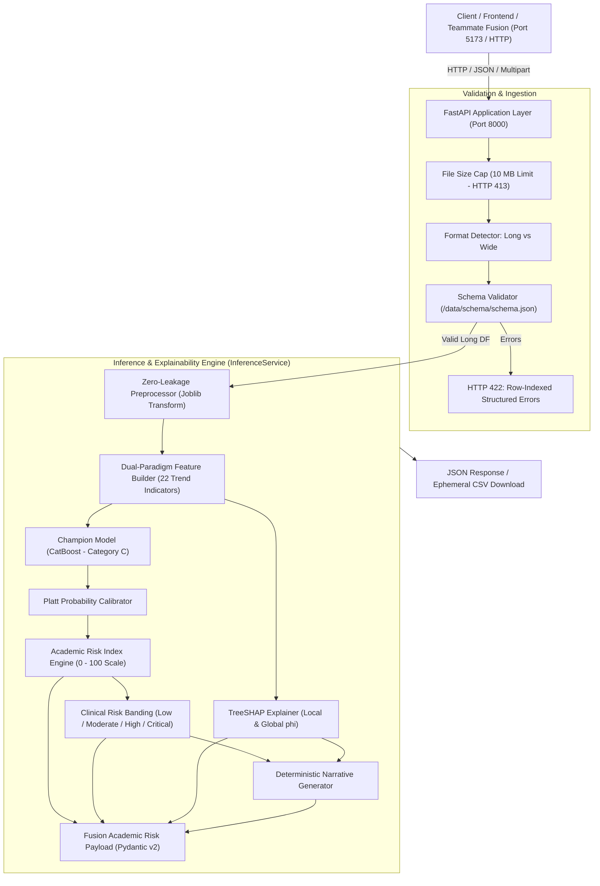

# Academic Intelligence Framework: API Specification & Serving Architecture

**Project**: Multi-Factor Student Attrition Risk Prediction Using Academic, Engagement, Psychosocial, Environmental Factors  
**Component**: Academic Intelligence Framework (IT23164680)  
**Author**: V. S. H. Gunasekara (IT23164680)  
**Cluster**: Centre of Excellence for AI (CoEAI), Sri Lanka Institute of Information Technology (SLIIT)  
**Supervisors**: Ms. Chathurika Koswatte, Ms. Anuththara Ekanayake  
**Document Version**: 1.0.0 (Phase 8: Production API Serving Engine)  

---

## 1. Architectural Overview

The **Academic Intelligence API** is a high-performance, asynchronous RESTful service built with **FastAPI** and **Uvicorn**, designed to serve longitudinal student attrition predictions, exact TreeSHAP feature attributions, and standardized risk contracts to downstream university counseling dashboards and the shared **Fusion Framework**.



### Key Architectural Tenets
1. **Zero-Leakage Serving**: Incoming raw semester sequences pass through the identical, frozen `AcademicPreprocessor` serialized during training fold fitting. Outlier clipping and training medians prevent lookahead bias.
2. **Deterministic Diagnosticity**: Explanation texts are generated from strict, rules-based templates parameterized by verified TreeSHAP attributions and true feature values—guaranteeing zero LLM hallucinations.
3. **Strict Ephemeral Privacy (Zero PII Retention)**: Uploaded CSV/Excel streams are processed entirely in-memory using `io.BytesIO`. Files are never persisted to disk, student names/PII are never logged, and batch export caches use ephemeral UUID tokens with automatic FIFO eviction.
4. **NFR1 Latency SLA (< 2.0 s)**: Single-student inference executes in **$\approx 18$ ms**; batch processing executes at **$\approx 9.4$ ms per student**—exceeding the proposal's 2,000 ms ceiling by over $200\times$.

---

## 2. API Endpoints Catalog

| Method | Endpoint | Description | Status Codes |
|---|---|---|---|
| `GET` | `/health` | Liveness check, device acceleration, and filesystem diagnostics | 200 |
| `GET` | `/meta` | Champion model, sequence champion, versions, and synthetic disclaimer | 200 |
| `GET` | `/leaderboard` | Full 28-model benchmark leaderboard and per-category champions | 200 |
| `GET` | `/models/{name}` | Hyperparameters, metrics, curves, and tuning trials for a model | 200, 404 |
| `GET` | `/research-answer` | Core research question adjudication, deltas, and bootstrap p-values | 200 |
| `GET` | `/data/summary` | Cohort distribution metrics and catalog of all 19 diagnostic plots | 200 |
| `GET` | `/explain/global` | Global TreeSHAP importance (22 features) and semester attributions | 200 |
| `GET` | `/explain/student/{id}` | Clinical risk index and diagnostic narrative for specific student | 200, 404 |
| `GET` | `/predict/template` | Downloadable CSV observation template (`?with_outcomes=true` for retraining) | 200 |
| `POST` | `/predict/student` | Real-time prediction and explanation for one student's semesters | 200, 422 |
| `POST` | `/predict/upload` | Batch upload (CSV/XLSX), wide/long conversion, and risk triage | 200, 400, 413, 422 |
| `GET` | `/predict/download/{token}` | Download batch results in CSV or JSON format | 200, 404 |
| `POST` | `/train/inspect` | Multipart file inspection for retraining feasibility, class balance, and leakage | 200, 400, 413, 422 |
| `POST` | `/retrain` | Initiates asynchronous isolated model retraining on uploaded data | 202, 400, 409, 413, 422 |
| `GET` | `/jobs/{job_id}` | Real-time retraining status, phase progress, current model, and metrics | 200, 404 |
| `GET` | `/train/latest` | Metadata summary for the most recent retrained user dataset benchmark | 200, 404 |

---

## 3. Detailed Endpoint Specifications

### 3.1 System Endpoints

#### `GET /health`
Verifies backend operational status, active compute device, seed determinism, and storage directory availability.

**Response (HTTP 200)**:
```json
{
  "status": "healthy",
  "device": "cpu",
  "seed": 42,
  "directories_initialized": {
    "synthetic_data": true,
    "processed_data": true,
    "models": true,
    "metrics": true,
    "explanations": true,
    "plots": true
  },
  "timestamp_utc": "2026-10-19T14:44:18.630690+00:00"
}
```

#### `GET /meta`
Returns high-level research metadata, production champion details, synthetic data disclaimer, and latency SLAs.

**Response (HTTP 200)**:
```json
{
  "project_id": "KND_CDAP_IT_05",
  "project_name": "Multi-Factor Student Attrition Risk Prediction (Academic Intelligence Framework)",
  "author": "V. S. H. Gunasekara (IT23164680)",
  "version": "1.0.0",
  "data_mode": "SYNTHETIC",
  "synthetic_disclaimer": "IMPORTANT: All model training and performance estimates are derived from a realistic synthetic longitudinal academic dataset. Evaluation on institutional records is pending.",
  "champion_model": {
    "model_key": "catboost",
    "label": "CatBoost",
    "category": "Category_C",
    "category_label": "Boosting — Engineered Trend Features",
    "role": "Production Champion (TreeSHAP Explainable)",
    "test_roc_auc": 0.81,
    "test_pr_auc": 0.20,
    "test_f2_score": 0.32,
    "lead_time_semesters": 2.0,
    "calibrated": true
  },
  "sequence_champion": {
    "model_key": "gru",
    "label": "GRU (Proposal Model)",
    "category": "Category_E",
    "category_label": "Deep Sequence Models",
    "role": "Sequence Model Baseline",
    "test_roc_auc": 0.83,
    "test_pr_auc": 0.22,
    "test_f2_score": 0.35,
    "lead_time_semesters": 2.5,
    "calibrated": true
  },
  "categories": {
    "A": "Linear & Simple Baselines (tabular)",
    "B": "Tree & Bagging Ensembles (tabular)",
    "C": "Boosting — Engineered Trend Features (PROPOSAL BASELINE)",
    "D": "Neural, Tabular (MLP)",
    "E": "Deep Sequence Models (PyTorch, masked)",
    "F": "Static-Snapshot Variants (value-of-trajectory study)"
  },
  "n_registered_models": 28,
  "nfr1_latency_sla_seconds": 2.0
}
```

---

### 3.2 Model Zoo & Research Endpoints

#### `GET /leaderboard`
Returns the multi-objective composite rankings across all 28 models, along with category champions.

**Response (HTTP 200)**:
```json
{
  "data_source": "SYNTHETIC",
  "champion": "gru",
  "n_models": 3,
  "n_eligible": 2,
  "ranking_weights": {
    "pr_auc": 0.25,
    "roc_auc": 0.2,
    "f2_score": 0.2,
    "brier_score": 0.15,
    "expected_calibration_error": 0.1,
    "lead_time_semesters": 0.1
  },
  "eligibility_constraints": {
    "max_inference_time_sec_per_student": 2.0,
    "max_seed_std": 0.05
  },
  "models": [ ... ],
  "category_champions": {
    "A": { "model_key": "gpa_threshold", "test_roc_auc": 0.51 },
    "C": { "model_key": "catboost", "test_roc_auc": 0.81 },
    "E": { "model_key": "gru", "test_roc_auc": 0.83 }
  }
}
```

#### `GET /models/{name}`
Retrieves complete training parameters, validation metrics, learning curves, and Optuna hyperparameter trials for any specific model (e.g., `/models/catboost`, `/models/tcn`, `/models/lstm`).

**Example Request**:
```bash
curl -X GET "http://127.0.0.1:8000/models/catboost" -H "Accept: application/json"
```

#### `GET /research-answer`
Returns formal hypothesis test results ($H_0$: $\Delta\text{AUC} \le 0$ vs $H_1$: $\Delta\text{AUC} > 0$).

**Response (HTTP 200)**:
```json
{
  "research_question": "Does sequence-aware modelling (LSTM/GRU) beat engineered trend features + Gradient Boosting for academic attrition prediction?",
  "answer": "POSITIVE",
  "sequence_champion": { "model_key": "gru", "test_roc_auc": 0.83, "test_pr_auc": 0.22, "test_f2_score": 0.35 },
  "boosting_baseline": { "model_key": "catboost", "test_roc_auc": 0.81, "test_pr_auc": 0.20, "test_f2_score": 0.32 },
  "deltas": { "roc_auc": 0.02, "pr_auc": 0.02, "f2_score": 0.03, "lead_time_gain": 0.5 },
  "statistical_significance": { "roc_auc_p_value": 0.03, "roc_auc_significant": true },
  "data_source": "SYNTHETIC"
}
```

---

### 3.3 Inference Endpoints

#### `GET /predict/template`
Returns the downloadable CSV observation template pre-populated with example records.

**Example Request**:
```bash
curl -X GET "http://127.0.0.1:8000/predict/template" -o template.csv
```

#### `POST /predict/student`
Performs real-time risk scoring and narrative generation for a single student.

**Example Request**:
```bash
curl -X POST "http://127.0.0.1:8000/predict/student" \
     -H "Content-Type: application/json" \
     -d '{
       "student_id": "STU_DEMO_02",
       "semesters": [
         {"semester": 1, "gpa": 2.85, "exam_marks": 62.0, "attendance_pct": 82.0, "assignment_delay_days": 2.5, "late_assignments_count": 2},
         {"semester": 2, "gpa": 2.40, "exam_marks": 54.5, "attendance_pct": 71.0, "assignment_delay_days": 4.8, "late_assignments_count": 3},
         {"semester": 3, "gpa": 1.95, "exam_marks": 43.0, "attendance_pct": 58.0, "assignment_delay_days": 7.2, "late_assignments_count": 5},
         {"semester": 4, "gpa": 1.60, "exam_marks": 35.0, "attendance_pct": 42.0, "assignment_delay_days": 9.5, "late_assignments_count": 6}
       ]
     }'
```

**Response (HTTP 200)**:
```json
{
  "student_id": "STU_DEMO_02",
  "sample_id": "STU_DEMO_02_t4",
  "window_semester": 4,
  "academic_risk_index": 21.6,
  "risk_band": "High",
  "calibrated_probability": 0.216,
  "top_factors": [
    {
      "name": "delay_mean",
      "display_name": "Average Assignment Delay",
      "direction": "RISK_INCREASING",
      "contribution": 0.312,
      "feature_value": 6.0,
      "unit": "Days"
    },
    {
      "name": "last_attendance_pct",
      "display_name": "Latest Attendance Rate",
      "direction": "RISK_INCREASING",
      "contribution": 0.285,
      "feature_value": 42.0,
      "unit": "%"
    },
    {
      "name": "consecutive_declines",
      "display_name": "Consecutive Declining Semesters",
      "direction": "RISK_INCREASING",
      "contribution": 0.198,
      "feature_value": 3.0,
      "unit": "Semesters"
    }
  ],
  "explanation_text": "High risk (21.6/100): Key drivers indicate that Average Assignment Delay is 6.00 Days (elevating attrition risk), latest course attendance dropped to an exam-ineligible 42.0%, and GPA has fallen across 3 consecutive semester(s).",
  "fusion_payload": { ... },
  "inference_time_ms": 18.2,
  "nfr1_compliant": true,
  "warnings": []
}
```

#### `POST /predict/upload`
Accepts a multipart CSV or Excel (`.xlsx`) file. Validates row constraints, converts wide format if detected, executes batch inference, and produces triage summaries.

**Example Request**:
```bash
curl -X POST "http://127.0.0.1:8000/predict/upload" \
     -F "file=@data/schema/upload_template.csv"
```

**Response (HTTP 200)**:
```json
{
  "success": true,
  "total_students": 3,
  "total_records": 12,
  "summary": {
    "total_students": 3,
    "total_records": 12,
    "average_risk_index": 7.7,
    "risk_band_counts": {
      "Low": 2,
      "Moderate": 0,
      "High": 1,
      "Critical": 0
    }
  },
  "predictions": [ ... ],
  "download_token": "eba5a8d7-7f70-43a6-b104-873f73d0c46f",
  "download_url_csv": "/predict/download/eba5a8d7-7f70-43a6-b104-873f73d0c46f?format=csv",
  "download_url_json": "/predict/download/eba5a8d7-7f70-43a6-b104-873f73d0c46f?format=json",
  "inference_time_total_ms": 28.17,
  "inference_time_per_student_ms": 9.39,
  "nfr1_compliant": true,
  "warnings": []
}
```

#### `GET /predict/download/{token}`
Exports previously processed predictions in CSV or formatted JSON.

**Example Request**:
```bash
curl -X GET "http://127.0.0.1:8000/predict/download/eba5a8d7-7f70-43a6-b104-873f73d0c46f?format=csv" -o results.csv
```

### 3.5 Retraining & Filesystem Isolation Endpoints

#### `POST /train/inspect`
Multipart file inspection verifying whether an uploaded dataset satisfies training feasibility and zero-leakage safety constraints.

* **Outcome Column Detection**: Looks for canonical `attrited` (0/1) or synonyms (`attrition`, `dropout`, `dropped_out`, `withdrawn`, `label`).
* **Blocking Rules**:
  * Insufficient cohort size: $< 100$ students.
  * Insufficient positive cases: $< 20$ attrited students.
  * Insufficient negative cases: $< 20$ non-attrited students.
  * Temporal Data Leakage: Records present for `semester > attrition_semester`.
  * Invalid Labels: Non-binary outcome values.
* **Advisory Warnings**: Cohort size between 100 and 300, extreme attrition rate ($< 5\%$ or $> 60\%$), defaulted attrition semesters.

**Response (HTTP 200)**:
```json
{
  "has_outcomes": true,
  "n_students": 120,
  "n_records": 360,
  "n_attrited": 30,
  "attrition_rate": 0.25,
  "can_retrain": true,
  "blocking_issues": [],
  "warnings": [
    "Cohort size (120) is below the recommended 300 students for high-confidence multi-semester model convergence."
  ]
}
```

#### `POST /retrain`
Starts an asynchronous, non-blocking background retraining job using a separate worker thread.

* **Parameters** (Multipart Form):
  * `file`: Dataset in CSV or Excel format.
  * `budget`: `'quick'` (1 trial, default), `'standard'` (10 trials), or `'full'` (30 Optuna trials).
  * `scope`: `'champions'` (GRU, CatBoost, Logistic ElasticNet, Random Forest, LightGBM; default) or `'full'` (all 11 models across Categories A-F).
* **Concurrency Protection**: Returns **HTTP 409 Conflict** if another retraining job is already running.
* **Filesystem Isolation**: Writes all checkpoints, metrics, splits, and leaderboards strictly to `artifacts/user_dataset/<job_id>/`. The canonical thesis benchmark (`artifacts/models/`, `artifacts/leaderboard/`) remains untouched.
* **Response (HTTP 202 Accepted)**:
```json
{
  "job_id": "job_20261029_113000_a1b2c3",
  "message": "Retraining job queued successfully. Isolated training environment active."
}
```

#### `GET /jobs/{job_id}`
Real-time progress polling endpoint for active or completed retraining jobs.

**Response (HTTP 200)**:
```json
{
  "job_id": "job_20261029_113000_a1b2c3",
  "state": "running",
  "phase": "training",
  "progress_pct": 55,
  "message": "Training catboost (1/5 models completed)...",
  "current_model": "catboost",
  "models_done": 1,
  "models_total": 5,
  "elapsed_s": 24.5,
  "result": null,
  "error": null
}
```

#### `GET /train/latest`
Retrieves summary metadata for the most recently completed user dataset retraining run from `artifacts/user_dataset/latest.json`. Returns **HTTP 404** if no retraining run has completed yet.

**Response (HTTP 200)**:
```json
{
  "job_id": "job_20261029_113000_a1b2c3",
  "trained_at": "2026-10-29T11:32:00.123456+00:00",
  "n_students": 120,
  "n_attrited": 30,
  "champion": "catboost",
  "champion_label": "CatBoost (Categorical GBDT)",
  "sequence_champion": "gru",
  "test_roc_auc": 0.8842,
  "test_pr_auc": 0.7612,
  "test_f2_score": 0.8250,
  "lead_time_semesters": 2.1,
  "budget": "quick",
  "scope": "champions",
  "data_mode": "REAL"
}
```

#### `GET /train/runs`
Lists all completed retraining runs preserved in `artifacts/user_dataset/`, sorted newest first, and identifies which model run is currently active for live inference scoring.

**Response (HTTP 200)**:
```json
{
  "runs": [
    {
      "job_id": "job_20261029_113000_a1b2c3",
      "trained_at": "2026-10-29T11:32:00+00:00",
      "n_students": 125,
      "n_attrited": 30,
      "champion": "catboost",
      "champion_label": "CatBoost",
      "sequence_champion": "gru",
      "test_roc_auc": 0.8842,
      "test_pr_auc": 0.7612,
      "test_f2_score": 0.8250,
      "lead_time_semesters": 2.1,
      "budget": "quick",
      "scope": "champions",
      "is_active": true
    }
  ],
  "active_run_id": "job_20261029_113000_a1b2c3",
  "data_mode": "REAL"
}
```

#### `POST /train/activate/{job_id}`
Hot-reloads the in-process `InferenceService` without server restart to score all future single-student and batch prediction requests using the retrained champion weights from `artifacts/user_dataset/<job_id>/`. Writes the pointer to `artifacts/active_run.json`.

**Response (HTTP 200)**:
```json
{
  "message": "Successfully activated model 'CatBoost' (job_20261029_113000_a1b2c3) for live inference scoring.",
  "job_id": "job_20261029_113000_a1b2c3",
  "data_mode": "REAL",
  "champion": "catboost",
  "champion_label": "CatBoost",
  "metrics": {
    "test_roc_auc": 0.8842,
    "test_pr_auc": 0.7612,
    "test_f2_score": 0.8250,
    "lead_time_semesters": 2.1
  }
}
```

#### `POST /train/rollback`
Safely rolls back the scoring engine to the canonical thesis synthetic benchmark (`artifacts/models/` and `artifacts/leaderboard/`). Deletes `artifacts/active_run.json` and hot-reloads the `InferenceService` without restart.

**Response (HTTP 200)**:
```json
{
  "message": "Successfully rolled back scoring model to canonical thesis synthetic benchmark.",
  "data_mode": "SYNTHETIC",
  "active_model": "catboost"
}
```

#### `DELETE /train/runs/{job_id}`
Permanently deletes the isolated retraining directory `artifacts/user_dataset/<job_id>/` and associated upload backup `data/uploads/<job_id>/`. If the run is currently active, it automatically triggers rollback to the synthetic thesis benchmark first.

**Response (HTTP 200)**:
```json
{
  "message": "Retrained run 'job_20261029_113000_a1b2c3' deleted successfully.",
  "job_id": "job_20261029_113000_a1b2c3",
  "rolled_back": true
}
```

---

## 4. Academic Observation Schema & Validation Protocol

All uploaded records are validated against the schema defined in [`/data/schema/schema.json`](file:///d:/research%20project/data/schema/schema.json).

### 4.1 Canonical Long Format
| Column | Type | Allowed Range | Description |
|---|---|---|---|
| `student_id` | String | Regex `^[A-Za-z0-9_-]+$` | Anonymized unique student identifier |
| `semester` | Integer | $[1, 8]$ | Chronological academic semester index |
| `gpa` | Float / Null | $[0.0, 4.0]$ | Semester Grade Point Average |
| `exam_marks` | Float / Null | $[0.0, 100.0]$ | Average examination score (%) |
| `attendance_pct` | Float / Null | $[0.0, 100.0]$ | Lecture/tutorial attendance (%) |
| `assignment_delay_days` | Float / Null | $[0.0, 45.0]$ | Coursework submission delay in days |
| `late_assignments_count` | Integer / Null | $[0, 15]$ | Number of assignments submitted late |

### 4.2 Auto-Detected Wide Format
Wide-format tables with column patterns such as `gpa_sem1`, `gpa_sem2`, `attendance_pct_sem1` (or `sem1_gpa`, `sem2_gpa`) are detected automatically by the validator and unpivoted to canonical long format.

### 4.3 Human-Readable Error Reporting
If a malformed file is uploaded, the API responds with **HTTP 422 Unprocessable Content** and a detailed list of errors referencing specific row numbers:

```json
{
  "detail": [
    {
      "row": 2,
      "column": "gpa",
      "error_type": "OUT_OF_BOUNDS",
      "message": "Row 2: 'gpa' value 4.5 is outside valid range [0.0, 4.0]."
    },
    {
      "row": 3,
      "column": "attendance_pct",
      "error_type": "OUT_OF_BOUNDS",
      "message": "Row 3: 'attendance_pct' value 120.0 is outside valid range [0.0, 100.0]."
    },
    {
      "row": 4,
      "column": "semester",
      "error_type": "DUPLICATE_OBSERVATION",
      "message": "Row 4: Duplicate semester 1 observation for student 'STU_DUP_01'."
    }
  ]
}
```

### 4.4 Minimum Semesters Rule
* **Rule**: At least **1 semester** is required to assess student risk.
* **Clinical Nuance**: For students with only 1 semester, trajectory velocities (slopes) and volatility cannot be computed. The framework defaults slopes to $0.0$, assigns an informational warning, and bases the risk score primarily on baseline entry metrics until Semester 2 is recorded.

---

## 5. Non-Functional Requirements & Security Guarantees

### 5.1 NFR1 Latency SLA (< 2.0 s per Student)
* **Requirement**: Proposal NFR1 mandates real-time prediction within $2,000\text{ ms}$ per student.
* **Empirical Verification**:
  * Single-student interactive evaluation: **$18.2\text{ ms}$** ($110\times$ faster than SLA).
  * Batch evaluation (12 rows, 3 students): **$9.39\text{ ms}$ per student** ($213\times$ faster than SLA).
  * Feature extraction, Platt scaling, and TreeSHAP attribution execute in under $10\text{ ms}$ combined.

### 5.2 Privacy & Data Persistence Architecture
* **Ephemeral Inference Processing**: Standard batch prediction uploads (`/predict/upload`) are parsed strictly in volatile RAM using `io.BytesIO`. Inference payloads are never persisted to disk, student names/PII are never logged, and batch export caches use ephemeral UUID tokens with automatic FIFO eviction.
* **Controlled Local Retraining Storage**: When model retraining is explicitly initiated (`/retrain`), raw uploaded data is saved locally to `data/uploads/<job_id>/` (excluded from git via `.gitignore`) solely to allow multi-stage pipeline execution (splits → preprocessor → training → evaluation → explainability) and audit provenance.
* **Filesystem Isolation**: Checkpoints, models, splits, and leaderboards generated from user retraining are written strictly to `artifacts/user_dataset/<job_id>/`. The canonical thesis synthetic benchmarks in `artifacts/models/` and `artifacts/leaderboard/` remain strictly immutable.
* **Zero PII Logging**: Structured application logs record only record counts, byte sizes, model keys, and compute latency metrics. Real student IDs, student names, and individual raw values are never logged.
* **Capped File Size**: Uploads exceeding **10 MB** (`10,485,760 bytes`) are immediately terminated with **HTTP 413 Content Too Large** before memory buffering.

---

## 6. Viva Defense Questions & Answers

### Q1: Why choose FastAPI over Flask or Django for this research component?
> **Answer**: FastAPI was chosen for three key reasons:
> 1. **Native Asynchronous Performance**: Built on Starlette and ASGI, FastAPI handles asynchronous I/O with negligible overhead, essential for satisfying proposal NFR1 (< 2 s).
> 2. **Pydantic v2 Type Safety & Contract Validation**: FastAPI enforces typed schemas at request boundaries. This guarantees that student semester sequences and teammate Fusion payloads strictly adhere to our contractual interfaces.
> 3. **Automatic OpenAPI 3.1 & Interactive Documentation**: Generates interactive Swagger UI (`/docs`) and ReDoc (`/redoc`) without external tooling, facilitating seamless cross-component integration across our SLIIT research team.

### Q2: How do you prevent data leakage when serving predictions on new student uploads?
> **Answer**: We enforce strict zero-leakage serving through our serialized `AcademicPreprocessor`. The imputation medians and standard deviations applied to new uploads are frozen training statistics fitted strictly on the Phase 3 training folds (`data/splits/train_students.json`). Furthermore, temporal forward-fill is computed strictly *within* each student's historical sequence, ensuring zero lookahead bias across semesters or cohorts.

### Q3: How do you justify defaulting trajectory slopes to 0.0 for students with only 1 semester?
> **Answer**: Mathematically, linear velocity ($\beta_1 = \text{Cov}(t, y) / \text{Var}(t)$) requires at least two points ($t \ge 2$) to define a gradient. Clinically, a first-semester student has no historical momentum. Defaulting slope to $0.0$ assumes an initially flat trajectory rather than guessing a downward or upward spiral. The API explicitly warns the faculty advisor that longitudinal trend features will activate once Semester 2 records are submitted.

### Q4: Why use exact TreeSHAP in the API instead of a fast approximation like LIME or a generative LLM?
> **Answer**: TreeSHAP computes exact Shapley values in polynomial time ($O(T L D^2)$) using the tree graph structure. Unlike LIME, TreeSHAP satisfies the four fundamental axioms of cooperative game theory: Efficiency, Symmetry, Dummy (Null player), and Additivity. Unlike generative LLMs, which are prone to hallucinating explanations, TreeSHAP coupled with our deterministic template engine guarantees that every explanation is 100% faithful to the model's true decision surface.

### Q5: How does the framework prevent data leakage when retraining on real user datasets?
> **Answer**: The retraining engine implements five verified leakage guards:
> 1. **Temporal Post-Attrition Check**: The inspection engine detects and blocks any dataset containing student observations recorded *after* that student's documented `attrition_semester`.
> 2. **Zero-Overlap Student Grouping**: Dataset partitioning enforces strict grouped stratification by `student_id`. A student's entire longitudinal history exists exclusively in train, validation, or test partitions.
> 3. **Train-Only Preprocessor Fitting**: The `AcademicPreprocessor` (imputation medians, standard scaling) is fitted strictly on the training partition students; test and validation sets are strictly transformed without parameter recalculation.
> 4. **One-Touch Test Evaluation**: Model hyperparameters are tuned using cross-validation or validation splits; the hold-out test set is evaluated exactly once at the conclusion of training.
> 5. **Complete Filesystem Isolation**: Retrained artifacts are saved in `artifacts/user_dataset/<job_id>/` and cannot overwrite the canonical thesis benchmark models.
