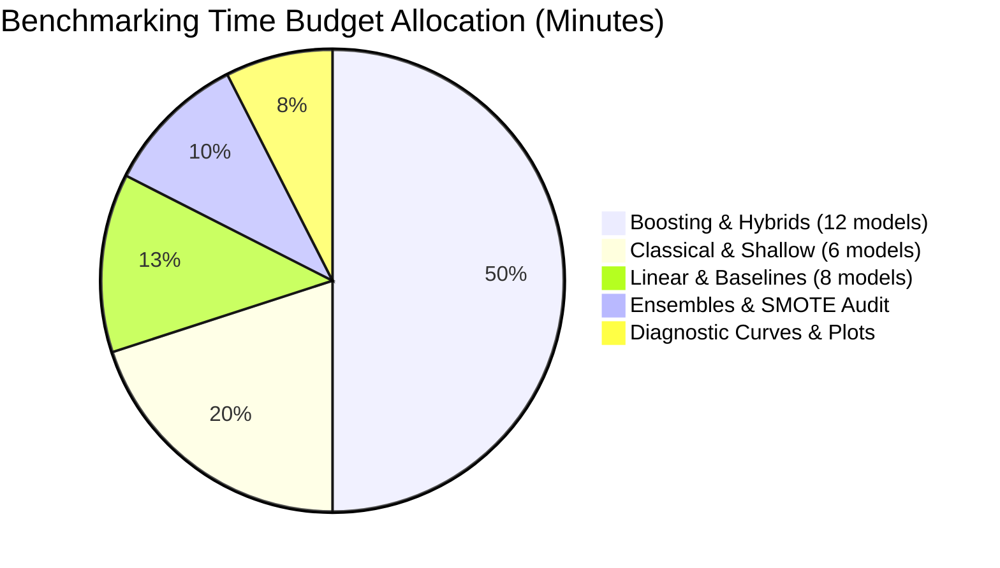

# Model Zoo: Comprehensive Taxonomy of MEI Classification Architectures

> **Document ID**: `DOC-MEI-07`  
> **Phase**: Phase 6 — Classification Model Zoo Benchmarking  
> **Status**: Completed  
> **Authors**: Senior ML Engineer & Benchmarking Lead  
> **Target Audience**: Technical reviewers, ML auditors, higher-education data scientists, academic leaders  

---

## 1. Executive Summary & Architectural Taxonomy

The **Multimodal Student Engagement Intelligence (MEI)** component benchmarks 28 distinct classification architectures to predict student attrition risk ($y \in \{0, 1\}$) from longitudinal self-report survey indicators across four 4-week academic periods ($T_1, T_2, T_3, T_4$). 

To satisfy Global Rule **G8**, every model in the zoo is documented with:
1. Mathematical formulation and algorithmic mechanics.
2. Distinct strengths and theoretical justification for survey-based early warning systems.
3. Known failure modes, inductive biases, and overfitting risks.
4. Key hyperparameter search spaces with plain-language definitions.
5. An intuitive **"Explain Like I Am 5" (ELI5)** analogy suitable for non-technical academic stakeholders.

```mermaid
flowchart TD
    subgraph Model Zoo [28 Candidate Classifiers across 6 Families]
        B[1. Baselines (3)]
        L[2. Linear Models (5)]
        C[3. Classical / Shallow (6)]
        T[4. Boosting & Tree Ensembles (7)]
        H[5. Proposed Hybrids (5)]
        E[6. Ensembles & Stacking (2)]
    end

    FS_single[Feature Set: single_signal (4)] --> B
    FS_agg[Feature Set: agg (100)] --> L
    FS_agg --> C
    FS_agg --> T
    FS_states[Feature Set: agg_states (126)] --> H
    OOF_probs[Out-of-Fold Predictions] --> E
```

---

## 2. Category 1: Baseline Benchmarks

Baseline models define the minimum acceptable performance floor. Any candidate ML model deployed in production must significantly outperform these baselines across all primary metrics.

### 2.1 Single-Signal Logistic Regression (`single_signal_lr`)
* **Feature Set**: `single_signal` (4 columns: `resource_access_p1` to `resource_access_p4`).
* **Description**: A regularized logistic regression trained exclusively on online material access frequency, simulating legacy institutional early-warning systems that monitor LMS login clicks.
* **Mathematical Formulation**:
  $$P(\text{at\_risk} = 1 \mid \mathbf{x}) = \sigma\left(w_0 + \sum_{t=1}^4 w_t \cdot \text{resource\_access\_p}t\right)$$
* **Strengths**: Lightweight, zero latency, transparent coefficients, requires only 4 survey items.
* **Weaknesses**: Ignores study time, assignments, quiz practice, self-regulation, and longitudinal momentum. Confounds passive material downloads with active cognitive engagement.
* **ELI5**: *"Judging whether a student will pass solely by checking how many times they opened their textbook, completely ignoring whether they actually read it or did their homework."*

### 2.2 Majority Class Dummy Classifier (`majority_dummy`)
* **Description**: Predicts the empirical cohort prevalence ($\hat{P}(y=1) \approx 0.25$) without using features.
* **Strengths**: Baseline calibration benchmark. Produces AUC-ROC $= 0.50$ and balanced accuracy $= 0.50$.
* **Weaknesses**: Zero discriminatory power; assigns identical probabilities to all students.
* **ELI5**: *"Guessing that every single student has a 25% chance of dropping out, without even looking at their names or grades."*

### 2.3 Rule Login Imitation Classifier (`rule_login_imitation`)
* **Description**: Deterministic heuristic flag: predicts high risk whenever a student's mean resource access code drops below $2.0$ (less than 2 days per week).
* **Strengths**: Deterministic, easily implemented in SQL or Excel without ML infrastructure.
* **Weaknesses**: Produces high false-positive rates for independent self-study learners who rely on offline printed materials.
* **ELI5**: *"A blunt rule that sounds an alarm if a student logs into the portal fewer than twice a week, even if they attend every lecture in person."*

---

## 3. Category 2: Linear Classifiers

Linear models establish whether the relationship between longitudinal engagement dynamics and attrition risk is primarily additive on the log-odds scale.

### 3.1 Logistic Regression ($L_2$ Ridge) (`logistic_regression_l2`)
* **Feature Set**: `agg` (100 standardized features).
* **Objective Function**:
  $$\min_{\mathbf{w}, b} \left[ -\frac{1}{N}\sum_{i=1}^N \left( y_i \log \hat{p}_i + (1 - y_i) \log (1 - \hat{p}_i) \right) + \frac{1}{2C} \|\mathbf{w}\|_2^2 \right]$$
* **Strengths**: Convex optimization with unique global minimum; well-calibrated posterior probabilities; odds ratios provide direct interpretability for advisors.
* **Weaknesses**: Cannot capture non-linear tipping points or multi-indicator synergies without manual interaction terms.
* **Key Hyperparameters**:
  * `C`: Inverse regularization strength. Smaller values enforce heavier shrinkage, preventing overfitting on collinear indicators.
* **ELI5**: *"A balance scale where every engagement habit has a fixed weight. Dropping study time adds penalty points; consistent practice removes them. If the scale tips past the line, the alarm sounds."*

### 3.2 Logistic Regression (Elastic-Net) (`logistic_regression_elasticnet`)
* **Description**: Regularized logistic regression combining $L_1$ sparsity with $L_2$ group selection:
  $$\min_{\mathbf{w}, b} \left[ \mathcal{L}(\mathbf{w}, b) + \alpha \cdot \text{l1\_ratio} \|\mathbf{w}\|_1 + \frac{\alpha (1 - \text{l1\_ratio})}{2} \|\mathbf{w}\|_2^2 \right]$$
* **Strengths**: Simultaneously performs automatic feature selection ($L_1$) while preserving correlated indicator groups ($L_2$).
* **Weaknesses**: Sensitive to standardization scale; requires coordinate descent tuning.
* **Key Hyperparameters**:
  * `C`: Regularization intensity ($1/\alpha$).
  * `l1_ratio`: Balance between LASSO ($1.0$) and Ridge ($0.0$).
* **ELI5**: *"Like a strict financial auditor who cuts out redundant metrics entirely, but keeps closely knit teams of numbers working together."*

### 3.3 Linear Support Vector Machine (`linear_svm_calibrated`)
* **Description**: Max-margin linear hyperplane optimized with hinge loss, calibrated post-fit via Platt scaling (sigmoid calibration on CV validation folds).
* **Strengths**: Robust to non-Gaussian feature outliers; focuses strictly on margin-support students near the risk boundary.
* **Weaknesses**: Uncalibrated raw decision function scores requires post-hoc Platt calibration.
* **ELI5**: *"Drawing a wide highway between passing and at-risk students, ensuring the boundary stays as far away from borderline students as possible."*

### 3.4 Ridge Classifier (`ridge_calibrated`)
* **Description**: Minimizes mean squared error treating binary labels as $\{-1, +1\}$, followed by Platt probability calibration.
* **Strengths**: Closed-form analytic solution; highly computationally efficient.
* **Weaknesses**: Assumes squared error loss which penalizes over-confident correct predictions.
* **ELI5**: *"Treating risk like a temperature thermometer and drawing the threshold line where the average error is smallest."*

### 3.5 Linear Discriminant Analysis (`lda`)
* **Description**: Generative linear model assuming normal class-conditional feature distributions with a shared covariance matrix $\mathbf{\Sigma}$.
* **Strengths**: Closed-form estimation; requires zero hyperparameter tuning; optimal when features satisfy normality.
* **Weaknesses**: Degrades if class covariance matrices differ significantly or if ordinal survey distributions deviate from multivariate normality.
* **ELI5**: *"Looking at the average shape and spread of happy students versus struggling students, and drawing the mathematical midpoint between them."*

---

## 4. Category 3: Classical & Shallow Classifiers

### 4.1 $k$-Nearest Neighbors (`knn`)
* **Description**: Non-parametric instance-based classification calculating the majority vote or distance-weighted vote among the $k$ closest students in Euclidean feature space.
* **Strengths**: Captures complex non-linear cluster boundaries without distributional assumptions.
* **Weaknesses**: Severe curse of dimensionality on 100 features; slow inference scaling $\mathcal{O}(N \cdot D)$.
* **Key Hyperparameters**:
  * `n_neighbors`: Neighborhood size $k$.
  * `weights`: `uniform` vs `distance`.
* **ELI5**: *"Looking at the 15 past students whose engagement patterns look almost identical to yours, and seeing how many of them ended up dropping out."*

### 4.2 Gaussian Naive Bayes (`gaussian_nb`)
* **Description**: Generative classifier applying Bayes' theorem under the assumption that all 100 features are mutually conditionally independent given the risk class.
* **Strengths**: Fast $\mathcal{O}(N \cdot D)$ training; handles small sample sizes well.
* **Weaknesses**: Extreme independence violation on correlated longitudinal indicators (e.g., $E_1..E_4$) produces over-confident, poorly calibrated probability estimates.
* **ELI5**: *"Assuming every clue is completely unrelated to every other clue—like assuming missing homework has nothing to do with skipping class."*

### 4.3 Decision Tree Classifier (`decision_tree`)
* **Description**: Recursive binary partitioning maximizing Gini impurity reduction or Shannon entropy gain.
* **Strengths**: 100% transparent visual flowchart; captures threshold interactions.
* **Weaknesses**: High variance; prone to overfitting on sample-specific noise without strict depth pruning.
* **Key Hyperparameters**:
  * `max_depth`: Maximum tree depth ($3 \dots 10$).
  * `min_samples_leaf`: Minimum sample count in terminal leaves.
* **ELI5**: *"A flowchart of yes/no questions: Did study time fall by more than 2 hours? If yes, was quiz practice below 2 days? If yes, flag as high risk."*

### 4.4 Support Vector Machine ($RBF$ Kernel) (`svm_rbf`)
* **Description**: Projects standardized features into an infinite-dimensional reproducing kernel Hilbert space via the Gaussian radial basis function:
  $$K(\mathbf{x}, \mathbf{x}') = \exp(-\gamma \|\mathbf{x} - \mathbf{x}'\|^2)$$
* **Strengths**: Models intricate, non-linear engagement manifolds with high theoretical margin guarantees.
* **Weaknesses**: Requires Platt probability calibration; sensitive to hyperparameter combination $(C, \gamma)$.
* **Key Hyperparameters**:
  * `C`: Penalty on margin slack violations.
  * `gamma`: Kernel bandwidth controlling boundary smoothness.
* **ELI5**: *"Lifting every student into a higher mathematical dimension where curved clumps of struggling students can be sliced away with a clean flat sheet."*

### 4.5 Shallow Multi-Layer Perceptron (`mlp_shallow`)
* **Description**: Feed-forward artificial neural network with a single hidden layer of 32–64 ReLU units, optimized with Adam and $L_2$ weight regularization.
* **Strengths**: Learns non-linear composite feature representations directly from data.
* **Weaknesses**: Stochastic gradient descent optimization can get trapped in local minima; requires careful weight decay.
* **Key Hyperparameters**:
  * `hidden_layer_sizes`: Hidden layer neuron count.
  * `alpha`: $L_2$ weight regularization penalty.
* **ELI5**: *"A small web of 32 artificial brain cells that combine clues into intermediate signals before making a final risk prediction."*

### 4.6 Extra-Trees Classifier (`extra_trees`)
* **Description**: Extremely randomized tree ensemble where split cut-points are chosen completely at random for each candidate feature subset.
* **Strengths**: Extreme variance reduction; significantly faster tree building than Random Forest.
* **Weaknesses**: Slightly higher bias; less interpretable than single trees.
* **Key Hyperparameters**:
  * `n_estimators`: Ensemble tree count.
  * `max_depth`: Depth ceiling.
* **ELI5**: *"A committee of 100 fast-thinking judges who make random split guesses and average their final opinions to cancel out mistakes."*

---

## 5. Category 4: Boosting & Gradient Tree Ensembles

Tree boosting algorithms represent the empirical gold standard for heterogeneous tabular datasets, building trees sequentially to minimize pseudo-residuals.

### 5.1 Random Forest (`random_forest`)
* **Description**: Bagging ensemble of deep decision trees built on bootstrap samples with random feature subsampling ($\sqrt{D}$).
* **Strengths**: Extremely robust against overfitting; handles correlated features gracefully; provides Gini and permutation importance.
* **Weaknesses**: Memory-intensive; slower inference latency than linear models.
* **Key Hyperparameters**:
  * `n_estimators`: Number of decision trees.
  * `max_depth`: Depth limitation.
  * `min_samples_leaf`: Regularizing leaf size threshold.
* **ELI5**: *"A forest of 150 independent trees, each voting secretly on a student's risk. The majority vote wins, preventing any single eccentric tree from making a bad call."*

### 5.2 Gradient Boosting (Scikit-Learn) (`gradient_boosting`)
* **Description**: Sequential additive model fitting shallow regression trees to the negative gradient of the binary cross-entropy loss function.
* **Strengths**: High predictive accuracy; adaptive residual correction.
* **Weaknesses**: Sequential training cannot be fully parallelized across trees; prone to overfitting if learning rate is too high.
* **Key Hyperparameters**:
  * `n_estimators`: Boosting rounds.
  * `learning_rate`: Shrinkage parameter $\eta$.
  * `max_depth`: Individual tree depth ($3 \dots 5$).
* **ELI5**: *"A team of students solving a difficult math exam together sequentially. Student 2 focuses entirely on correcting Student 1's mistakes, Student 3 fixes Student 2's mistakes, and so on."*

### 5.3 HistGradientBoosting (`hist_gradient_boosting`)
* **Description**: Scikit-learn's LightGBM-inspired implementation binning continuous features into 256 discrete integer bins.
* **Strengths**: Accelerates split finding from $\mathcal{O}(N)$ to $\mathcal{O}(256)$; native missing value support.
* **Weaknesses**: Slight loss of numerical precision on fine-grained continuous features.
* **Key Hyperparameters**:
  * `max_iter`: Maximum boosting iterations.
  * `learning_rate`: Step size shrinkage.
  * `max_leaf_nodes`: Complexity limit per tree.
* **ELI5**: *"Sorting student numbers into 256 neat buckets before analyzing them, allowing the computer to run lightning fast without losing the big picture."*

### 5.4 XGBoost (`xgboost`)
* **Description**: Extreme Gradient Boosting utilizing exact second-order Taylor approximations of the loss function with built-in $L_1$ ($\alpha$) and $L_2$ ($\lambda$) tree complexity penalties:
  $$\mathcal{L}^{(t)} \approx \sum_{i=1}^N \left[ g_i f_t(\mathbf{x}_i) + \frac{1}{2} h_i f_t^2(\mathbf{x}_i) \right] + \gamma T + \frac{1}{2}\lambda \sum_{j=1}^T w_j^2$$
* **Strengths**: Exact Hessian curvature weighting; cache-aware block memory access; column and row subsampling.
* **Weaknesses**: Many interdependent hyperparameters requiring careful Bayesian optimization.
* **Key Hyperparameters**:
  * `n_estimators`: Tree count ($40 \dots 240$).
  * `learning_rate`: Shrinkage $\eta \in [0.02, 0.2]$.
  * `max_depth`: Depth limit ($3 \dots 6$).
  * `subsample`: Row subsampling ratio.
* **ELI5**: *"A formula-one racing engine for boosting that calculates not just which direction to steer, but how sharply the road curves ahead."*

### 5.5 LightGBM (`lightgbm`)
* **Description**: Fast gradient boosting using Gradient-based One-Side Sampling (GOSS), Exclusive Feature Bundling (EFB), and leaf-wise (best-first) tree growth.
* **Strengths**: Outstanding execution speed on CPU; leaf-wise growth achieves lower loss with fewer leaves; native categorical handling.
* **Weaknesses**: Leaf-wise growth can overfit on small sample sizes if `min_child_samples` is too low.
* **Key Hyperparameters**:
  * `num_leaves`: Primary complexity parameter ($15 \dots 63$).
  * `learning_rate`: Shrinkage.
  * `n_estimators`: Iteration count.
* **ELI5**: *"Growing branches only where the biggest errors are happening, rather than growing every branch evenly like standard trees."*

### 5.6 CatBoost (`catboost`)
* **Description**: Gradient boosting utilizing oblivious (symmetric) decision trees and ordered boosting to eliminate target leakage during gradient estimation.
* **Strengths**: Minimal hyperparameter tuning required; symmetric trees prevent overfitting and evaluate exceptionally fast at inference time.
* **Weaknesses**: Slower training per iteration due to ordered boosting calculations.
* **Key Hyperparameters**:
  * `iterations`: Boosting iterations ($50 \dots 250$).
  * `depth`: Symmetric tree depth ($3 \dots 7$).
  * `learning_rate`: Shrinkage.
* **ELI5**: *"Building perfectly balanced, symmetrical decision trees that evaluate rules in parallel like hardware circuits, preventing over-optimistic self-delusion."*

### 5.7 AdaBoost (`adaboost`)
* **Description**: Classic adaptive boosting sequentially up-weighting incorrectly classified instances using decision stumps (depth-1 trees).
* **Strengths**: Elegant theoretical foundation; minimal parameters.
* **Weaknesses**: Sensitive to mislabeled noise and outliers; less competitive than modern second-order gradient boosters.
* **Key Hyperparameters**:
  * `n_estimators`: Number of boosting stumps.
  * `learning_rate`: Weight update multiplier.
* **ELI5**: *"Focusing harder and harder on the hardest students to classify, like a teacher spending extra tutoring time with the most difficult questions."*

---

## 6. Category 5: Proposed Hybrid Models

The **Proposed Hybrid Architecture** represents the core methodological contribution of this research component. Each hybrid model evaluates on the expanded feature set `agg_states` (126 features), pairing an established classical or boosting classifier with the unsupervised latent state features discovered in Phase 5:
* **HMM Features**: Decoded latent states ($S_1 \dots S_4$), final state, expected dwell time, transition count, state posteriors, sequence log-likelihood.
* **Clustering Features**: Longitudinal cluster one-hot assignment and distance to cluster centroid.
* **Pattern & Level**: Categorical behavioral trajectory flags (Consistent, Declining, Improving, Sporadic) and overall engagement level.

To provide rigorous scientific ablation, **every hybrid model has an exact architectural twin** evaluated on `agg` (100 features without states):

| Hybrid Model (`agg_states`) | Twin Model (`agg`) | Architectural Family |
|:----------------------------|:-------------------|:---------------------|
| `xgboost_hybrid`            | `xgboost`          | Gradient Boosting    |
| `lightgbm_hybrid`           | `lightgbm`         | Gradient Boosting    |
| `catboost_hybrid`           | `catboost`         | Gradient Boosting    |
| `random_forest_hybrid`      | `random_forest`    | Bagging Ensemble     |
| `logistic_regression_hybrid`| `logistic_regression_l2` | Linear Model   |

* **Theoretical Advantage**: While boosting algorithms can theoretically infer non-linear step-downs, providing explicit temporal transition probabilities and continuous Markov likelihoods gives the trees direct access to global trajectory topology that would otherwise require deep tree splits to approximate.
* **ELI5**: *"Giving the classification model a cheat-sheet summary of the student's semester story ('This student was High in month 1 but steadily collapsed to Low by month 4') alongside the raw numbers."*

---

## 7. Category 6: Ensembles & Meta-Learning

### 7.1 Soft-Voting Ensemble (`voting_soft`)
* **Description**: Computes the unweighted arithmetic mean of out-of-fold predicted probabilities from the top 3 performing individual models across the leaderboard:
  $$\hat{P}_{\text{vote}}(y=1 \mid \mathbf{x}) = \frac{1}{3} \sum_{m=1}^3 \hat{P}_m(y=1 \mid \mathbf{x})$$
* **Strengths**: Variance reduction without risk of meta-overfitting; smooths calibration curves.
* **Weaknesses**: Fails if constituent models share identical systematic biases.
* **ELI5**: *"Taking the average confidence score from the top 3 best-performing AI advisors, ensuring no single advisor's bias dominates."*

### 7.2 Stacking Meta-Classifier (`stacking`)
* **Description**: Trains a constrained meta-learner ($L_2$-regularized Logistic Regression) strictly on the **out-of-fold predicted probabilities** of the top 5 models across the 15 CV folds:
  $$\hat{P}_{\text{stack}}(y=1 \mid \mathbf{x}) = \sigma\left(\beta_0 + \sum_{k=1}^5 \beta_k \cdot \hat{P}_k^{\text{OOF}}(\mathbf{x})\right)$$
* **Anti-Leakage Safeguard**: The meta-learner is never trained on in-sample predictions. Each fold's meta-features are generated exclusively by constituent models that did not see those validation students during training.
* **Strengths**: Optimal mathematical weighting of diverse model perspectives; discounts redundant or overconfident constituents.
* **Weaknesses**: Adds architectural complexity; requires serial pipeline execution.
* **ELI5**: *"A wise chief advisor who listens to 5 specialist advisors and learns through experience which specialists are most trustworthy in different situations."*

---

## 8. Hyperparameter Search Spaces & Budget Allocation

All models are tuned using **Optuna TPE (Tree-structured Parzen Estimator)** on Outer Fold 0 using 5-fold cross-validation. Tuning is constrained to adhere strictly to the 40-minute hardware budget on standard commodity hardware (8 GB RAM):



---

## 9. Model Zoo Summary Matrix

| Model ID | Category | Feature Set | Needs Scaler | Class Weights | Key Hyperparameter Sweep |
|:---|:---|:---|:---:|:---:|:---|
| `single_signal_lr` | baseline | `single_signal` | Yes | Yes | $C \in [0.01, 10.0]$ |
| `majority_dummy` | baseline | `agg` | No | No | Strategy (`prior`) |
| `rule_login_imitation` | baseline | `single_signal` | No | No | Threshold ($2.0$) |
| `logistic_regression_l2` | linear | `agg` | Yes | Yes | $C \in [0.001, 100.0]$ |
| `logistic_regression_elasticnet` | linear | `agg` | Yes | Yes | `l1_ratio` $\in [0.1, 0.9]$ |
| `linear_svm_calibrated` | linear | `agg` | Yes | Yes | $C \in [0.01, 10.0]$ |
| `ridge_calibrated` | linear | `agg` | Yes | Yes | $\alpha \in [0.1, 100.0]$ |
| `lda` | linear | `agg` | Yes | No | Solver (`lsqr`, `svd`) |
| `knn` | classical | `agg` | Yes | No | $k \in [3, 25]$ |
| `gaussian_nb` | classical | `agg` | Yes | No | `var_smoothing` |
| `decision_tree` | classical | `agg` | No | Yes | `max_depth` $\in [3, 10]$ |
| `svm_rbf` | classical | `agg` | Yes | Yes | $C \in [0.1, 50.0]$ |
| `mlp_shallow` | classical | `agg` | Yes | No | Hidden Units ($32, 64$) |
| `extra_trees` | classical | `agg` | No | Yes | `n_estimators` $\in [50, 200]$ |
| `random_forest` | boosting | `agg` | No | Yes | `max_depth` $\in [4, 16]$ |
| `gradient_boosting` | boosting | `agg` | No | No | `learning_rate` $\in [0.02, 0.2]$ |
| `hist_gradient_boosting` | boosting | `agg` | No | Yes | `max_iter` $\in [50, 200]$ |
| `xgboost` | boosting | `agg` | No | Yes | `max_depth` $\in [3, 7]$ |
| `lightgbm` | boosting | `agg` | No | Yes | `num_leaves` $\in [15, 63]$ |
| `catboost` | boosting | `agg` | No | Yes | `depth` $\in [3, 7]$ |
| `adaboost` | boosting | `agg` | No | No | `n_estimators` $\in [30, 150]$ |
| `xgboost_hybrid` | hybrid | `agg_states` | No | Yes | `max_depth` $\in [3, 7]$ |
| `lightgbm_hybrid` | hybrid | `agg_states` | No | Yes | `num_leaves` $\in [15, 63]$ |
| `catboost_hybrid` | hybrid | `agg_states` | No | Yes | `depth` $\in [3, 7]$ |
| `random_forest_hybrid` | hybrid | `agg_states` | No | Yes | `max_depth` $\in [4, 16]$ |
| `logistic_regression_hybrid` | hybrid | `agg_states` | Yes | Yes | $C \in [0.001, 100.0]$ |
| `voting_soft` | ensemble | `agg_states` | No | No | Top 3 Averaging |
| `stacking` | ensemble | `agg_states` | No | No | Logistic Regression Meta-Learner |

---

*This document defines the formal architectural blueprint for MEI Track A classification models. All quantitative evaluation results and empirical leaderboard scores are recorded in [docs/08_training_validation.md](docs/08_training_validation.md) and [docs/phase_reports/phase_06.md](docs/phase_reports/phase_06.md).*
