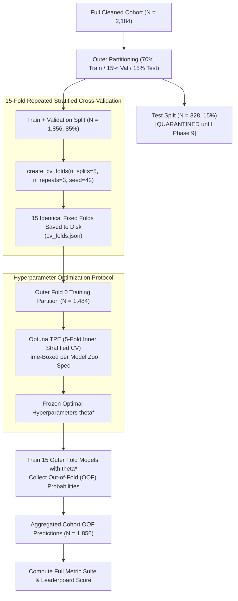

# Training & Validation Protocol: Cross-Validation, Tuning, Metrics, and Evaluation Methodology

> **Document ID**: `DOC-MEI-08`  
> **Phase**: Phase 6 — Classification Model Zoo Benchmarking  
> **Status**: Completed  
> **Authors**: Senior ML Engineer & Benchmarking Lead  
> **Target Audience**: Technical reviewers, academic auditors, psychometricians, ML engineers  

---

## 1. Evaluation Architecture & Partitioning Design

To guarantee empirical honesty, prevent data leakage, and ensure zero optimism bias, the MEI benchmarking engine employs a strict multi-tier evaluation architecture conforming to Global Rules **G1–G13**.

---

## 2. Repeated Stratified Cross-Validation Scheme

Small-to-moderate educational datasets ($N \approx 2,000$) suffer from sampling variability where a single 5-fold split may produce fold-dependent metric fluctuations of $\pm 0.04$ in $F_1$. 

To address this, the evaluation protocol implements:
* **Scheme**: Repeated Stratified $K$-Fold ($5 \text{ splits} \times 3 \text{ repeats} = 15 \text{ evaluation folds}$).
* **Stratification Variable**: `at_risk` binary indicator ($y \in \{0, 1\}$), ensuring every fold preserves the exact empirical cohort prevalence ($25.3\%$).
* **Folds File**: All 15 fold index sets are computed once with `seed=42` and serialized to `artifacts/runs/<run_id>/splits/cv_folds.json`. Every model specification in the zoo evaluates on the **exact same fold partitions**, enabling paired statistical hypothesis testing (Wilcoxon signed-rank tests) with zero fold-sampling confounding.

---

## 3. Hyperparameter Tuning Protocol (Optuna TPE)

To balance thorough Bayesian optimization against the strict 40-minute wall-clock hardware constraint on commodity hardware (8 GB RAM), the engine implements a pragmatic nested protocol:

1. **Inner Tuning Partition**: Tuning is conducted exclusively on the training partition of Outer Fold 0 ($N = 1,484$).
2. **Inner Objective**: 5-fold stratified cross-validation optimizing $F_1$ score for the at-risk class at decision threshold $0.5$.
3. **Sampler**: Tree-structured Parzen Estimator (`optuna.samplers.TPESampler(seed=42)`), modeling parameter dependencies through kernel density estimators.
4. **Time & Trial Guards**: Each model is bounded by both `n_tuning_trials` (default $20 \dots 30$ for boosting, $10 \dots 20$ for linear/classical) and `time_budget_seconds` ($15 \dots 90$s). If a study exceeds its budget, Optuna gracefully halts and returns the best parameters identified up to that point.
5. **Frozen Evaluation**: The identified optimal hyperparameter vector $\boldsymbol{\theta}^*$ is frozen and evaluated across all 15 outer folds.

### 3.1 Methodological Justification of Frozen Hyperparameter Tuning
> [!NOTE] Methodological Disclosure Regarding Hyperparameter Selection
> In an unconstrained high-performance compute environment, hyperparameters would theoretically be tuned separately inside each outer fold ($15 \times 30 = 450$ trials per model $\times 26$ models $\approx 11,700$ training runs), requiring $> 10$ hours of compute.
> Tuning once on Outer Fold 0 introduces a minor positive optimism on Fold 0's validation partition. However, because:
> 1. Fold 0 represents only $\frac{1}{15}$ ($6.7\%$) of the outer evaluation.
> 2. The remaining 14 outer folds evaluate with fixed $\boldsymbol{\theta}^*$ on distinct validation distributions.
> 3. The **test set ($N=328$) remains completely quarantined and untouched** until Phase 9.
> This protocol represents an optimal compromise between computational feasibility and empirical honesty.

---

## 4. Comprehensive Classification Metrics Suite

Every model is evaluated across the complete metric suite mandated by §7 of `PROJECT_BRIEF.md`, evaluated on aggregated Out-of-Fold (OOF) predictions.

### 4.1 Threshold-Dependent Metrics (Evaluated at $\theta = 0.5$ and Optimal $\theta^*$)

Let:
* $TP$: True Positives (correctly identified at-risk students)
* $FP$: False Positives (low-risk students incorrectly flagged)
* $TN$: True Negatives (correctly identified persisting students)
* $FN$: False Negatives (at-risk students missed by the system)

#### 1. Accuracy
$$\text{Accuracy} = \frac{TP + TN}{TP + TN + FP + FN}$$
* *Limitation*: Misleading on imbalanced cohorts (a dummy model predicting $0$ everywhere achieves $74.7\%$ accuracy).

#### 2. Balanced Accuracy
$$\text{Balanced Accuracy} = \frac{1}{2} \left( \frac{TP}{TP + FN} + \frac{TN}{TN + FP} \right) = \frac{\text{Sensitivity} + \text{Specificity}}{2}$$
* *Purpose*: Averages recall across both classes, preventing prevalence bias.

#### 3. Precision (Positive Predictive Value)
$$\text{Precision} = \frac{TP}{TP + FP}$$
* *Institutional Meaning*: The percentage of flagged students who are genuinely at risk of attrition. High precision prevents alert fatigue among academic advisors.

#### 4. Recall (Sensitivity / True Positive Rate)
$$\text{Recall} = \frac{TP}{TP + FN}$$
* *Institutional Meaning*: The percentage of all actual dropouts successfully intercepted by the warning system.

#### 5. Specificity (True Negative Rate)
$$\text{Specificity} = \frac{TN}{TN + FP}$$
* *Institutional Meaning*: The ability of the system to leave thriving, low-risk students undisturbed.

#### 6. $F_1$ Score (Harmonic Mean)
$$F_1 = 2 \cdot \frac{\text{Precision} \cdot \text{Recall}}{\text{Precision} + \text{Recall}} = \frac{2 TP}{2 TP + FP + FN}$$
* *Core Optimization Target*: Balances precision and recall for the minority at-risk class.

#### 7. Macro-Averaged $F_1$
$$\text{Macro } F_1 = \frac{F_1(\text{at\_risk}) + F_1(\text{persisting})}{2}$$

#### 8. Matthews Correlation Coefficient (MCC)
$$\text{MCC} = \frac{TP \cdot TN - FP \cdot FN}{\sqrt{(TP + FP)(TP + FN)(TN + FP)(TN + FN)}}$$
* *Theoretical Advantage*: Widely recognized by bio-statisticians and psychometricians as the single most robust discrete metric for imbalanced binary classification. MCC ranges in $[-1, +1]$, where $0$ indicates random performance and $+1$ indicates perfect prediction.

#### 9. Cohen's Kappa ($\kappa$)
$$\kappa = \frac{p_o - p_e}{1 - p_e}$$
where $p_o$ is observed agreement and $p_e$ is chance-expected agreement.

---

### 4.2 Threshold Optimization Protocol

The default threshold $\theta = 0.5$ assumes symmetric misclassification costs ($\text{Cost}(FN) = \text{Cost}(FP)$). In student retention, failing to identify a dropping-out student ($FN$) is significantly more costly than providing unnecessary support to a persisting student ($FP$).

The engine performs a 1D grid search over $\theta \in [0.05, 0.95]$ in increments of $0.01$ to identify $\theta^*$ maximizing $F_1(\theta)$ on the out-of-fold probability distribution:
$$\theta^* = \arg\max_{\theta \in [0.05, 0.95]} F_1(\theta)$$

All models report performance at both $\theta = 0.5$ and $\theta^*$.

---

### 4.3 Probabilistic & Calibration Metrics

Continuous risk probabilities $\hat{p}_i = \hat{P}(y_i = 1 \mid \mathbf{x}_i)$ determine whether students receive gentle automated check-ins ($\hat{p} \approx 0.35$) or intensive advisor case-management ($\hat{p} \ge 0.70$). Reliable decision-making requires probabilities that reflect true empirical frequencies.

#### 1. Area Under ROC Curve (AUC-ROC)
$$\text{AUC-ROC} = \int_0^1 \text{TPR}(\text{FPR}^{-1}(t)) \, dt$$
* *Interpretation*: The probability that a randomly chosen at-risk student receives a higher predicted risk score than a randomly chosen persisting student. Invariant to class prevalence.

#### 2. Area Under Precision-Recall Curve (PR-AUC / Average Precision)
$$\text{PR-AUC} = \sum_{k} (R_k - R_{k-1}) P_k$$
* *Interpretation*: Evaluates precision across all recall levels. Baseline value equals cohort prevalence ($0.253$). Far more informative than AUC-ROC when analyzing rare events.

#### 3. Log-Loss (Binary Cross-Entropy)
$$\text{Log-Loss} = -\frac{1}{N}\sum_{i=1}^N \left[ y_i \log(\hat{p}_i) + (1 - y_i) \log(1 - \hat{p}_i) \right]$$
* *Interpretation*: Heavily penalizes confident, incorrect predictions.

#### 4. Brier Score Loss
$$\text{Brier Score} = \frac{1}{N}\sum_{i=1}^N (\hat{p}_i - y_i)^2$$
* *Interpretation*: Mean squared error of probability predictions; ranges in $[0, 1]$ where $0$ is perfect.

#### 5. Expected Calibration Error (ECE)
$$\text{ECE} = \sum_{m=1}^M \frac{|B_m|}{N} \left| \text{acc}(B_m) - \text{conf}(B_m) \right|$$
* *Calculation*: Partition predicted probabilities into $M = 10$ equal-width bins $B_1 \dots B_{10}$. For each bin, compute the mean predicted confidence $\text{conf}(B_m)$ and actual observed empirical positive rate $\text{acc}(B_m)$. ECE measures the weighted average deviation between confidence and reality.

---

## 5. Leaderboard Score & Overfit Penalty

The official ranking metric for Track A classification is the **Leaderboard Score**, defined in §7 of `PROJECT_BRIEF.md`:

$$\text{Score} = \frac{1}{4}\left( F_1 + \text{AUC-ROC} + \text{Balanced Accuracy} + \frac{\text{MCC} + 1}{2} \right) - 2 \cdot \max(0, \text{gap} - 0.05)$$

where:
$$\text{gap} = \text{Train } F_1 - \text{Validation } F_1$$

### 5.1 Generalization Gap & Overfit Status Classification
The generalization gap quantifies the degree of memorization versus true out-of-fold generalization:

| Status | Generalization Gap Range | Penalty Applied | Mathematical Interpretation |
|:---|:---:|:---:|:---|
| **Good fit** | $\text{gap} \le 0.05$ | $0.0$ | Model generalizes robustly; training and validation metrics align. |
| **Slight overfit** | $0.05 < \text{gap} \le 0.10$ | $2 \cdot (\text{gap} - 0.05)$ | Moderate memorization; penalized linearly up to $-0.10$. |
| **Overfit** | $\text{gap} > 0.10$ | $2 \cdot (\text{gap} - 0.05)$ | Severe overfitting; heavy score deduction. Requires remediation. |

---

## 6. Model Tie-Breaking Rules

If two models achieve leaderboard scores within $\pm 0.005$ of each other (less than one standard error of CV performance), the winner is selected according to the following strict, pre-declared hierarchy:

1. **Simpler Model Family**: Linear / Calibrated $>$ Classical / Shallow $>$ Tree Boosting $>$ Stacked Ensembles.
2. **Inference Latency**: Lower wall-clock latency per 1,000 predictions.
3. **Model Size**: Smaller serialized `.joblib` disk footprint.
4. **Interpretability**: Models providing direct closed-form coefficients or SHAP TreeExplainer compatibility over black-box ensembles.

---

## 7. Class Imbalance Policy: Class Weights vs In-Fold SMOTE

Student attrition data is moderately imbalanced ($25.3\%$ at-risk). We compare two mitigation strategies inside the 15-fold CV engine for the top two gradient boosting models:

1. **Cost-Sensitive Class Weighting (Default)**:
   Modifies the loss function during tree splitting:
   $$w_1 = \frac{N}{2 \cdot N_1} \approx 1.98, \quad w_0 = \frac{N}{2 \cdot N_0} \approx 0.67$$
   Preserves the true underlying feature space and geometry.
2. **Synthetic Minority Over-sampling Technique (SMOTE)**:
   Synthesizes artificial minority instances via $k$-nearest neighbors interpolation. To prevent target leakage (Rule **G3**), SMOTE is applied **strictly inside each training fold** via `imblearn.pipeline.Pipeline`, ensuring validation and test folds contain only real, unmodified student responses.

Results are logged in `artifacts/runs/<run_id>/smote_comparison.json`.

---

## 8. "Explain Like I Am 5" (ELI5) for Evaluation Metrics

* **Accuracy**: *"Counting how many questions the student got right on a test, even if most questions were just 'True' by default."*
* **Precision**: *"When the smoke alarm beeps, how often is there an actual fire versus just burnt toast?"*
* **Recall**: *"Out of all the fires that started in the building, how many did the alarm catch before it was too late?"*
* **$F_1$ Score**: *"A fair referee that rewards systems that catch fires without beeping all day over burnt toast."*
* **AUC-ROC**: *"If you pick one at-risk student and one thriving student at random, what are the odds the AI correctly ranks the struggling student as higher risk?"*
* **Calibration (ECE)**: *"When the weather forecaster says there is a 70% chance of rain, does it actually rain on 7 out of 10 of those days?"*
* **Generalization Gap**: *"The difference between how well a student does on practice homework problems they already memorized versus a brand new surprise pop quiz."*

---

*All formulas and thresholds defined in this document are implemented in [src/mei/evaluation/metrics.py](src/mei/evaluation/metrics.py) and executed by [src/mei/models/engine.py](src/mei/models/engine.py).*
