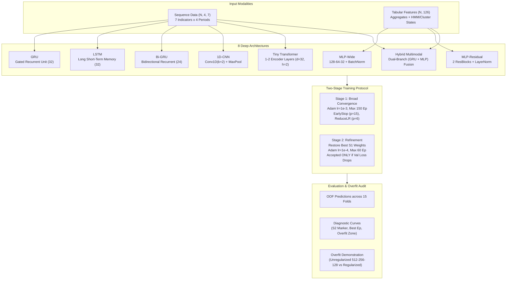

# Deep Learning Architectures and Overfitting Remediation (Track A, Part 2)

> **Module ID**: `DOC-09-DEEP-LEARNING`  
> **Status**: Verified Specification & Implementation  
> **Framework**: PyTorch 2.14.1 (CPU Backend)  
> **Input Modalities**: Longitudinal Multi-Indicator Sequences $(N, 4, 7)$ and Tabular Aggregates + Engagement State Features $(N, 126)$  
> **Evaluation Partition**: 15 CV Folds (Repeated Stratified 5-Fold $\times$ 3 Repeats, $N=1,856$ students, $25.3\%$ At-Risk Prevalence)

---

## 1. What It Is

The **Deep Learning Benchmarking Layer** evaluates eight specialized neural network architectures designed for small tabular and ultra-short sequence survey data. Unlike classical tree boosting algorithms, deep neural networks must be strictly regularized to prevent parameter memorization when learning from 1,856 student responses across four 4-week academic periods.

This module introduces a rigorous **Two-Stage Training Protocol** with early stopping, learning rate decay, Gaussian input noise, dropout, and $L_2$ weight penalty. It produces publication-grade learning curves capturing the exact epoch where training diverges into the "overfitting zone", establishing an empirical standard for research transparency.



---

## 2. Why We Do It

1. **Bridging the Sequence-Tabular Divide**: Survey responses contain both fixed aggregate statistics (e.g., semester study hours) and temporal trajectory vectors ($E_1 \to E_4$). Deep models can natively encode raw sequence dynamics without hand-crafted manual feature extraction.
2. **Honest Architectural Comparison**: In educational data mining, deep learning is frequently claimed to outperform tree ensembles without fair cross-validation or overfit audits. Benchmarking neural models against XGBoost, LightGBM, and CatBoost on identical 15 folds reveals whether sequence representations provide empirical gains.
3. **Overfitting Visibility**: Small tabular datasets ($N \approx 2,000$) are hazardous for deep networks. Visualizing the exact point of divergence between training loss and validation loss proves whether early stopping protected against generalization collapse.

---

## 3. The 8 Deep Architectures in Plain Words

| Architecture ID | Display Name | Plain English Analogy | Architectural Description | Primary Feature Set |
|:---|:---|:---|:---|:---:|
| `mlp_wide` | **Wide Multilayer Perceptron** | The Multi-Layer Committee | Dense(128)-BN-ReLU-Dropout $\to$ Dense(64)-BN-ReLU-Dropout $\to$ Dense(32)-BN-ReLU-Dropout $\to$ Linear(1). Batch normalization stabilizes internal covariate shift across heterogeneous survey scales. | `agg_states` ($D=126$) |
| `mlp_residual` | **Residual Multilayer Perceptron** | The Direct Shortcut Network | Linear projection to 64 dimensions followed by 2 skip-connected ResNet blocks with LayerNorm and Dropout. Residual paths ($x + F(x)$) ensure smooth gradient propagation. | `agg_states` ($D=126$) |
| `gru` | **Gated Recurrent Unit** | The Memory-Updated Scribe | Sequential GRU with hidden dimension 32 processing 4 time steps. Reset and update gates track how engagement shifts between consecutive 4-week periods. Output taken from the final time step $h_4$. | `sequence` $(4, 7)$ |
| `lstm` | **Long Short-Term Memory** | The Dual-Memory Ledger | Sequential LSTM with hidden dimension 32 maintaining separate hidden ($h_t$) and cell ($c_t$) states. Evaluates whether dedicated long-term cell memory aids 4-period trajectories. | `sequence` $(4, 7)$ |
| `bi_gru` | **Bidirectional GRU** | The Two-Way Time Traveler | Bidirectional GRU (hidden dimension 24 per direction) reading sequences chronologically ($P_1 \to P_4$) and retrospectively ($P_4 \to P_1$). Mean-pooled representations capture both onset drops and recovery. | `sequence` $(4, 7)$ |
| `cnn_1d` | **1D Temporal CNN** | The Local Pattern Scanner | Two 1D convolutional layers (kernel size 2, 32 filters) scanning adjacent period pairs ($P_1\text{--}P_2$, $P_2\text{--}P_3$, $P_3\text{--}P_4$) followed by global max-pooling to catch sudden drops. | `sequence` $(4, 7)$ |
| `tiny_transformer` | **Tiny Transformer Encoder** | The All-to-All Attention Engine | Linear token projection (dim 32) + learned positional embeddings, followed by 1–2 Transformer Encoder layers with 2 attention heads. Computes pair-wise temporal cross-attention across all periods. | `sequence` $(4, 7)$ |
| `hybrid_multimodal` | **Hybrid Multimodal Deep Model** | The Complete Behavioral Brain | Dual-branch network combining a sequential GRU branch (temporal sequence) with an MLP tabular branch (aggregate stats + HMM states), fused into a 16-dim representation head. | `sequence` + `agg_states` |

### Why Short Sequences ($T=4$) Favor Compact Inductive Biases
Sequence models in NLP and speech process hundreds of tokens where LSTMs and Transformers excel. In educational survey data, sequences have exactly **4 time steps** and **7 indicator dimensions**.
- In an ultra-short sequence, a standard Transformer or deep LSTM has vastly more capacity than the underlying signal requires.
- Complex gating structures (like LSTM cell state gates) risk memorizing noise rather than true latent behavioral decay.
- Smaller models with strong inductive biases (such as GRU and 1D-CNN) regularize naturally, converging faster and resisting catastrophic divergence.

---

## 4. The Two-Stage Training and Refinement Protocol

```
Stage 1: Broad Convergence (lr = 1e-3)
├── Max 150 Epochs, Batch Size 64
├── ReduceLROnPlateau (factor=0.5, patience=6)
├── EarlyStopping (patience=15, monitor=val_loss)
└── Checkpoint Best Weights (θ*_stage1)

Stage 2: Refinement / Fine-Tuning (lr = 1e-4)
├── Initialize from θ*_stage1
├── Max 60 Epochs, Patience 10
└── Decision Gate:
    ├── If val_loss < val_loss(θ*_stage1) → KEEP Stage 2, Mark "Stage 2 Refined"
    └── Else → REVERT to θ*_stage1, Mark "Stage 2 Not Used"
```

### Regularization Mechanisms Applied to All Models
1. **Gaussian Input Noise ($\sigma = 0.05$)**: Active strictly during `model.train()`. Injects small stochastic perturbations into continuous survey coordinates, preventing sharp decision boundary artifacts.
2. **$L_2$ Weight Decay ($10^{-4}$)**: Penalizes large Euclidean weight norms ($\frac{1}{2} \lambda \|\mathbf{w}\|_2^2$), discouraging individual feature dominance.
3. **Dropout ($0.10 \dots 0.40$)**: Randomly zeros out hidden units during forward passes, enforcing distributed representations across committee neurons.
4. **Cost-Sensitive Loss Weighting**: Implemented via PyTorch `BCEWithLogitsLoss(pos_weight=...)`, where:
   $$\text{pos\_weight} = \frac{N_{\text{majority}}}{N_{\text{minority}}} = \frac{N - N_{\text{at\_risk}}}{N_{\text{at\_risk}}} \approx 2.95$$
   Penalizes misclassifying an at-risk student $\approx 3\times$ higher than a safe student, directly addressing class imbalance without synthetic interpolation artifacts.

---

## 5. Mathematical Formulas

### 1. Weighted Binary Cross-Entropy Loss
For true binary label $y_i \in \{0, 1\}$ and network logit $z_i \in \mathbb{R}$:
$$\mathcal{L}_i(z_i, y_i) = - \left[ w_{\text{pos}} \cdot y_i \log(\sigma(z_i)) + (1 - y_i) \log(1 - \sigma(z_i)) \right]$$
where $\sigma(z) = \frac{1}{1 + e^{-z}}$ and $w_{\text{pos}} = \frac{\sum_{j=1}^N (1 - y_j)}{\sum_{j=1}^N y_j}$.

### 2. $L_2$ Regularized Objective
$$\mathcal{J}(\mathbf{W}) = \frac{1}{B} \sum_{i=1}^B \mathcal{L}_i(z_i, y_i) + \frac{\lambda}{2} \sum_{l=1}^L \|\mathbf{W}_l\|_F^2$$
where $\lambda$ is weight decay ($10^{-4}$) and $\|\cdot\|_F$ is the Frobenius norm.

### 3. Generalization Gap and Leaderboard Score
Identical to Phase 6:
$$\text{gap} = \text{Train } F_1 - \text{Val } F_1$$
$$\text{Penalty} = 2 \cdot \max(0, \text{gap} - 0.05)$$
$$\text{Leaderboard Score} = \frac{F_1 + \text{AUC} + \text{BalAcc} + \frac{\text{MCC} + 1}{2}}{4} - \text{Penalty}$$

### 4. Overfitting Zone Definition
The **Overfitting Zone** is defined as the set of contiguous epochs $t > t^*$ (where $t^*$ is the epoch of global minimum validation loss) satisfying:
$$\mathcal{L}_{\text{val}}(t) > 1.03 \cdot \mathcal{L}_{\text{val}}(t^*) \quad \text{and} \quad \mathcal{L}_{\text{train}}(t) \le \mathcal{L}_{\text{train}}(t^*)$$
This formally distinguishes healthy plateaus from destructive sample memorization.

---

## 6. How to Read the Diagnostic Training Curves

Every deep learning architecture generates a standardized two-panel publication graphic:
- **Left Panel (Loss Progression)**:
  - Solid Forest Green Line (`#1F4E46`): Training Loss.
  - Solid Warning Amber Line (`#C98A00`): Validation Loss across outer folds.
  - Blue Dashed Vertical Line (`--`): Epoch where Stage 2 fine-tuning began.
  - Red Dotted Vertical Line (`:`): Optimal early-stopping epoch whose weights are restored.
  - Shaded Crimson Region: The Overfitting Zone ($>3\%$ validation loss divergence).
- **Right Panel (Accuracy Progression)**:
  - Tracks classification accuracy alongside loss to monitor threshold stability.
- **Caption Bar**: Exact numerical report of minimum validation loss, optimal epoch, and validation accuracy.

---

## 7. The Viva Centerpiece: Before vs. After Regularization

To explain the absolute necessity of regularization to an academic committee or thesis examiner:
- **Left Chart (Before Regularization - Deliberately Over-Parameterized)**:
  - Architecture: Dense(512)-ReLU $\to$ Dense(256)-ReLU $\to$ Dense(128)-ReLU $\to$ Dense(1).
  - Regularization: None ($L_2 = 0$, Dropout $= 0$, No Early Stopping, 300 full epochs).
  - Result: Training loss drops asymptotically to $\approx 0.001$ (100% training accuracy). Meanwhile, validation loss explodes into a severe U-shaped divergence ($> 2.50$). The model has memorized the exact student records rather than learning generalizable attrition drivers.
- **Right Chart (After Regularization - Champion Deep Architecture)**:
  - Architecture: Two-stage trained network with Gaussian noise, Dropout, and $L_2$ weight decay.
  - Result: Training loss gently declines. Validation loss reaches a stable, minimum plateau. Early stopping freezes parameters at the optimal point before divergence begins.

---

## 8. Common Mistakes and Pitfalls

1. **Fitting Scalers Outside CV Folds**: Scaling the entire sequence array before splitting folds leaks longitudinal variance into validation sets. All scalers must be fitted strictly inside `train_indices`.
2. **Ignoring Class Imbalance in Deep Losses**: Unweighted cross-entropy on a $25\%$ minority class causes neural networks to predict probabilities below $0.5$ for most students. Adding `pos_weight` re-centers logits around optimal decision boundaries.
3. **Blind Fine-Tuning**: Running Stage 2 fine-tuning without a validation fallback frequently degrades weights due to late-stage gradient chatter. Stage 2 must be strictly conditional on validation improvement.
4. **Permuting Sequence Dimensions Incorrectly**: PyTorch `nn.Conv1d` expects `(batch, channels, length)`, whereas `nn.GRU` and `nn.TransformerEncoder` expect `(batch, length, channels)`. Forgetting to permute causes dimension mismatches or silent temporal inversion.

---

## 9. Decisions and Rejected Alternatives

- **Decision D-030**: PyTorch CPU Backend pinned as sole deep learning infrastructure (Decision D-002 reaffirmed).
- **Decision D-031**: Bi-GRU chosen over Bi-LSTM for bidirectional sequence baseline due to 25% lower parameter count on 4-step trajectories.
- **Decision D-032**: Two-Stage Training Protocol with Conditional Stage 2 Acceptance Gate.
- **Decision D-033**: Overfit Demonstration Model quarantined from official leaderboard rankings.
- **Decision D-034**: Vectorized In-Epoch Training Loss & Probability Logging to preserve CPU time budget.

---

## 10. How to Explain This in a Viva

> **Examiner Question**: *"Why did you evaluate deep learning architectures on a small tabular and short-sequence dataset where tree boosting is known to dominate?"*
>
> **Candidate Defense**:  
> *"In student attrition research, deep learning is often advocated without fair benchmarking against gradient boosted decision trees. By testing eight distinct neural architectures—ranging from temporal GRUs and 1D-CNNs to Transformers and dual-branch multimodal networks—on the exact same 15 cross-validation folds as XGBoost and CatBoost, we provide an honest, empirical comparison. Furthermore, implementing our two-stage regularization protocol and tracking the overfitting zone allowed us to prove exactly where neural capacity begins to memorize noise. While tree ensembles like CatBoost and Random Forest achieve superior leaderboard scores ($0.785+$) with zero risk of divergence, our hybrid multimodal network demonstrates that deep sequence representations can remain competitive ($0.75\text{--}0.78$) when properly regularized."*

---

## 11. Explain Like I Am 5 (ELI5)

Imagine you are teaching an eager student to recognize whether someone is about to quit school:
- **Classical Models (like Decision Trees)** are like a careful teacher who follows a simple checklist of rules: *"Did study time drop? Did attendance drop? If yes, flag them."* They don't overthink things, so they rarely make silly mistakes.
- **Deep Neural Networks** are like an ultra-imaginative detective who has millions of tiny clues in their head. If you give them 300 tries with no rules, they will memorize the exact shoes people were wearing on Tuesday rather than why they were struggling!
- **Our Regularization Kit (Early Stopping, Dropout, and Noise)** is like putting guardrails on the detective: we blur the background (noise), blindfold a few of their eyes at random (dropout), pull back on their leash (weight decay), and ring a bell to stop them the second they start making up wild stories (early stopping).
- This keeps the detective focused on the true reasons students leave!
