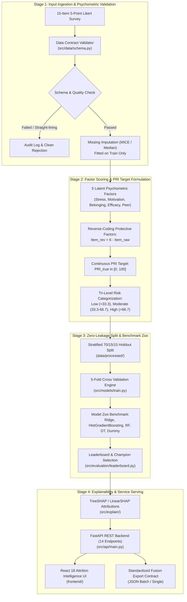

# 09 — End-to-End System Walkthrough & Examiner Cheat Sheet

## 1. Simple Explanation (Age-5 Level)

Imagine our university is like a big team of coaches helping students finish their degrees without dropping out. 

Instead of waiting until someone fails an exam or drops out unexpectedly, we give them a short, friendly 15-question quiz asking how stressed they feel, whether they have study friends, and if they feel they belong. 

Our computer brain takes their answers, balances the good things (like having friends) against the hard things (like feeling stressed), and gives them a score from 0 to 100 called the **Psychosocial Risk Index (PRI)**. 
- If their score is green (0–33), they are doing well!
- If their score is orange (34–66), they might need a little check-in.
- If their score is red (67–100), our coaches reach out right away to offer tutoring or support.

Then, we hand this score over to the university's main dashboard so other coaches who look at grades and lecture attendance can see the whole picture together.

---

## 2. Technical Architecture & End-to-End Workflow

The Psychosocial Intelligence Framework operates as a self-contained, reproducible microservice in the multi-factor student attrition prediction system at SLIIT Kandy, Sri Lanka.

---

## 3. Stage-by-Stage Detailed Mechanics

### Stage 1: Questionnaire Ingestion & Quality Audit
- **Survey Instrument:** 15 items on a 1–5 Likert scale across 5 latent domains:
  - Stress: `S1, S2, S3` (Risk orientation)
  - Motivation: `M1, M2, M3` (Protective orientation)
  - Belongingness: `B1, B2, B3` (Protective orientation)
  - Self-Efficacy: `SE1, SE2, SE3` (Protective orientation)
  - Peer Support: `PS1, PS2, PS3` (Protective orientation)
- **Quality Gate:** Automated screening detects missingness, out-of-range values, and unengaged straight-lining respondents (identified in `artifacts/metrics/reliability.json` as 18 records with identical response patterns).

### Stage 2: Classical Test Theory (CTT) & Target Formulation
- **Factor Scoring:** Mean of 3 constituent items per construct.
- **Orientation Inversion:** Protective items are inverted ($Item_{rev} = 6 - Item_{raw}$) when mapped to risk dimensions.
- **Continuous PRI Calculation:** 
  $$\text{PRI} = 100 \times \left( \frac{\overline{Factor}_{risk} - 1.0}{4.0} \right)$$
  Yielding an empirical synthetic cohort mean of **52.01 ± 18.91** (`data/synthetic/metadata.json`).
- **Tri-Level Tiers:** Low (0–33.33), Moderate (33.34–66.67), High (66.68–100).

### Stage 3: Zero-Leakage Cross-Validation & Model Selection
- **Train/Val/Test Split:** 70% train (2,086 rows), 15% validation (448 rows), 15% test (448 rows) sealed under lock (`data/processed/test.lock`).
- **Feature Set Tournament:** Factor scores vs. raw 15 items evaluated under identical conditions. Factor scores strictly outperformed raw items across all metrics.
- **Leaderboard Champions:**
  - **Regression Champion:** Ridge Regression ($R^2 = 0.9908$, RMSE = $1.8023$, Overfit Gap = $0.5178$; `artifacts/leaderboards/regression_leaderboard.md`).
  - **Classification Champion:** HistGradientBoosting (Macro-F1 = $0.9494$, High-Risk Recall = $0.9459$, Overfit Gap = $0.0482$; `artifacts/leaderboards/classification_leaderboard.md`).

### Stage 4: Cooperative Game-Theoretic Explainability & Serving
- **SHAP Engine:** Automated explainer selection (TreeSHAP for ensembles, LinearSHAP for Ridge).
- **Sanity Audits:** 100% additivity pass, seed stability $r_s = 1.0$, ground-truth recovery correlation $r = 0.8748$ (`artifacts/shap/sanity_checks.json`).
- **Integration API:** FastAPI microservice exposes 14 endpoints delivering JSON/CSV exports strictly adhering to the Fusion Framework contract specification.

---

## 4. "If My Panel Asks X, Show Y" Defense Cheat Sheet

| If the Viva Examiner Asks... | Core Concept & Scientific Justification | Show Them This Artifact / Figure |
| :--- | :--- | :--- |
| **"How did you prevent data leakage in your preprocessing?"** | Scalers, imputers, and transformers are fitted **strictly on the training split** (70%, N=2,086) inside `PsychometricFeatureTransformer`. The holdout test set remained sealed until champion verification. | Point to `src/data/preprocess.py` and `data/processed/test.lock`. |
| **"Why did you use synthetic data instead of real SLIIT students?"** | Collecting psychological surveys requires ethical review board (ERC) approval and sensitive student de-identification. Synthetic data allows full architectural engineering, benchmarking, and CI testing without privacy violations. | Open `data/synthetic/metadata.json` and `docs/10_data_generation_explained.md`. |
| **"Is your synthetic data trivial or deterministic?"** | No. Data is generated via multivariate normal latent factor copulas with realistic correlation structure and injected non-linear noise. The attrition label is a probabilistic logistic function with confounders. | Show `artifacts/plots/correlation_heatmap.png` and `artifacts/plots/inter_factor_correlations.png`. |
| **"Why is $R^2$ appropriate for a bounded index like PRI?"** | The PRI is a continuous metric on $[0, 100]$. $R^2$ quantifies proportion of variance explained ($99.08\%$), complemented by scale-dependent metrics: MAE ($1.40$) and Within $\pm10$ Accuracy ($99.33\%$). | Show `artifacts/leaderboards/regression_leaderboard.md` line 3 and `artifacts/models/final/regression_champion_bundle.json`. |
| **"Why did Ridge win over deep learning or complex ensembles for regression?"** | The underlying construct aggregation is psychometrically linear by definition ($\text{PRI} = \sum w_i F_i$). Occam's razor: Ridge achieved $R^2=0.9908$ with sub-millisecond latency ($0.967$ ms) and zero overfitting. | Show `artifacts/leaderboards/regression_leaderboard.md` comparison between Ridge and DecisionTree. |
| **"Why did you choose HistGradientBoosting for classification?"** | Missing a high-risk student is costly. HistGradientBoosting maximized **High-Risk Recall (94.6%)** and Macro-F1 ($0.9494$) with an expected calibration error (ECE) of just $0.0172$. | Show `artifacts/leaderboards/classification_leaderboard.md` line 3 and `artifacts/plots/test_hist_gradient_boosting_confusion_matrix.png`. |
| **"Are your SHAP explanations mathematically reliable?"** | Yes. We audited all 3 Shapley efficiency axioms: additivity error is exactly $0.0$, seed stability is $r_s = 1.0$, and SHAP recovers ground-truth generating weights with $r = 0.8748$. | Open `artifacts/shap/sanity_checks.json`. |
| **"Does this tool diagnose student mental illness?"** | **Strictly NO.** The PRI is purely a statistical decision-support indicator for educational advising, not a psychological or psychiatric diagnosis. The disclaimer is embedded in all UI pages and API payloads. | Point to the persistent banner in `frontend/src/components/common/EthicsBanner.tsx` and `src/api/main.py` line 67. |
| **"How does this integrate with the team's shared Fusion Framework?"** | We export a clean, standardized schema with `study_id`, `pri` (0–100), `category`, subscales, top risk indicators, and model confidence via `GET /api/export/fusion/{id}.json`. | Show `src/api/schemas.py` (`FusionExportRecord`) and `frontend/src/pages/MethodologyDocsPage.tsx`. |
