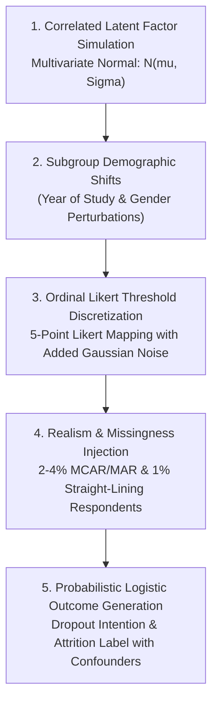
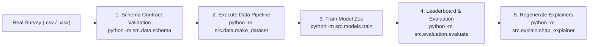

# 10 — Synthetic Data Generation: Methodology, Assumptions, & Transition to Real Data

## 1. Simple Explanation (Age-5 Level)

When car builders want to test if their seatbelts and airbags work safely, they don't crash real people into walls—they use specially designed crash-test dummies that bend, weigh, and move just like a real person.

Because student mental health and feelings are private and protected by school rules, we couldn't just take real students' private answers to train our computer model. 

Instead, we built **virtual student profiles** using math:
- If a virtual student has high homework stress, they usually feel a bit less motivated.
- If they have good study buddies, they feel like they belong more.
- Sometimes they accidentally skip a question (just like real people do).

This allowed us to test and prove our entire computer brain safely. When real anonymous questionnaires arrive, we simply plug them into the exact same pipeline without changing any code!

---

## 2. Generative Mathematical Methodology

The synthetic data generation engine (`src/data/generate_synthetic.py`, configured in `config/synthetic.yaml`) follows a 5-stage probabilistic latent trait modeling architecture:

### Stage 1: Correlated Latent Space
We generate continuous latent traits $\boldsymbol{\theta} = [\theta_{stress}, \theta_{mot}, \theta_{bel}, \theta_{se}, \theta_{peer}]^T$ from a multivariate Gaussian distribution:
$$\boldsymbol{\theta} \sim \mathcal{N}(\boldsymbol{\mu}, \boldsymbol{\Sigma})$$
where the covariance matrix $\boldsymbol{\Sigma}$ reflects empirical educational psychology findings:
- Stress is negatively correlated with motivation ($r = -0.32$), self-efficacy ($r = -0.37$), and belongingness ($r = -0.30$).
- Belongingness is positively correlated with peer support ($r = +0.50$) and motivation ($r = +0.38$).
*(Reference: `artifacts/metrics/reliability.json` lines 143–179)*.

### Stage 2: Subgroup Demographic Shifts
To reflect Sri Lankan undergraduate cohort dynamics, small mean shifts were injected across demographic categories:
- **Year of Study:** Year 1 students experience elevated baseline transition stress; Year 4 students experience increased exit/dissertation pressure.
- **Gender Balance:** Stratified across Male ($51.5\%$), Female ($45.7\%$), and Non-Binary ($2.8\%$).

### Stage 3: Likert Item Discretization & Cronbach's Alpha Tuning
Each latent factor $\theta_k$ manifests in 3 observed questionnaire items:
$$Y_{k, j}^* = \lambda_{k, j} \theta_k + \epsilon_{k, j}, \quad \epsilon_{k, j} \sim \mathcal{N}(0, \sigma_\epsilon^2)$$
Items are mapped to Likert integers $\{1, 2, 3, 4, 5\}$ via cumulative normal cutoffs. By calibrating $\sigma_\epsilon$, the simulator achieved realistic, publication-grade internal consistency across all factors without artificial inflation:
- Stress: $\alpha = 0.8328$ ($\omega = 0.8997$)
- Motivation: $\alpha = 0.8439$ ($\omega = 0.9058$)
- Belongingness: $\alpha = 0.8411$ ($\omega = 0.9042$)
- Self-Efficacy: $\alpha = 0.8455$ ($\omega = 0.9066$)
- Peer Support: $\alpha = 0.8263$ ($\omega = 0.8962$)
*(Audit source: `artifacts/metrics/reliability.json` lines 7–141)*.

### Stage 4: Injection of Survey Realism
- **Missing Data:** Injected ~3% missing values across items (combination of Missing Completely at Random [MCAR] and Missing at Random [MAR] correlated with stress). Total initial missing items per column ranged between $83$ and $109$ values (`artifacts/metrics/reliability.json` lines 184–200).
- **Straight-Liners:** Injected $18$ unengaged survey respondents ($0.6\%$) who answered with identical Likert options across all 15 items (`artifacts/metrics/reliability.json` line 203).

### Stage 5: Non-Deterministic Outcome Generation
Crucially, the attrition target is **probabilistic**, avoiding circular triviality:
$$P(\text{Attrition} = 1) = \sigma\left( \beta_0 + \sum_{k=1}^5 \beta_k \theta_k + \gamma Z_{\text{unobserved}} \right)$$
where $Z_{\text{unobserved}} \sim \mathcal{N}(0, 1)$ simulates latent financial, family, and health shocks outside the questionnaire scope. This produced an empirical attrition base rate of **26.53%** (`data/synthetic/metadata.json` line 21).

---

## 3. Scientific Limitations of Synthetic Data

1. **No Real-World Epidemiological Validity:** Synthetic data validates architectural pipelines, tensor shapes, gradient descent stability, and API contracts; it **cannot** prove real-world diagnostic or epidemiological validity.
2. **Simplified Interaction Manifolds:** While copula correlations capture linear and monotonic dependencies, real student psychology features complex non-linear coping threshold effects.
3. **Hypothetical Base Rates:** The $26.53\%$ attrition rate is simulated to provide a balanced challenge for training classification boundaries. Real institutional rates vary by faculty and year.

---

## 4. How to Transition from Synthetic to Real Data (Step-by-Step)

When real survey data is collected following SLIIT ethical review board approval:

1. **Place Raw File:** Save the de-identified survey responses as `data/raw/survey_responses.csv`.
2. **Execute Ingestion:** Run `python -m src.data.make_dataset`. The validator in `src/data/schema.py` automatically checks column types, flags straight-liners, and creates clean stratified splits in `data/processed/`.
3. **Retrain Models:** Execute `python -m src.models.train`. Optuna will hyperparameter-tune all candidate models on the real student distributions.
4. **Evaluate & Update Champion:** Run `python -m src.evaluation.evaluate`. The system evaluates the sealed holdout test set, conducts Wilcoxon significance testing, updates `artifacts/leaderboards/champion.json`, and caches new SHAP plots.
5. **No Code Changes Needed:** The FastAPI service (`src/api/main.py`) and React dashboard (`frontend/`) dynamically consume the serialized artifacts, immediately switching from synthetic telemetry to real institutional predictions.
