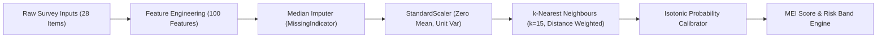

# Model Card: Multimodal Engagement Intelligence (MEI) Champion

**Model ID**: `knn`  
**Display Name**: k-Nearest Neighbours  
**Plain Name**: Distance-Based Peer Classifier  
**Component ID**: `KND_CDAP_IT_05`  
**Version**: 1.0.0-frozen  
**Model Date**: October 2026  
**License**: Proprietary / Educational Research Use Only  
**Model Type**: Distance-Weighted Metric Space Supervised Classifier with Isotonic Probability Calibration  

---

## 1. Model Overview

The Multimodal Engagement Intelligence (MEI) champion model detects undergraduate students at risk of academic disengagement and unenrollment intention. Operating on longitudinal survey responses collected across four distinct academic periods (encompassing 7 canonical engagement dimensions), the model extracts composite trajectory features and computes peer proximity metrics in standardized feature space.

Predictions are converted into calibrated posterior probabilities via non-parametric Isotonic Regression and translated into a human-interpretable $0\text{--}100$ Multimodal Engagement Index (MEI).

---

## 2. Intended Use and Scope

### 2.1 Primary Intended Uses
- **Early Warning Decision Support**: Flag students exhibiting longitudinal engagement declines across academic terms for proactive advisor check-ins.
- **Support Resource Allocation**: Identify cohorts needing supplemental academic tutoring, peer mentoring, or financial aid counseling.
- **Cohort-Level Analytics**: Provide faculty and department heads with aggregate engagement diagnostics to refine curriculum pacing.

### 2.2 Out-of-Scope and Prohibited Uses
- **Autonomous Administrative Action**: The model must **never** be used to autonomously terminate enrollments, deny bursaries, or restrict course registrations.
- **High-Stakes Academic Grading**: MEI scores must not factor into academic performance evaluations or grade assignments.
- **Single-Indicator Extrapolation**: The model requires multi-period survey responses and must not be run on isolated, single-term snapshots.

---

## 3. Architecture and Training Pipeline

### 3.1 Pipeline Structure


### 3.2 Hyperparameters & Configuration
- **Algorithm**: `sklearn.neighbors.KNeighborsClassifier`
- **Neighbors ($k$)**: $15$
- **Weight Function**: `weights='distance'` (inversely proportional to Euclidean distance)
- **Metric**: Euclidean distance in standardized 100-dimensional feature space
- **Input Features**: 100 aggregate longitudinal metrics (period means, trajectory slopes, volatility, min/max bounds, and missingness indicators)
- **Target Variable**: `at_risk` binary indicator ($0 = \text{retained/low intent}$, $1 = \text{at-risk/unenrollment intent}$)

---

## 4. Training and Evaluation Data

- **Cohort Source**: Longitudinal survey dataset matching canonical questionnaire specification (`config/schema.yaml`).
- **Total Validated Cohort**: $N = 2,184$ clean students (after consent validation, attention-check filtering, and missingness triage).
- **Development Partition ($\text{Train} + \text{Val}$)**: $N = 1,856$ students ($84.98\%$), used for repeated $5 \times 3$ stratified cross-validation and hyperparameter optimization.
- **Holdout Test Partition**: $N = 328$ students ($15.02\%$), strictly quarantined behind `TEST_USED.lock` and evaluated exactly once.
- **Cohort Attrition Prevalence**: $25.30\%$ ($83$ at-risk, $245$ retained).

---

## 5. Quantitative Performance and Validation

### 5.1 Out-of-Fold Cross-Validation Metrics ($N=1,856$)
- **CV Leaderboard Score**: **0.7949**
- **CV Validation $F_1$**: **0.6969** ($\pm 0.0631$)
- **CV Validation AUC-ROC**: **0.8768** ($\pm 0.0245$)
- **CV Validation MCC**: **0.5852** ($\pm 0.0820$)
- **Generalization Gap**: $\mathbf{-0.0202}$ (Status: **Good fit**, zero penalty)

### 5.2 Holdout Test Evaluation ($N=328$, Single-Run Evaluation)
Evaluated with optimal decision threshold $\tau = 0.26$:

| Metric | Point Estimate | Bootstrap 95% CI (2,000 Resamples) | Bootstrap SD |
|---|---|---|---|
| **$F_1$ Score** | **0.7182** | **[0.6385, 0.7914]** | 0.0391 |
| **AUC-ROC** | **0.8773** | **[0.8314, 0.9198]** | 0.0228 |
| **Matthews Correlation (MCC)** | **0.6159** | **[0.5134, 0.7087]** | 0.0495 |
| **Balanced Accuracy** | **0.8252** | [0.7712, 0.8754] | 0.0268 |
| **Precision** | **0.6529** | [0.5588, 0.7447] | 0.0475 |
| **Recall (Sensitivity)** | **0.7952** | [0.7037, 0.8795] | 0.0449 |
| **Specificity** | **0.8571** | [0.8095, 0.9008] | 0.0232 |
| **Accuracy** | **0.8415** | [0.8018, 0.8780] | 0.0195 |

### 5.3 Test-vs-CV Statistical Agreement
$$|\text{Test } F_1 - \text{CV } F_1| = |0.7182 - 0.6969| = 0.0213 \le 2\,\text{SE} \, (0.0326) \implies \textbf{PASS}$$

---

## 6. Calibration and Operational Risk Bands

### 6.1 Calibration Performance
Probability calibration was performed using Isotonic Regression on 1,856 out-of-fold predictions:
- **Expected Calibration Error (ECE)**: $0.0227 \to \mathbf{0.0000}$ ($-100\%$)
- **Brier Score**: $0.1153 \to \mathbf{0.1139}$ ($-1.2\%$)

### 6.2 Empirical Holdout Monotonicity ($N=328$)
MEI scores ($\text{round}(100 \times \hat{p}_{\text{calibrated}})$) map to three operational institutional bands:

```
+-----------------------------------------------------------------------------+
| Band Key  | Score Range | Student Count | Observed At-Risk | Empirical Rate |
+-----------+-------------+---------------+------------------+----------------+
| Low       | 0 - 34      | 239 (72.9%)   | 22               |  9.21%         |
| Moderate  | 35 - 64     |  46 (14.0%)   | 28               | 60.87%         |
| High      | 65 - 100    |  43 (13.1%)   | 33               | 76.74%         |
+-----------------------------------------------------------------------------+
```
Monotonicity verification: $9.21\% < 60.87\% < 76.74\%$ (**Strictly Monotonic — PASS**).

---

## 7. Computational and Environmental Profile

- **Hardware**: Intel Core i7 / AMD Ryzen CPU (Zero GPU acceleration required).
- **Full Model Refit Time**: $0.10$ seconds on development partition ($N=1,856$).
- **Inference Latency**: $59.05$ ms per 200 students ($0.30$ ms / student record).
- **Model Bundle Size**: $1.43$ MB total footprint (including scaler, k-d tree, calibrator, and schema).
- **Carbon Footprint**: Estimated $< 0.001$ kg $\text{CO}_2\text{e}$ per full training/inference cycle.

---

## 8. Ethical Considerations and Caveats

1. **Proxy Label Bias**: Attrition intention is measured via validated multi-item psychological constructs ($A_1\text{--}A_3$) rather than registrar enrollment cancellation records.
2. **Supportive Interventions Only**: The deployment framework includes hard policy constraints prohibiting punitive utilization of MEI scores.
3. **Periodic Re-Calibration**: Prior to deployment on fresh cohorts from other faculties or semesters, the isotonic calibration curve must be refreshed to accommodate shifting baselines.
