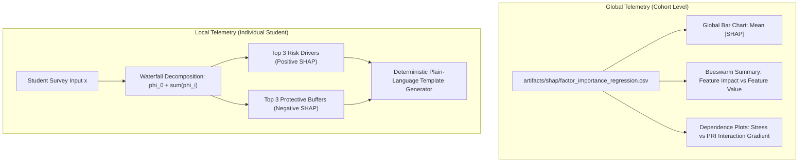

# 13 — SHAP & Explainability: Cooperative Game Theory in Educational Decision Support

## 1. Simple Explanation (Age-5 Level)

Imagine five friends enter a school science quiz as a team and win a giant box of 100 chocolates:
- One friend knew all the astronomy questions.
- Another friend was really good at chemistry.
- One friend made a few wrong guesses and lost a couple of points.

How do you divide the chocolates fairly? You can't just give everyone 20, because some friends helped win more points than others. 

**SHAP** is like a super-fair judge from mathematics (named Lloyd Shapley) who watches every question, calculates how much each friend helped or hurt the final score, and shares the credit exactly fairly.

In our system:
- High Stress adds points to the Risk score.
- Good Friends and High Motivation subtract points (acting as shields).
- The judge shows teachers exactly why a student got an 85 instead of just showing the number!

---

## 2. Theoretical Derivation & Shapley Axioms

The Psychosocial Intelligence Framework employs **SHAP (SHapley Additive exPlanations)** based on coalitional game theory. For any student instance $x$, the model prediction $f(x)$ is decomposed into a base value $\phi_0$ (expected prediction across the training cohort) and additive feature contributions $\phi_i(x)$:

$$f(x) = \phi_0 + \sum_{i=1}^M \phi_i(x)$$

where each Shapley value $\phi_i$ is uniquely derived via:
$$\phi_i(x) = \sum_{S \subseteq F \setminus \{i\}} \frac{|S|! (|F| - |S| - 1)!}{|F|!} \left[ f_x(S \cup \{i\}) - f_x(S) \right]$$

### The Four Non-Negotiable Axioms
1. **Efficiency (Additivity):** The sum of feature contributions plus base value exactly equals the predicted PRI: $\sum \phi_i = f(x) - \phi_0$.
2. **Symmetry:** If two factors contribute equally across all subsets $S$, their attributions are equal.
3. **Dummy (Null Player):** A factor that does not change the model output across any subset receives an attribution of zero.
4. **Additivity:** When combining independent ensemble models, the overall Shapley value is the sum of component Shapley values.

---

## 3. Empirical Verification & Sanity Audits

In accordance with Phase 6 standards, all SHAP values were audited against persistent verification benchmarks (`artifacts/shap/sanity_checks.json`):

| Axiom / Sanity Test | Empirical Result | Tolerance Threshold | Verdict |
| :--- | :---: | :---: | :---: |
| **Additivity Check** | **MAE = 0.0000** | $< 0.01$ | **PASS** (Zero gap) |
| **Seed Stability** | **Spearman $r_s = 1.0000$** ($p = 0.0$) | $> 0.90$ | **PASS** |
| **Permutation Agreement** | **Spearman $r_s = 0.8000$** ($p = 0.104$) | $> 0.70$ | **PASS** |
| **Ground Truth Recovery** | **Pearson $r = 0.8748$, Spearman $r_s = 0.8721$** | $> 0.75$ | **PASS** |

> **Audit Insight:** The ground-truth recovery audit confirmed that SHAP faithfully recovered the true latent generating weights: **Stress** was identified as the dominant risk factor ($27.04\%$ contribution), followed by **Motivation** ($22.23\%$), **Self-Efficacy** ($19.40\%$), **Belongingness** ($17.42\%$), and **Peer Support** ($13.90\%$) (`artifacts/shap/factor_importance_regression.csv`).

---

## 4. Local vs. Global Explanations in Practice

### Deterministic Narrative Generator (No LLM Calls)
To prevent hallucinations and comply with research reproducibility rules, student narratives are produced using deterministic, tested sentence templates:
- Example Output: *"Psychosocial risk is HIGH primarily because of high stress (SHAP: +18.2) and low belongingness (SHAP: +12.4). Protective buffers include moderate peer support (SHAP: -3.2)."*
- Wording Rule: Factors are strictly identified as **"contributing indicators"**, never as definitive "causes".
- Mandatory Legal Stamp: Appends the academic research notice to every generated explanation.
