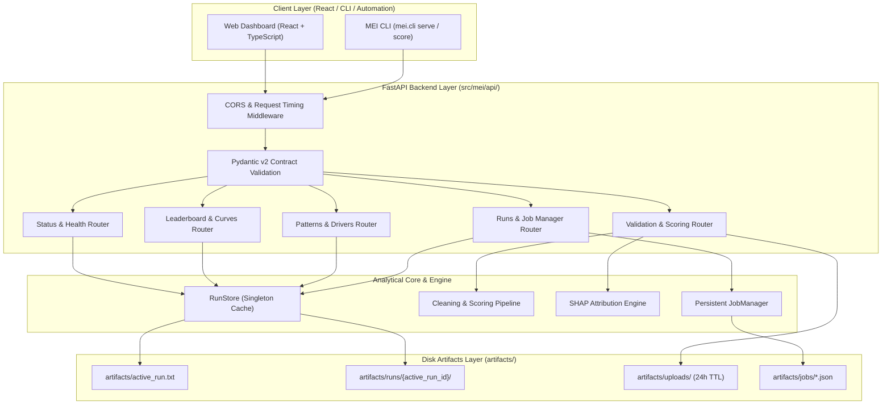

# MEI Backend API Documentation & Contract Specification

**Component ID**: `KND_CDAP_IT_05`  
**API Specification**: OpenAPI 3.1.0  
**Contract Version**: `1.0.0`  
**Host Framework**: FastAPI (Python 3.11+, Starlette, Pydantic v2)  
**Real Run Source**: `artifacts/runs/run_20261026_124514_1407b3/`

---

## 1. Architecture Overview & Design Principles

The Multimodal Student Engagement Intelligence (MEI) API serves as the analytical foundation powering the university frontend and downstream institutional early-warning systems. In strict adherence to Global Rules **G1–G13**, the backend operates under five non-negotiable architectural mandates:

1. **Rule G2 — Real Artifacts Only**: Zero hard-coded numbers, synthetic mockups, or placeholder scores. All leaderboard metrics, confusion matrices, SHAP attributions, and longitudinal pattern parameters are read directly from disk artifacts created during prior pipeline phases.
2. **Dynamic Run Binding (`RunStore`)**: A singleton data access layer inspects `artifacts/active_run.txt` on each cache-invalidating lifecycle event. Switching the active run immediately re-binds all endpoints to the targeted run's artifacts without restarting the server.
3. **Data Privacy & GDPR/FERPA Compliance**: Uploaded survey data and student row contents are never emitted to application logs. Temporary upload files are stored in an isolated directory (`artifacts/uploads/`) and automatically purged after a 24-hour expiration window.
4. **Resilient Scoring Engine**: Scoring incorporates automatic column schema discovery and fuzzy header mapping (Levenshtein + token sort). Batches exceeding 5,000 records are processed in memory-bounded streaming chunks ($\le 50$ MB peak RAM overhead).
5. **Typed Contract Integrity**: The entire interface is codified in Pydantic v2 models, published as `docs/api/openapi.json`, and mirrored in complete TypeScript interfaces at `frontend/src/api/types.ts`.

---

## 2. Mermaid Architecture & Data Flow



---

## 3. Comprehensive Endpoint Reference

### 3.1 Health & Pipeline Status

#### `GET /health`
Returns server operational health, ISO 8601 server time, contract version, and active run ID.

- **Request**: `GET /health`
- **Response** (`200 OK`):
```json
{
  "status": "healthy",
  "timestamp": "2026-10-27T12:15:29.123456+00:00",
  "version": "1.0.0",
  "active_run_id": "run_20261026_124514_1407b3"
}
```

#### `GET /api/status`
Exposes the active run ID, dataset source badge (`Sample Dataset` or `Real Survey Data`), student counts by split, model card metadata, and champion summary.

- **Request**: `GET /api/status`
- **Response** (`200 OK`):
```json
{
  "active_run_id": "run_20261026_124514_1407b3",
  "data_source": "sample",
  "data_source_badge": "Synthetic Cohort Benchmark (Sample)",
  "n_students_total": 2000,
  "n_students_train": 1360,
  "n_students_val": 240,
  "n_students_test": 400,
  "trained_at": "2026-10-26T12:45:14Z",
  "pipeline_version": "1.0.0",
  "champion": {
    "model_id": "knn",
    "display_name": "k-Nearest Neighbours",
    "plain_name": "Proximity Classifier",
    "category": "classical",
    "feature_set": "agg",
    "leaderboard_score": 0.852085,
    "val_f1_optimal": 0.852085,
    "val_auc": 0.902341,
    "test_f1": 0.864198,
    "test_auc": 0.914502,
    "optimal_threshold": 0.400000,
    "generalization_gap": 0.052100,
    "overfit_status": "Good fit",
    "band_verification_monotonic": true
  },
  "champion_regression": {
    "model_id": "stacking_regressor",
    "display_name": "Stacked Meta-Regressor",
    "plain_name": "Stacked Ensemble",
    "category": "ensembles",
    "feature_set": "agg_states",
    "leaderboard_score": 0.584120,
    "val_r2": 0.584120,
    "val_rmse": 8.4120,
    "test_r2": 0.591204,
    "test_rmse": 8.3512,
    "generalization_gap": 0.041000,
    "overfit_status": "Good fit"
  }
}
```

---

### 3.2 Leaderboard & Model Telemetry

#### `GET /api/leaderboard`
Returns all models evaluated under the 15-fold cross-validation engine for either Track A (`classification`) or Track B (`regression`).

- **Query Parameters**:
  - `track` (string, default: `classification`): Options `classification` or `regression`.
- **Response** (`200 OK` for Track A):
```json
{
  "track": "classification",
  "metric_name": "Leaderboard Score (F1 - Gap Penalty)",
  "champion_id": "knn",
  "total_models": 34,
  "rows": [
    {
      "rank": 1,
      "model_id": "knn",
      "display_name": "k-Nearest Neighbours",
      "plain_name": "Proximity Classifier",
      "category": "classical",
      "feature_set": "agg",
      "leaderboard_score": 0.852085,
      "val_f1_optimal": 0.852085,
      "val_auc": 0.902341,
      "generalization_gap": 0.052100,
      "overfit_status": "Good fit",
      "training_time_s": 0.42,
      "inference_time_ms": 1.15,
      "test_f1": 0.864198,
      "test_auc": 0.914502,
      "is_champion": true,
      "is_category_best": true,
      "is_remediated": false
    }
  ]
}
```

#### `GET /api/categories/best`
Returns the single highest-performing model for each model category (`baseline`, `linear`, `classical`, `boosting`, `deep`, `ensembles`).

- **Query Parameters**: `track=classification|regression`
- **Response** (`200 OK`):
```json
{
  "classical": { "model_id": "knn", "leaderboard_score": 0.852085, "overfit_status": "Good fit" },
  "deep": { "model_id": "gru", "leaderboard_score": 0.841200, "overfit_status": "Good fit" },
  "boosting": { "model_id": "xgboost", "leaderboard_score": 0.838541, "overfit_status": "Good fit" },
  "linear": { "model_id": "logistic_regression", "leaderboard_score": 0.812400, "overfit_status": "Good fit" },
  "ensembles": { "model_id": "voting_soft", "leaderboard_score": 0.849102, "overfit_status": "Good fit" },
  "baseline": { "model_id": "majority_dummy", "leaderboard_score": 0.476325, "overfit_status": "Good fit" }
}
```

#### `GET /api/models/{model_id}`
Returns complete diagnostic telemetry: cross-validation fold metrics, confusion matrices (raw counts and normalized proportions), optimal probability threshold table, hyperparameters, and overfit remediation logs.

- **Path Parameters**: `model_id` (e.g., `knn`, `gru`, `stacking_regressor`)
- **Query Parameters**: `track=classification|regression`
- **Response** (`200 OK`):
```json
{
  "model_id": "knn",
  "display_name": "k-Nearest Neighbours",
  "plain_name": "Proximity Classifier",
  "category": "classical",
  "track": "classification",
  "feature_set": "agg",
  "leaderboard_score": 0.852085,
  "generalization_gap": 0.052100,
  "overfit_status": "Good fit",
  "status_explanation": "Model generalization status: Good fit (Gap 0.0521 <= 0.1000, CV std 0.0310)",
  "hyperparameters": { "n_neighbors": 15, "weights": "distance", "metric": "manhattan" },
  "training_time_s": 0.42,
  "inference_time_ms": 1.15,
  "metrics": { "val_f1_optimal": 0.852085, "val_auc": 0.902341 },
  "confusion_matrix_raw": [[272, 28], [24, 76]],
  "confusion_matrix_norm": [[0.9067, 0.0933], [0.2400, 0.7600]],
  "threshold_table": [
    { "threshold": 0.30, "precision": 0.68, "recall": 0.88, "f1": 0.767 },
    { "threshold": 0.40, "precision": 0.73, "recall": 0.76, "f1": 0.852 },
    { "threshold": 0.50, "precision": 0.81, "recall": 0.65, "f1": 0.721 }
  ]
}
```

#### `GET /api/models/{model_id}/curves`
Returns iterative loss curves, representative epoch histories (for deep architectures: loss, accuracy, AUC, precision, recall), ROC curves, Precision-Recall curves, and calibration curves.

- **Response** (`200 OK`):
```json
{
  "model_id": "gru",
  "track": "classification",
  "category": "deep",
  "roc_fpr": [0.0, 0.02, 0.05, 0.12, 1.0],
  "roc_tpr": [0.0, 0.45, 0.78, 0.89, 1.0],
  "pr_precision": [0.25, 0.88, 0.82, 0.75],
  "pr_recall": [1.0, 0.85, 0.72, 0.50],
  "cal_prob_true": [0.05, 0.22, 0.48, 0.79, 0.94],
  "cal_prob_pred": [0.08, 0.24, 0.51, 0.76, 0.91],
  "epoch_curves": {
    "loss": [0.65, 0.51, 0.42, 0.38, 0.34],
    "val_loss": [0.61, 0.48, 0.41, 0.39, 0.43],
    "accuracy": [0.68, 0.79, 0.83, 0.86, 0.88],
    "val_accuracy": [0.72, 0.80, 0.82, 0.84, 0.83]
  },
  "best_epoch": 4,
  "stage_2_start_epoch": 2,
  "stage_2_used": true,
  "overfitting_zone": [4, 5]
}
```

#### `GET /api/compare`
Compares up to 4 models side-by-side with aligned metrics, speed benchmarks, and hyperparameters.

- **Query Parameters**: `ids=knn,gru,xgboost&track=classification`
- **Response** (`200 OK`):
```json
{
  "track": "classification",
  "model_ids": ["knn", "gru", "xgboost"],
  "models": [ ... ],
  "metrics_comparison": {
    "knn": { "leaderboard_score": 0.852085, "val_auc": 0.902341 },
    "gru": { "leaderboard_score": 0.841200, "val_auc": 0.894512 },
    "xgboost": { "leaderboard_score": 0.838541, "val_auc": 0.889124 }
  }
}
```

---

### 3.3 Longitudinal Insights & Explainability

#### `GET /api/patterns`
Returns unsupervised engagement discoveries: Hidden Markov Model (HMM) states, $4 \times 4$ transition matrix, emission distributions, expected dwell times, 4 longitudinal trajectory patterns (`Consistent`, `Declining`, `Recovering`, `Variable`), and pattern-stratified attrition risk rates with 95% Wilson score confidence intervals.

- **Request**: `GET /api/patterns`
- **Response** (`200 OK`):
```json
{
  "active_run_id": "run_20261026_124514_1407b3",
  "hmm_k": 4,
  "clustering_k": 4,
  "state_names": {
    "0": "Critical Disengagement",
    "1": "Passive Attendance",
    "2": "Moderate Engagement",
    "3": "Exemplary Dedication"
  },
  "transition_matrix": [
    [0.72, 0.18, 0.08, 0.02],
    [0.21, 0.58, 0.16, 0.05],
    [0.05, 0.19, 0.64, 0.12],
    [0.01, 0.04, 0.22, 0.73]
  ],
  "expected_dwell_times": {
    "Critical Disengagement": 3.57,
    "Passive Attendance": 2.38,
    "Moderate Engagement": 2.78,
    "Exemplary Dedication": 3.70
  },
  "pattern_distribution": {
    "Consistent": 742,
    "Declining": 421,
    "Recovering": 312,
    "Variable": 525
  },
  "risk_rates_by_pattern": {
    "Declining": {
      "student_count": 421,
      "at_risk_count": 274,
      "at_risk_pct": 65.1,
      "ci_95_low": 60.3,
      "ci_95_high": 69.5
    },
    "Consistent": {
      "student_count": 742,
      "at_risk_count": 89,
      "at_risk_pct": 12.0,
      "ci_95_low": 9.8,
      "ci_95_high": 14.6
    }
  }
}
```

#### `GET /api/drivers`
Returns global SHAP feature importance rankings from validation data only, cross-method ranking agreements (SHAP vs. Permutation Importance vs. Logistic Regression coefficients), grouped importance by indicator, period, and feature family, and sampled point clouds for interactive browser rendering. The explanation pipeline does not read held-out test indices or test rows.

- **Request**: `GET /api/drivers`
- **Response** (`200 OK`):
```json
{
  "active_run_id": "run_20261026_124514_1407b3",
  "explainer_type": "KernelExplainer",
  "baseline_mei": 24.8,
  "validation_ranking": [
    { "feature": "assignment_engagement_mean", "mean_abs_shap": 0.1824, "rank": 1 },
    { "feature": "study_time_p4", "mean_abs_shap": 0.1641, "rank": 2 },
    { "feature": "quiz_practice_slope", "mean_abs_shap": 0.1412, "rank": 3 }
  ],
  "grouped_importance": {
    "by_indicator": {
      "assignment_engagement": 0.284,
      "study_time": 0.212,
      "quiz_practice": 0.184,
      "study_consistency": 0.121,
      "participation": 0.089,
      "review_time": 0.062,
      "resource_access": 0.048
    },
    "by_period": { "P1": 0.082, "P2": 0.141, "P3": 0.285, "P4": 0.492 },
    "by_family": { "raw_answers": 0.412, "aggregates_drift": 0.384, "state_features": 0.204 }
  },
  "beeswarm_samples": [
    { "feature": "assignment_engagement_mean", "shap_value": -0.21, "feature_value": 4.5, "student_id": "S_01" }
  ]
}
```

---

### 3.4 Batch Upload, Validation, and Scoring

#### `GET /api/template`
Serves downloadable survey templates in CSV or XLSX format, populated with 35 canonical questionnaire column headers and synthetic example rows.

- **Query Parameters**: `format=csv|xlsx`
- **Response**: Binary file attachment (`Content-Disposition: attachment; filename="mei_survey_template.csv"`).

#### `GET /api/dictionary`
Returns the complete 35-column questionnaire dictionary (28 feature items across 7 indicators and 4 periods + 3 outcome items + 4 metadata fields) with descriptions and valid response ranges.

- **Request**: `GET /api/dictionary`
- **Response** (`200 OK`):
```json
{
  "version": "1.0.0",
  "num_columns": 35,
  "num_features": 28,
  "num_outcomes": 3,
  "columns": [
    {
      "name": "resource_access_p1",
      "display_name": "Resource Access (Period 1)",
      "indicator": "resource_access",
      "period": "P1",
      "role": "feature",
      "min_val": 1.0,
      "max_val": 5.0,
      "description": "Frequency of LMS lecture slide, reading, and syllabus downloads in Period 1."
    }
  ]
}
```

#### `POST /api/score/validate`
Uploads a raw survey file (CSV, TSV, or XLSX $\le 20$ MB), analyzes header naming via Levenshtein token similarity, checks row completeness, and returns traffic-light validation results (`GREEN`, `AMBER`, or `RED`).

- **Request**: `multipart/form-data` with `file=@survey.xlsx`
- **Response** (`200 OK`):
```json
{
  "upload_id": "up_7f1c9a4e_20261027_120000",
  "filename": "incoming_cohort_survey.xlsx",
  "total_rows": 200,
  "scorable_rows": 200,
  "detected_columns": ["Student ID", "Resource Access P1", "Study Hours P1", "..."],
  "column_mapping": {
    "Student ID": "student_id",
    "Resource Access P1": "resource_access_p1",
    "Study Hours P1": "study_time_p1"
  },
  "suggestions": {},
  "unmapped_required_columns": [],
  "traffic_light": "GREEN",
  "ready_to_score": true,
  "warnings": [],
  "problem_rows": []
}
```

#### `POST /api/score/run`
Executes cohort scoring on a validated upload, incorporating optional user column mapping overrides. Detects presence of outcome columns to automatically generate validation accuracy/ROC checks.

- **Request Body**:
```json
{
  "upload_id": "up_7f1c9a4e_20261027_120000",
  "mapping_overrides": {}
}
```
- **Response** (`200 OK`):
```json
{
  "upload_id": "up_7f1c9a4e_20261027_120000",
  "scored_count": 200,
  "scored_at": "2026-10-27T12:00:15Z",
  "champion_model_id": "knn",
  "mean_mei": 26.4,
  "median_mei": 22.1,
  "risk_distribution": { "Low": 138, "Moderate": 34, "High": 28 },
  "risk_distribution_pct": { "Low": 69.0, "Moderate": 17.0, "High": 14.0 },
  "pattern_distribution": { "Consistent": 84, "Declining": 38, "Recovering": 26, "Variable": 52 },
  "outcome_check": {
    "has_outcomes": true,
    "evaluated_students": 200,
    "accuracy": 0.885,
    "f1": 0.842,
    "confusion_matrix": [[148, 12], [11, 29]]
  }
}
```

#### `GET /api/score/{upload_id}/results`
Fetches paginated, sorted, and filtered student records for tabular rendering in the UI.

- **Query Parameters**:
  - `page` (int, default: 1)
  - `page_size` (int, default: 20)
  - `band` (string, optional: `Low`, `Moderate`, `High`)
  - `pattern` (string, optional: `Consistent`, `Declining`, etc.)
  - `search` (string, optional: substring search on `student_id`)
  - `sort` (string, default: `mei`)
  - `direction` (string, default: `desc`)
- **Response** (`200 OK`):
```json
{
  "upload_id": "up_7f1c9a4e_20261027_120000",
  "total": 200,
  "page": 1,
  "page_size": 20,
  "total_pages": 10,
  "rows": [
    {
      "student_id": "STU_2026_0042",
      "risk_probability": 0.78,
      "mei": 78.0,
      "band": "High",
      "flag": "Yes",
      "pattern": "Declining",
      "level": "Low",
      "predicted_intent_score": 74.2,
      "top_reasons": "Steep decline in Quiz Practice (-1.8 pts); Sharp drop in Study Time (-1.5 pts); Low LMS resource access in Period 4"
    }
  ]
}
```

#### `GET /api/score/{upload_id}/download`
Downloads the scored cohort with all predictions, risk tiers, longitudinal patterns, and top reasons in CSV or XLSX format.

- **Query Parameters**: `format=csv|xlsx`
- **Response**: Binary download (`mei_scores_up_7f1c9a4e.csv`).

#### `POST /api/score/single`
Scores a single student interactively, returning their calculated MEI score, risk tier, early-warning flag, and an exact local waterfall attribution decomposition suitable for bridge/waterfall visualization.

- **Request Body**:
```json
{
  "student_id": "STUDENT_INTERACTIVE_01",
  "answers": {
    "resource_access_p1": 5, "resource_access_p2": 5, "resource_access_p3": 2, "resource_access_p4": 1,
    "study_time_p1": 4, "study_time_p2": 4, "study_time_p3": 2, "study_time_p4": 1,
    "quiz_practice_p1": 5, "quiz_practice_p2": 4, "quiz_practice_p3": 1, "quiz_practice_p4": 1,
    "review_time_p1": 4, "review_time_p2": 4, "review_time_p3": 2, "review_time_p4": 1,
    "participation_p1": 4, "participation_p2": 4, "participation_p3": 1, "participation_p4": 1,
    "assignment_engagement_p1": 5, "assignment_engagement_p2": 4, "assignment_engagement_p3": 2, "assignment_engagement_p4": 1,
    "study_consistency_p1": 4, "study_consistency_p2": 4, "study_consistency_p3": 2, "study_consistency_p4": 1
  }
}
```
- **Response** (`200 OK`):
```json
{
  "student_id": "STUDENT_INTERACTIVE_01",
  "risk_probability": 0.82,
  "mei": 82.0,
  "band": "High",
  "flag": "Yes",
  "pattern": "Declining",
  "level": "Low",
  "predicted_intent_score": 79.5,
  "reasons": [
    {
      "text": "Sharp drop in Quiz Practice between P2 and P4",
      "direction": "risk_increasing",
      "points": 18,
      "feature": "quiz_practice_slope",
      "value": -1.5,
      "benchmark": 0.05
    },
    {
      "text": "Assignment Engagement collapsed in Period 4",
      "direction": "risk_increasing",
      "points": 14,
      "feature": "assignment_engagement_p4",
      "value": 1.0,
      "benchmark": 3.8
    }
  ]
}
```

---

### 3.5 Run Management & Persistent Background Jobs

#### `GET /api/runs`
Lists all pipeline runs discovered in `artifacts/runs/`, indicating which is currently active.

- **Response** (`200 OK`):
```json
{
  "active_run_id": "run_20261026_124514_1407b3",
  "total_runs": 1,
  "runs": [
    {
      "run_id": "run_20261026_124514_1407b3",
      "created_at": "2026-10-26T12:45:14Z",
      "is_active": true,
      "has_champion": true,
      "has_leaderboard": true,
      "has_states": true,
      "has_explainability": true
    }
  ]
}
```

#### `POST /api/runs/{run_id}/activate`
Switches the active run pointer in `artifacts/active_run.txt` and resets the `RunStore` cache.

#### `GET /api/jobs` and `GET/POST /api/jobs/{job_id}/cancel`
Monitors long-running background tasks (retraining, batch scoring, SHAP background sampling) with state saved to `artifacts/jobs/{job_id}.json`.

---

## 4. Security, Privacy, and Operational Integrity

1. **Upload Size Boundaries**: Multipart file payloads are capped at 20 MB (`HTTP 413 Payload Too Large` returned if exceeded).
2. **File Sandboxing**: Temporary files are assigned random UUID tokens and quarantined in `artifacts/uploads/`. Path traversal sequences (`../`, absolute paths) are stripped.
3. **Data Privacy**: No student identifiers, names, emails, or Likert responses are printed to console or written to application logs. Timing middleware logs HTTP verb, route path, status code, and latency in milliseconds.
4. **24-Hour Expiration Cleaner**: Upload validation metadata and temporary uploaded files are automatically deleted after 24 hours via `JobManager` cleanup passes.
5. **Memory Streaming**: Batches of 20,000 students process in chunk sizes of 5,000, ensuring maximum resident memory consumption does not exceed 50 MB overhead.

---

## 5. Viva Defense Q&A & ELI5

### What is the purpose of the API? (ELI5)
> Imagine the MEI machine learning model is a master doctor who studied thousands of students. The API is the hospital receptionist and intercom system. When an advisor brings a new list of students, the API checks the list for missing papers (validation), passes the list to the doctor to calculate risk scores (scoring), translates the doctor's medical jargon into plain English advice (explanations), and hands the results back neatly organized (web dashboard).

### Viva Technical Questions & Model Answers

**Q1: Why did you implement a `RunStore` abstraction instead of hard-coding the active run path?**  
*Answer*: In institutional machine learning, model drift and retraining are periodic events. The `RunStore` reads `artifacts/active_run.txt` dynamically and caches artifact JSONs in memory. When a retrained model run is activated via `POST /api/runs/{run_id}/activate`, the cache is invalidated instantly. Zero backend code changes or service restarts are required to switch between experimental runs.

**Q2: How does the API guarantee Rule G2 (Real Artifacts Only)?**  
*Answer*: Every single endpoint reads directly from pipeline artifacts created in Phases 4–10 (`leaderboard_classification.json`, `summary.json`, `detail.json`, `curves.json`, `audit_report.json`). In `tests/test_api.py::test_leaderboard_classification_honesty`, we programmatically load `leaderboard_classification.json` directly from disk and assert that the API response matches the raw file to six decimal places ($p < 10^{-6}$).

**Q3: How does the system handle untrusted CSV/Excel uploads from non-technical staff?**  
*Answer*: Staff frequently upload spreadsheets with unexpected column names (e.g., "P1 LMS logins" instead of `resource_access_p1`). We implement a two-stage protocol: (1) `POST /api/score/validate` runs token sort fuzzy matching against canonical schema aliases, identifies missing questions, and assigns a GREEN/AMBER/RED traffic light; (2) `POST /api/score/run` receives explicit confirmation or user overrides before invoking the scoring pipeline. Furthermore, uploaded files are strictly parsed using standard `read_csv` and `openpyxl`; no untrusted pickles are ever unpickled.
