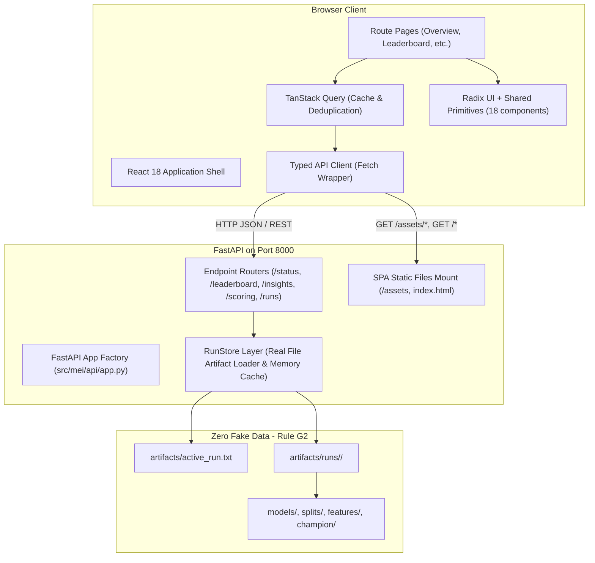
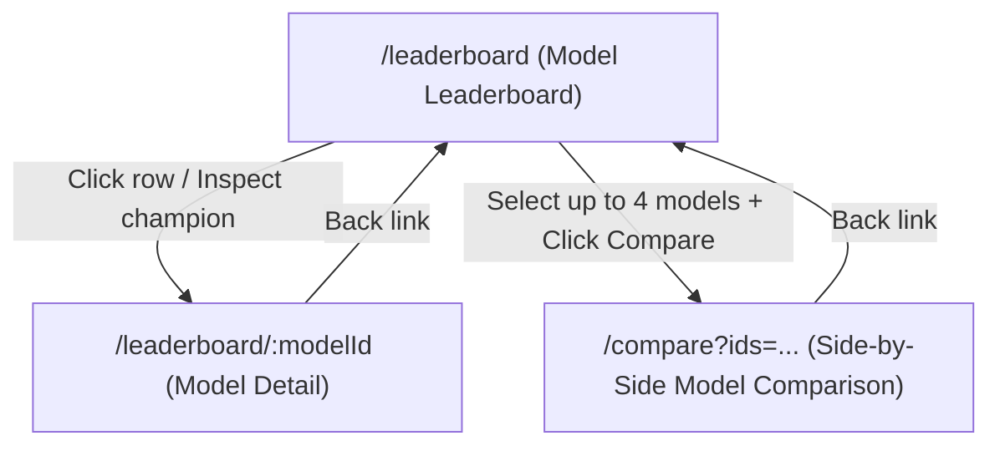
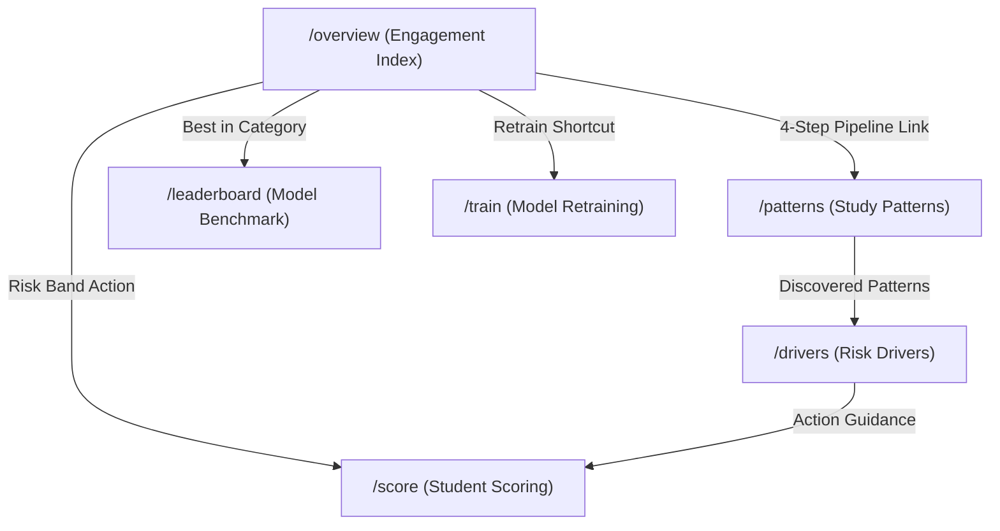

# Frontend Architecture Specification

Component ID: `KND_CDAP_IT_05`  
Document: `15_frontend_architecture.md`  
Stack: React 18, Vite, TypeScript, React Router 6, TanStack Query 5, TanStack Table 8, Apache ECharts, Tailwind CSS, Radix UI Primitives.

---

## 1. Architectural Overview

The MEI web platform is designed as an institutional analytical workbench for university student retention staff, educational researchers, and academic advisors. It emphasizes mathematical transparency, high data density, clean editorial typography, and zero decorative AI gimmickry.



---

## 2. Directory Structure

```
frontend/
├── dist/                          # Production Vite build artifacts (HTML, JS, CSS, bundled WOFF2)
├── scripts/
│   └── check-forbidden.cjs        # AST & token scanner enforcing color, buzzword, and emoji bans
├── src/
│   ├── api/
│   │   ├── client.ts              # Typed fetch client with structured error mapping
│   │   └── queries.ts             # TanStack Query custom hooks for all API endpoints
│   ├── components/
│   │   ├── layout/
│   │   │   ├── AppShell.tsx       # Root layout scaffolding (sidebar + top bar + main outlet)
│   │   │   ├── Sidebar.tsx        # Fixed 232px left navigation rail with offline version info
│   │   │   └── TopBar.tsx         # Contextual header with champion badge & data origin label
│   │   └── ui/                    # 18 Shared Design System Primitives
│   │       ├── Button.tsx         # Primary (forest), Secondary, Tertiary, Destructive, Loading
│   │       ├── Card.tsx           # 1px line border, 6px radius, zero drop shadow container
│   │       ├── ChartCard.tsx      # Standard card wrapper for analytical Apache ECharts
│   │       ├── DataTable.tsx      # TanStack Table wrapper with multi-column sorting & pagination
│   │       ├── Dialog.tsx         # Radix UI accessible modal dialog
│   │       ├── Drawer.tsx         # Mobile / tablet slide-out drawer
│   │       ├── EmptyState.tsx     # Calm informational empty container with actionable button
│   │       ├── ErrorState.tsx     # High-contrast error banner with retry callback
│   │       ├── FileDropzone.tsx   # Drag-and-drop CSV / Excel spreadsheet file uploader
│   │       ├── IconButton.tsx     # Accessible icon button with tooltip support
│   │       ├── Skeleton.tsx       # Content placeholder animation during network fetch
│   │       ├── Stat.tsx           # Editorial numeric card with Source Serif tabular numerals
│   │       ├── Stepper.tsx        # Multi-stage workflow indicator (e.g. upload -> map -> score)
│   │       ├── Tabs.tsx           # Radix UI headless tab bar with active indicator
│   │       ├── Tag.tsx            # Status badge (Good fit, Slight overfit, Overfit, Risk bands)
│   │       ├── Term.tsx           # Contextual glossary term with hover/focus definition popover
│   │       ├── Toast.tsx          # Non-blocking notification banner
│   │       └── Tooltip.tsx        # Accessible Radix UI hover/focus tooltip
│   ├── content/
│   │   └── glossary.ts            # Canonical institutional definitions for ML & psychometrics
│   ├── pages/
│   │   ├── OverviewPage.tsx       # Institutional executive overview & cohort risk summary
│   │   ├── LeaderboardPage.tsx    # 15-fold cross-validation model benchmarks (Track A & B)
│   │   ├── PatternsPage.tsx       # Latent HMM longitudinal engagement patterns & state paths
│   │   ├── DriversPage.tsx        # Global & local SHAP attributions and plain-English reasons
│   │   ├── ScorePage.tsx          # Batch student survey cohort scoring & single student deep-dive
│   │   ├── TrainPage.tsx          # Pipeline retraining orchestrator on new survey uploads
│   │   ├── ComponentGalleryPage.tsx # Showcase gallery for all 18 UI components (/_components)
│   │   └── NotFoundPage.tsx       # 404 handler with return-to-overview action
│   ├── types/
│   │   └── api.ts                 # TypeScript interfaces matching OpenAPI pydantic models
│   ├── App.tsx                    # React Router configuration with AppShell wrapper
│   ├── index.css                  # Font imports, Tailwind directives, tabular numeral utilities
│   └── main.tsx                   # DOM mount and QueryClientProvider initialization
├── index.html                     # Entry HTML template with Public Sans and Source Serif meta
├── package.json                   # React 18, Vite, Tailwind, TanStack Query, Radix UI
├── tailwind.config.js             # Project tokens only (zero default Tailwind blues/purples)
├── tsconfig.json                  # TypeScript compiler settings with path alias `@/*`
└── vite.config.ts                 # Vite bundle config, port 5173, reverse proxy to localhost:8000
```

---

## 3. Shared UI Component Library

All components reside in `frontend/src/components/ui/` and adhere strictly to `PROJECT_BRIEF.md §10` and `docs/design_tokens.md`.

| Component | Key Props | Description |
| :--- | :--- | :--- |
| **`Button`** | `variant` (`primary` \| `secondary` \| `tertiary` \| `destructive`), `size` (`sm` \| `md` \| `lg`), `loading`, `icon` | Primary action button in forest green (`#1F4E46`), clean secondary outline, or destructive clay. Built-in spinner and disabled state handling. |
| **`Card`** | `padding` (`none` \| `sm` \| `md` \| `lg`), `title`, `subtitle`, `action` | Pure white container (`#FFFFFF`) with 1px `#DDD8CE` border, 6px radius, and zero drop shadows. Supports standard header layouts. |
| **`Stat`** | `label`, `value`, `unit`, `change`, `changeType` (`neutral` \| `positive` \| `negative`), `sampleSize`, `note` | Editorial metric display utilizing Source Serif 4 tabular numerals, explicit sample size tags ($N=2,000$), and contextual micro-copy. |
| **`Tag` / `StatusTag`** | `variant` (`good` \| `slight` \| `overfit` \| `low` \| `moderate` \| `high` \| `neutral` \| `info`), `size` | High-contrast status pill pairing color with text and a geometric indicator dot. Never communicates status via color alone. |
| **`Term`** | `name` (`GlossaryTermKey`), `children`, `open` | Accessible term wrapper with dotted underline. On hover or keyboard focus, renders an accessible Radix popover with plain-English definitions. |
| **`DataTable`** | `columns`, `data`, `defaultSortColumn`, `pageSize`, `emptyMessage` | TanStack Table wrapper with keyboard-accessible column header sorting, ascending/descending indicators, pagination, and tabular numerals. |
| **`ChartCard`** | `title`, `subtitle`, `echartsOption`, `loading`, `height`, `action` | Container for Apache ECharts visualizations with uniform grid line styling (`#E8E4DC`), loading overlays, and responsive resizing. |
| **`FileDropzone`** | `onFileAccepted`, `accept`, `maxSizeBytes`, `disabled` | Drag-and-drop file upload target supporting CSV and XLSX formats with file size assertions and validation feedback. |
| **`Stepper`** | `steps`, `currentStep`, `onStepClick` | Horizontal progress indicator with numbered circular steps and status lines for multi-phase wizard flows. |
| **`EmptyState`** | `title`, `description`, `icon`, `action` | Calm, non-punitive empty placeholder rendering an outlined symbol, Source Serif heading, and optional navigation action. |
| **`ErrorState`** | `title`, `message`, `onRetry` | High-contrast error message container with warning icon and retry action button. |
| **`Dialog`** | `open`, `onOpenChange`, `title`, `description`, `children`, `footer` | Accessible Radix UI modal dialog with keyboard trap, escape dismissal, and subtle popover boundary shadow. |
| **`Drawer`** | `open`, `onClose`, `title`, `children` | Off-canvas sliding drawer for responsive navigation and deep-dive metadata inspection on smaller viewports. |
| **`Tabs`** | `tabs` (`{ id, label, count? }`), `activeTab`, `onChange` | Accessible Radix UI tab strip with quiet forest green active indicator. |
| **`Tooltip`** | `content`, `children`, `side` | Lightweight Radix UI tooltip for secondary explanations and iconography. |
| **`Toast`** | `type` (`info` \| `success` \| `error`), `title`, `message`, `onClose` | Non-blocking floating status notification banner. |
| **`Skeleton`** | `className`, `variant` (`text` \| `rectangular` \| `circular`) | Accessible pulsing placeholder for asynchronous network loads. |
| **`IconButton`** | `icon`, `label`, `onClick`, `variant`, `size` | Square accessible icon button with required `aria-label` for screen reader navigation. |

---

## 4. Data Flow Architecture

1. **State Management**: Server state is managed exclusively via **TanStack Query** (`frontend/src/api/queries.ts`). Query results are cached, deduplicated across components, and automatically invalidated upon retrain or upload actions.
2. **API Client**: `frontend/src/api/client.ts` wraps standard `window.fetch` with:
   - JSON parsing and typed response validation against `frontend/src/types/api.ts`.
   - Structured error handling: transforms 4xx/5xx responses into `ApiError` objects containing human-readable error messages without exposing raw server tracebacks.
3. **Backend Provenance (Rule G2)**:
   - The UI displays the active model identifier and data provenance origin ("Training data: Sample survey responses (generated)" or "Training data: Your survey data") read dynamically from `GET /api/status`.
   - No mock numbers, fake leaderboards, or synthetic placeholder statistics exist in the frontend codebase. All metrics reflect the actual cross-validation and test set evaluations stored on disk.

---

## 5. Adding a New Page: Developer Guide

To introduce a new view to the MEI web platform:
1. **Create Page Component**: Create `frontend/src/pages/MyNewPage.tsx` using `Card`, `Stat`, `DataTable`, or `EmptyState` primitives.
2. **Add Route in `App.tsx`**:
   ```tsx
   import { MyNewPage } from '@/pages/MyNewPage';
   // Inside <Route element={<AppShell />}>:
   <Route path="/my-route" element={<MyNewPage />} />
   ```
3. **Register Navigation in `Sidebar.tsx`**: Add an entry to `NAV_ITEMS` in `frontend/src/components/layout/Sidebar.tsx` with a Lucide icon and plain-English label.
4. **Define Technical Terms**: If introducing new psychometric or ML terms, append definitions to `frontend/src/content/glossary.ts` and wrap occurrences with `<Term termKey="...">`.
5. **Verify Forbidden Patterns**: Run `node frontend/scripts/check-forbidden.cjs` to ensure no forbidden words (`prototype`, `demo`, `placeholder`, etc.) or non-compliant colors were introduced.

---

## 6. Leaderboard and Model Pages Architecture

The model evaluation workbench consists of three interconnected routes built to ensure transparent, research-grade inspection of all trained algorithms across classification and regression benchmarks.

### 6.1 Routes & Hierarchy



### 6.2 Key Components & Data Sources

| Component | Route | API Endpoint(s) | Role & Features |
|:---|:---|:---|:---|
| **`ChampionBanner`** | `/leaderboard` | `GET /api/leaderboard`, `GET /api/status` | Quiet top accent line, model name, category, 4 key metrics with test set 95% bootstrap confidence intervals, and selection rationale from model card. |
| **`CategoryBestStrip`** | `/leaderboard` | `GET /api/categories/best` | 7 cards (Baseline, Linear, Classical, Boosting & trees, Deep learning, Ensembles, Proposed hybrid) with score mini-bars, champion badges, and click-to-filter interaction. |
| **`LeaderboardTable`** | `/leaderboard` | `GET /api/leaderboard` | TanStack Table with multi-column sorting, text search, overfit status filter, category filter chip, column chooser, CSV export, sticky header, row navigation, row selection checkboxes, and comparison toolbar. |
| **`GapBar`** | `/leaderboard`, `/leaderboard/:modelId` | Component | Visual progress bar displaying normalized generalisation gap with risk-token coloring, tabular numeric format (`+0.042`), and `StatusTag`. |
| **`LeaderboardCharts`** | `/leaderboard` | `GET /api/leaderboard` | 5 ECharts visualizations (Score by model, Generalisation gap, Metric heatmap, Training time vs score, Category score distribution). Each includes a 1-sentence caption, sample size N, PNG export, and toggleable accessible table alternative (`sr-only` DOM table). |
| **`StateAblationCard`** | `/leaderboard` | `GET /api/leaderboard`, `GET /api/patterns` | Benchmark comparing hybrid architectures against twins trained on aggregates alone, displaying score delta and empirical Wilcoxon test findings. |
| **`ModelDetailPage`** | `/leaderboard/:modelId` | `GET /api/models/{id}`, `GET /api/models/{id}/curves` | 6 tabbed panels: `Summary` (key metrics, latency, provenance metadata), `Training curves` (deep twin loss/acc with stage 2 and best epoch markers, boosting iteration loss), `Splits` (research paper table), `Errors & Thresholds` (confusion matrix toggle, ROC, PR, calibration, and `ThresholdSlider`), `Stability` (15-fold score bar/box plot, SE, bootstrap CI), and `Settings` (hyperparameters and feature set metadata). |
| **`ThresholdSlider`** | `/leaderboard/:modelId` | `GET /api/models/{id}` (`threshold_table`) | Interactive decision slider simulating precision, recall, F1, and student cohort flags across probability cutoffs (0.05–0.95). |
| **`ComparePage`** | `/compare` | `GET /api/compare?ids=...` | Multi-column comparative matrix where the best metric in each row is bold and underlined (not indicated by color alone), paired with an overlaid generalisation gap chart. |

---

## 7. Data Storytelling Architecture (Overview, Patterns, Drivers)

Phase 14 establishes three data storytelling pages designed for non-technical university stakeholders (academic advisors, course convenors, and student support administrators) without compromising statistical honesty or introducing hallucinations.

### 7.1 Core Storytelling Routes



### 7.2 Page Specifications & Data Mapping

| Route | Title | Key Components | Data Sources & Artifacts | Storytelling Function |
|:---|:---|:---|:---|:---|
| **`/overview`** | Engagement Index | 4 Stat cards, 4-step horizontal pipeline, 10-point score distribution histogram with band shading, holdout risk band table, and operational shortcuts. | `GET /api/status`, `GET /api/leaderboard`, `champion/bands.json`, `champion/model_card.json` | Demystifies what the 0–100 score is, how it is calculated across 4 transparent stages, and verifies strictly monotonic risk across holdout cohorts (9.2% < 60.9% < 76.7%). |
| **`/patterns`** | Study Patterns | 4 pattern cards with P1–P4 sparklines and 95% CIs, mean trajectory chart with toggleable ±1 SD bands, HMM emission heatmap (7 indicators), transition matrix heatmap with dwell times, clustering method comparison, pattern × level cross-matrix, and ablation benchmark. | `GET /api/patterns`, `states/summary.json`, `features/train_agg_states.parquet` | Demonstrates that students study at dynamic tempos (Consistent, Declining, Sporadic, Improving) rather than constant paces, and honestly reports that latent state features carry high standalone signal (AUC 0.869) but neutral incremental gain over rich aggregates. |
| **`/drivers`** | Risk Drivers | Top 10 factors horizontal bar chart with 4-way grouping switch, non-linear dependence view with scatter jitter and trendline, friendly cohort beeswarm plot, pattern small multiples with subgroup sample sizes, and SHAP fold consistency audit. | `GET /api/drivers`, `explain/global_importance.json`, `explain/grouped_importance.json`, `explain/dependence_samples.json`, `explain/beeswarm_samples.json`, `explain/shap_consistency.json` | Explains what survey behaviors push scores up or down, shows that trend drops carry more signal than point-in-time answers, highlights pattern-specific differences, and provides an explicit caution that drivers are statistical associations, not proof of cause. |

### 7.3 Deterministic Plain-English Templating (`sentences.ts`)

To avoid runtime hallucinations and maintain 100% adherence to Global Rules G2 and G13, all interpretive sentences are generated via deterministic pure functions in `frontend/src/content/sentences.ts`:

- **`getPatternSummarySentence`**: Produces plain explanations of observed risk prevalence with 95% confidence intervals (e.g. *"Students whose engagement dropped off sharply in later periods showed the highest at-risk rate at 49.5% (95% CI: 42.8%–56.3%)."*).
- **`getAblationVerdictSentence`**: Generates mathematically honest evaluations of feature additions based on paired Wilcoxon significance tests.
- **`getDependenceInsightSentence`**: Explains directional feature shifts in concrete risk point terms.
- **`getShapConsistencySentence`**: Synthesizes 15-fold rank stability (Spearman $\rho$, Kendall's $W$, top-10 Jaccard).
- **`getGroupSizeWarningSentence`**: Flags subgroup samples under 200 students to prevent over-interpretation of small cohorts.
- **`getBandActionSentence`**: Translates triage tiers into institutional advising workflows.


