> Summary: This walkthrough follows the project from the research question to maintenance.
> It separates the survey design from the generated sample used in the active run.
> It points to the detailed method and result documents at every step.
> It highlights held-out test use, target leakage controls, and weak evidence.
> Use the linked figures as illustrations, not as proof of causation.

# End-to-End Walkthrough

## Project flow

```mermaid
flowchart LR
    A[Problem and intentions] --> B[Four-period survey]
    B --> C[Quality checks]
    C --> D[Leakage-safe features]
    D --> E[States and sequences]
    E --> F[Classification and regression]
    F --> G[Cross-validation leaderboard]
    G --> H[Champion and uncertainty]
    H --> I[SHAP and calibration]
    I --> J[Supportive-use website]
    J --> K[Governed retraining]
```

### Problem

The project asks whether students' self-reported engagement patterns can help identify elevated *intention* to leave a course. It does not observe confirmed dropout. Read [24_LIMITATIONS_ETHICS.md](./24_LIMITATIONS_ETHICS.md) before explaining the intended use, and use [ui_overview_1440.png](figures/final/ui_overview_1440.png) to introduce the problem. The main research question is about a cautious support signal, not an automated decision.

### Data

The survey design records engagement over four time points and includes outcome items A1–A3. The active model run is explicitly identified as generated sample data, not completed real survey responses. The latest split cohort and source marker are in [19_RESULTS_SUMMARY.md](./19_RESULTS_SUMMARY.md), the design and participant text is in [25_PROPOSAL_UPDATE_NOTES.md](./25_PROPOSAL_UPDATE_NOTES.md), and [eda_01_marginal_distributions.png](figures/final/eda_01_marginal_distributions.png) illustrates the survey inputs.

### Cleaning

The pipeline audits headers, ordinal values, duplicates, careless responding, and missingness. The active run has no training-cleaning report, so its raw input and dropped-row counts are unavailable. A separate scoring audit must not be substituted for those counts. The current evidence and this boundary are stated in [19_RESULTS_SUMMARY.md](./19_RESULTS_SUMMARY.md); [eda_05_missingness_map.png](figures/final/eda_05_missingness_map.png) is a visual aid, not a substitute for the missing report.

### Features

Predictors summarize engagement levels and change across periods. Outcomes A1–A3 must remain outside the feature matrix. Split students before fitting preprocessing; fit every learned transformation within each cross-validation fold. Read [26_REPRODUCIBILITY_AND_RUN_GUIDE.md](./26_REPRODUCIBILITY_AND_RUN_GUIDE.md) for the safety checks and [25_PROPOSAL_UPDATE_NOTES.md](./25_PROPOSAL_UPDATE_NOTES.md) for proposal language. [feat_01_feature_distributions_by_risk.png](figures/final/feat_01_feature_distributions_by_risk.png) gives a feature-stage visual.

### States

Clustering summarizes recurring engagement profiles. The HMM represents latent states that can change over a sequence. A name such as “declining” is a descriptive label, not a diagnosis. The active selected values and state-feature ablation tests appear in [19_RESULTS_SUMMARY.md](./19_RESULTS_SUMMARY.md), with a trajectory view in [state_03_trajectories_by_pattern.png](figures/final/state_03_trajectories_by_pattern.png). The figure is illustrative and does not validate the state meaning.

### Models

The classification track predicts the binary intention label. The regression track predicts the continuous score. Simple models, ensembles, and temporal neural models are compared using the same split logic. Definitions are in [21_CONCEPTS_FOR_BEGINNERS.md](./21_CONCEPTS_FOR_BEGINNERS.md); the proposal text is in [25_PROPOSAL_UPDATE_NOTES.md](./25_PROPOSAL_UPDATE_NOTES.md); [class_01_leaderboard_bars.png](figures/final/class_01_leaderboard_bars.png) shows a model-comparison view.

### Leaderboard

The intended selection rule is to use cross-validation rather than the held-out test. However, the active leaderboard also stores test metrics for non-champion models, so the saved artifacts alone do not confirm strict one-time test access. [19_RESULTS_SUMMARY.md](./19_RESULTS_SUMMARY.md) lists the rows and this caveat. A leaderboard rank is a result for the current run, not a promise that the model will rank first on real survey data. [class_03_metric_heatmap.png](figures/final/class_03_metric_heatmap.png) helps show why metrics should be compared together.

### Champion

The model card names the packaged champion and records its threshold and uncertainty. The leaderboard and model card currently record different thresholds; the results summary identifies both instead of concealing the conflict. Test estimates have uncertainty and must not be described as guaranteed future performance. Use [class_06_calibration_curves.png](figures/final/class_06_calibration_curves.png) to discuss probability calibration.

### Explanations

SHAP summarizes how input values contribute to a model output. In this run the fold-to-fold consistency is weak. These explanations are neither causal effects nor stable evidence about all students. See the SHAP metrics and feature ranks in [19_RESULTS_SUMMARY.md](./19_RESULTS_SUMMARY.md), the guidance in [24_LIMITATIONS_ETHICS.md](./24_LIMITATIONS_ETHICS.md), and [fig_shap_05_fold_consistency.png](figures/final/fig_shap_05_fold_consistency.png).

### Website

The website presents the project workflow and supports the permitted user-facing interactions. It is not a research result and does not change the evidence in the model artifacts. The exact walk-through steps and backup screenshots are in [23_PRESENTATION_GUIDE.md](./23_PRESENTATION_GUIDE.md); [ui_overview_1440.png](figures/final/ui_overview_1440.png) is the key orientation view. The documentation pack stays under `docs/`; it is not content for the website.

### Retraining

New survey data require consent and quality checks, a student-level split before model fitting, fold-local preprocessing, and a single held-out test evaluation. Record the new active run and regenerate the metrics with `python -m mei.cli docs`. Do not deploy from generated data or a weak validation result. The operational steps and safety limits are in [26_REPRODUCIBILITY_AND_RUN_GUIDE.md](./26_REPRODUCIBILITY_AND_RUN_GUIDE.md), and [ui_shell_1440.png](figures/final/ui_shell_1440.png) illustrates the governed system surface.

## Common mistakes

- Calling intention a verified dropout outcome.
- Fitting preprocessing before student splitting or outside a CV fold.
- Describing a latent state or SHAP value as an established cause.
- Quoting the separate scoring audit as the training cleaning report.

## If the examiner asks

Explain the pipeline in this order: survey design, safe split, fold-local preprocessing, model comparison, one-time test, then cautious interpretation. Point to [19_RESULTS_SUMMARY.md](./19_RESULTS_SUMMARY.md) for current values.
